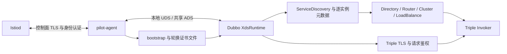

<!--
Licensed to the Apache Software Foundation (ASF) under one
or more contributor license agreements. See the NOTICE file
distributed with this work for additional information
regarding copyright ownership. The ASF licenses this file
to you under the Apache License, Version 2.0 (the
"License"); you may not use this file except in compliance
with the License. You may obtain a copy of the License at

    http://www.apache.org/licenses/LICENSE-2.0

Unless required by applicable law or agreed to in writing,
software distributed under the License is distributed on an
"AS IS" BASIS, WITHOUT WARRANTIES OR CONDITIONS OF ANY
KIND, either express or implied. See the License for the
specific language governing permissions and limitations
under the License.
-->

# Dubbo 3.3 Istio xDS 实施规划

更新日期：2026-10-12。实施位置：主目录 `/Users/ken/dubbo/dubbo`，分支 `3.3`。
当前代码基线 `0d76ba28a0`；参考分支 `3.3-dev-xds` 基线 `290139c2ff`。
本文件替代此前的阶段安排；阶段完成后更新本文件与验收记录。

**最新用户决定（D4）**：本轮完成mTLS/SAN/ALLOW-DENY RBAC，JWT/CUSTOM明确留到下一轮。
此前“D4待答复”的记录是历史状态，本轮不再等待该选择，也不改变已有pilot-agent架构。
**本轮交付状态**：M1–M5实施及M6诊断/文档/BOM/构建交付已完成，关键正常/负向轻量验证已通过。
用户指定后续集中执行的混合负载、全面回归与完整集群验收仍保留为下一阶段，未标记通过。
当前简明交付清单见[DELIVERY.md](../../dubbo-xds/DELIVERY.md)。
当前完整120模块release/checkstyle编译、源码/二进制打包及产物核查已通过；全面回归、
混合负载/集中验收按用户原安排后续进行。签名/正式发布本批未执行。

2026-10-12 运维接续：逐实例元数据异常类型链、SDK 排障指南和可选 xDS 信任边界
已补齐，19 项相关回归通过并完成重新装配。本批不部署或改动保留的集群环境，
集中验收及其余发布/运维核查仍未完成；D4随后已由用户确认，细节见末节。
接续补齐生产证书状态/到期只读诊断，并修复同字节恢复后刷新错误不清除的问题；
27项安全/发现相关回归通过。二进制、源码包、SPI/许可证/gRPC runtime装配核查通过，
未部署；不以这些轻量检查替代后续集中验收或整个项目release流程。
当前源码reactor联合回归一次通过277项/55类：xDS全37类202项、相关核心18类75项，
零失败/错误/跳过。普通registry factory/cache后续单独4项通过；并非整个项目全部测试。
这是当前本地回归基线，下文117/149/91等早期分批数字仅保留历史证据。
发布接续：xDS公开API Javadoc严格生成通过，当前新诊断方法出现在产物；xDS/native头部
及全项目头部许可证检查零无效；完整/compile-runtime依赖许可证元数据107/82条无Unknown。
接续完整项目release/checkstyle的120模块package已通过；签名/正式发布及集中验收未执行，
不能将构建/本地产物核查等同正式发行或完整验收。

本次更新以主目录实际代码和已保存的验证日志为准，不重新实施已有基础链路。
M4.4 独立元数据端口、IDL/POJO wire 和进行中调用资源生命周期已有本地证据；
M5 的 `max_requests`、fault 调用闭环与 LEAST_REQUEST 已完成本地轻量验证，
真实 Istio 扩展资源已采集。上一批 xDS 模块去重覆盖 117 项、24 个测试类，分批通过
（2026-10-11 16:43 主批和 16:45 补验）；主批有一个 mock 签名错误，不能称为
一次全绿的 117 项命令。核心 62 项保留 16:08 的历史证据。
此前 149 项联合基线仅保留为历史记录。当前实现与本地检查不代替 M6
原生业务集群验收，完整范围保持不变。
M5.4 EDS 选择批 26 项已通过（17:01）；接续的连接状态/native backoff 批已修改相关核心
模块，43 个 xDS 检查与 7 个相关核心检查分批通过（17:09～17:13）。状态与默认 native
重连已接入。接续实现了 per-reference priority 状态机、10 秒 CONNECTING 宽限、
有界可取消调用等待，以及 native HTTP/2 初始连接异步化；本批真实调用和生命周期检查
通过。当前相关覆盖重构为 53 个 xDS 检查与 38 个核心检查，分批通过，包含失败修复后的
定向补验；不是一次全绿的 91 项命令。M5.4 本地实现与轻量检查完成，原生集群验收仍在 M6。
M5.3 的真实 RING_HASH/MAGLEV 样本已采集；按用户 D6 决定实现 RING_HASH，MAGLEV 明确 NACK。
hash 与双协议本地实现、真实控制面样本、支持矩阵和基础诊断已补齐；
gRPC 模型与核心依赖统一至 1.81.0，相关 60 项轻量检查分批通过，最终构建成功。
各批失败/修复及 priority 间歇时序跟踪项保留在下方，未称为一次全绿命令。
正常 SDK 启动与原生部署装配已通过：2 个本地 bootstrap 检查，及独立命名空间中的
5 组轻量业务调用；完整 M6 集中验收仍待执行。跨 Service D5 按兼容的 per-target 覆盖方案接续实施，用户反馈后可调整。

## 本次实施启动安排

| 顺序 | 工作包 | 本批完成条件 |
| --- | --- | --- |
| 1（已验证） | M5.2 fault 调用闭环 | 106 个 xDS 检查已通过，含 17 个 fault 实际调用场景和 IDL 客户端流；总预算、取消、销毁、计数释放及 LDS/RDS NACK 留住合法策略有本地证据；集群验收留在 M6 |
| 2 | 补齐 M4.4 跨 Service 上下文 | D5 暂按 per-target 覆盖方案实施，目标自身的元数据 application/group、端口、协议和 TLS/SAN 生效；跨目标连接隔离；错误身份及元数据缺失明确失败 |
| 3 | 完成 M5.3/M5.4 扩展选择 | LEAST_REQUEST 已实现并有本地证据；接续 priority/locality 故障转移与恢复、hash 真实输出与实现；outlier 按控制面证据决定支持范围，不能静默当作 RR |
| 4 | 完成 M5.5 双协议发现 | 同一 Service 暴露 Triple 与 Dubbo 的两个 Service port，分别解析对应 EDS workload port；逐实例元数据与接口地址不串；二进制协议的未支持 TLS 模式明确拒绝 |
| 5 | 完成 M5.6 与发布装配 | 功能矩阵列明控制面生成、SDK 解析、执行及验证状态；补诊断、配置/部署示例、BOM/依赖与打包检查 |
| 6 | 完成 M6 原生集群验收 | 在已有测试集群运行真正的 Dubbo provider/consumer，覆盖 STRICT、ALLOW/DENY、路由、限时、重试、fault、熔断、策略/证书更新、重连、删除及混合负载 |

每批先做相关轻量正常/负向检查与必要构建，再更新状态；集中压力和综合集群验收放在
M6。已完成工作保留证据，未验证代码不提前标记完成。D5 尚无用户答复，本轮已明确说明按推荐的兼容方案暂定实施，
保留用户后续调整配置契约的空间。D4已确认JWT/CUSTOM延期到下一轮评审；本轮收口
mTLS/SAN及ALLOW/DENY RBAC，不把缺失的下发能力算作SDK已实现。

**当前接续工作**：M5.4 的 priority 状态机与 unary/streaming 等待已完成本地轻量检查，
含总预算、取消、Reference 销毁、dispatch 前配额、地址撤销和异步连接关闭边界。
RING_HASH 已接入路由 hash、跨 locality 加权环、连接等待和重试保持；MAGLEV 明确 NACK。
双协议本地检查、矩阵、基础诊断与原生 SDK 部署装配已补齐；接续 M6 验收准备，
D5 per-target 配置与跨 Service 真实调用已完成本地轻量检查，42 项相关联合回归通过；
原生跨 Service 24 条轻量记录已通过，综合验收仍留在 M6。
接续共享运行时累计调用/drop 统计、per-instance 元数据失败状态码和 EDS drop 已实现，
本批去重 50 项检查分两批通过；接续 LRS SELF interval/locality 上报已实现，
协议、真实 Triple 及控制面来源隔离的最终复验和装配结果见末节。
正常 SDK 原生集群的在线路由、DENY/恢复、RING_HASH 与 MAGLEV NACK 轻量批已通过。
deadline/retry/fault 程序和 14 个业务场景分批验证已补齐，包含工作期间取消的加强检查。
max_requests 原生饱和/本地拒绝/完成释放/恢复轻量批已通过，并修复等待层丢失异常类型
导致本地拒绝被重试的问题。原生错误身份/无证书/SAN/明文负向轻量批及带有效报文
对照的定向补验已通过。端点撤回/恢复和 Triple 子集路由与二进制元数据隔离轻量批
已通过，修复了元数据图跟随业务子集及空地址误报鉴权拒绝的问题。测试临时资源
已清理、策略已核对。SDK 到 agent 的 ADS 与原生 HTTP/2 连接重连轻量批已通过，
同一进程保留订阅/Reference，重连后新的 RDS 和同步/异步/流式调用生效。
工作负载叶证书自动轮换轻量批已通过，两端 SDK 加载新证书并用于新的 TLS/h2 会话，
临时资源已清理，原 echo 基线正常。agent 到 Istiod 实际连接阻断/恢复、断线期间
保留已接受策略、恢复后接受新路由，以及 Service 删除/重建恢复的原生轻量批已通过；
binary 空地址误报鉴权拒绝也已修复并复验。全部 EDS 撤回后的原生异步 unary/
server-stream 保持至完成轻量批已通过，修复 Invoker 回收提前关闭在途连接的问题；
priority 状态发布/通知滞后竞态已通过修复前反例与修复后 56 项联合轻量检查；
连接等待 fixture 已区分运输失败和 RPC deadline，生产 grace/budget 不变。
接续 SDK test-root 共存/切换/撤销及保留旧 A TLS 连接的原生拒绝验证已通过。
原生 EDS 撤回下四种调用（含实际 IDL client-stream/bidi）在途完成/更新后继续输入与
half-close/新调用拒绝/恢复轻量批 47 条通过；RBAC 四种调用组合发现并修复请求间取消串扰，
本地 14 项联合轻量回归与重新装配后的原生 54 条轻量记录通过。
其他中断场景、熔断的更多生命周期及综合压力仍留在集中批。

代码与文档均继续直接位于 `/Users/ken/dubbo/dubbo` 的 `3.3` 分支，保留现有修改。
代码未提交/推送；原有 Go 测试环境保留，新增的原生业务测试环境见下方装配记录。

## 1. 已确定的架构与范围

采用 **pilot-agent + Dubbo 原生 xDS**，直接兼容 Istio `grpc-agent` 注入模板。
agent 生成 bootstrap、代理 ADS、利用 ServiceAccount 连接 Istiod并轮换证书；
Dubbo 负责订阅/解释资源，并在自己的发现、调用和传输体系执行策略。
业务请求由 Dubbo 直接处理。业务进程无需 Kubernetes API 权限或 kubeconfig。



- 应用级 ServiceDiscovery；Reference 显式指定目标 Service/application。
- 不接入 interface-application mapping 和 revision 反查。逐实例直接读取元数据，
  元数据响应中的 revision 可作为内部信息，但不作为发现前置条件或跨实例缓存键。
- Triple 是首条完整实施路径，覆盖发现、流量控制和可验证的 xDS 安全能力。
- Dubbo 二进制协议只接应用发现，不承诺 Istio 的 HTTP/gRPC 流量或安全策略。
- 对接目标是 **Istio 实际为 `GENERATOR=grpc` 生成的 xDS 资源**。建立功能矩阵，
  区分控制面未生成、SDK 尚未支持和已端到端验证；“全量”不能视为 Envoy 全功能承诺。
- 第一轮以现有 Istio 1.31.1 集群为验收基线；后续再扩展版本矩阵。

## 2. 现状与复用边界

| 项目 | 当前状态 | 实施动作 |
| --- | --- | --- |
| Istio 与 agent-only 环境 | 已部署并验证 | 保留作联调基线 |
| gRPC-Go 发现、20/80、STRICT mTLS、ALLOW/DENY | 已验证 | 转为 Dubbo 原生端到端验收 |
| `3.3` 的 native xDS 模块 | 运行时、发现、安全、基础流量、独立元数据入口、wire、资源持有、fault 与 LEAST_REQUEST 已接入 | 当前 xDS 117 项分批通过；核心 62 项保留历史证据；接续跨目标、扩展策略与集中验收 |
| `3.3-dev-xds` Bootstrapper | 解析后返回 null，配置源处理未完成 | 参考数据模型，重做可用初始化流程 |
| 参考分支的 Cluster/Directory、CDS/EDS 结构 | 有适配原型 | 有选择地复用，补生命周期和协议语义测试 |
| 参考分支 Kubernetes 客户端与自行签证路径 | 不符合本轮 agent 契约 | 本轮不引入 |
| 现有 `ServiceInstancesChangedListener` | 无有效 revision 的实例被跳过 | 增加 xDS 专用实例到接口地址的适配 |
| MetadataService V1 | `getMetadataInfos()` / `getExportedURLs()` 无需 revision | 第一阶段复用 |
| MetadataService V2 | 当前空 revision 返回 null | 不把空请求视为等价替代；V2-only 提供端需明确报错 |
| 现有 `CertProvider` / Netty SSL / Triple | 已有扩展点 | 复用并补动态配置、策略隔离和轮换能力 |
| 现有 `mesh-enable` | 会生成直接 Service URL，绕过注册发现链路 | native xDS 使用独立明确入口，保留原模式语义 |

参考分支不整体合并。先审查 grpc-java 的协议状态机和数据模型，再移植与 Dubbo
适配有关的代码；移植保留来源/许可证。初始 xDS 模型依赖 grpc-xds 1.78.0；
M5.6 已改用依赖 BOM 管理到 1.81.0，与 core/api/netty-shaded 等一致，专项验证记录见后文。
不在第一步提升整个项目的 gRPC/Netty/Protobuf 版本。

## 3. 必须先落实的契约

### Bootstrap 与共享运行时

- 配置源顺序：显式 Dubbo bootstrap 配置（若提供）→ `GRPC_XDS_BOOTSTRAP`
  文件 → `GRPC_XDS_BOOTSTRAP_CONFIG` JSON。默认路径不能覆盖显式配置。
- 支持 `xds_servers`、channel credentials、v3 features、Node、certificate providers、
  入站 listener template；解析时保留必要扩展字段。Federation/多 authority 后续单列支持。
- 实测地址 `unix:///etc/istio/proxy/XDS`，需要 Linux UDS 支持；TCP 保留用于本地协议测试。
  SDK 使用的 native transport 与 Dubbo Netty 类空间隔离/兼容性在 M1 验证。
- 保留 agent 生成的 Node ID 与 metadata，包括 `GENERATOR=grpc`；不以 Dubbo application
  自行替换工作负载身份，也不宣告尚未实现的 client feature。
- 同一 agent 端点共享一条 ADS 流：消费端、提供端、References、Registries 和
  ApplicationModels 都必须复用。运行时按工作负载端点管理，并与框架生命周期绑定；
  多 FrameworkModel 也不能盲目重复建流，需进程内复用或显式冲突校验。
- 初始化对 agent 文件/socket 尚未就绪做有上限等待；连接中断重试带退避。
  显式配置不合法需可定位报错；安全要求不得因初始化失败而退回明文。
- 第一版部署约定每 Pod 一个 SDK 进程。多个进程共享同一个 agent 的 ADS 需要额外协调，
  当前 agent 会关闭旧流；不得通过静默重连互相抢占掩盖问题。

### 发现目标、endpoint 与调用上下文

概念模型与字段命名在 M1 定稿；保留以下独立维度：

| 对象 | 身份/隔离维度 | 作用 |
| --- | --- | --- |
| DiscoveryTarget | 控制面上下文、规范化 Service FQDN、Service port、调用协议 | 订阅与发现缓存 |
| ClusterState | 完整 xDS cluster 名、TLS/策略快照 | subset、连接和负载均衡状态 |
| EndpointIdentity | 目标、EDS cluster、地址/端口及可用实例身份/代次 | 元数据任务去重与实例移除 |
| ReferenceBinding | interface、group、version、目标 | 接口可用性和 URL 参数 |
| MetadataEntry | 元数据 Service FQDN/Service port/协议、解析后的 workload port、安全上下文、application/group、API version | 逐实例点对点调用入口，可与业务目标独立 |

同一 Service 的 Dubbo 与 Triple 端口不能混用。用 Service port 请求资源，用 EDS
返回的 workload port 建立连接；例如测试环境 7070 → 17070。保持原始 target/subset/TLS
上下文，避免把路由到其他 Service 的 endpoint 误归入初始 application。
连接池至少区分目标服务身份与 TLS 配置；相同 IP:port 不代表可以共享安全连接。

### 元数据查询

- 每个新实例都建立点对点元数据读取任务；有界并发、超时、退避、缓存 TTL/刷新和取消。
  多个接口引用共享实例任务，不在每次业务 RPC 上拉取元数据。
- 优先复用 V1 读取接口、group/version、参数及协议端口；提供端须启用 V1，
  首版不要求修改 V2 的协议或继续调用 revision 查询。
- 建议部署基线：MetadataService V1 使用 Triple，共用已暴露的 Triple workload port；
  提供端显式配置元数据协议/端口。消费者允许按目标指定元数据入口。
  application/group 不能假定永远等于 Kubernetes Service 名。
- 只部署 Dubbo 二进制协议的提供端可显式指定 Dubbo 元数据入口；它不享有本轮 Triple 安全。
- 读取元数据时直接固定该实例地址，绕过该接口的 Registry/Directory 初始化，
  避免“先拿元数据才能创建取元数据的 Invoker”的循环依赖。
- 元数据 Triple 连接沿用目标的 xDS TLS/SAN 和入站鉴权规则；不通过临时明文端口绕开策略。
  专用元数据端口必须有相应 Service port/Listener/Cluster 安全配置。
- 事件版本防止旧查询结果覆盖新 EDS 快照；实例移除立即取消任务、摘除 Invoker，
  IP 复用需重新校验/刷新，不能无限沿用旧缓存。
- D1 实施默认值：首次读取失败采用**隔离失败实例并重试**；已有同一实例、
  有效期内的缓存可继续使用。该默认值已经实现，不阻塞后续工作。
  如保留回退，仅作为明确开启的发现选项，不允许绕过 TLS/RBAC。

## 4. Dubbo 适配与策略执行原则

- **ServiceDiscovery**：维护 xDS endpoint 快照和实例事件。远端注册由 Kubernetes 管理；
  provider 的 register/update 仍需维护 Dubbo 本地元数据和资源订阅，不能全部简单 no-op。
- **实例监听器**：通过 `ServiceDiscovery.createListener` 等现有扩展点实现 revision-free
  适配；避免用虚构 revision 套用全局缓存。EDS 回调线程不阻塞执行元数据 RPC。
- **Directory/Invoker**：继续使用 Dubbo URL→Invoker、增删和销毁机制；接口元数据与
  endpoint/cluster 上下文附着到地址快照，不能丢掉 subset、权重、健康和 TLS 身份。
- **Router**：按 Triple 实际 wire path、authority 和 metadata 匹配，覆盖 POJO 与 IDL。
  不从 Java 方法名称简单拼接并假定与实际请求一致。先选 route/cluster，再选 endpoint。
- **Cluster**：负责 xDS 调用策略与 retry budget。重试不能再叠加默认 Failover 次数；
  asynchronous result 的错误也必须进入策略处理。流式重试/消息重放独立定义边界。
- **LoadBalance**：区分 route 的 cluster 权重、locality 权重和 endpoint 选择，
  不把所有 endpoint 展平成一次普通随机选择。按明确实现的 xDS LB policy 执行。
- **Triple 传输与鉴权**：TLS 策略进入连接建立；RBAC 在真实请求头/路径与已认证 peer
  上执行，拒绝发生在业务方法分派前。身份来自验证后的证书，不信任客户端 identity header。
  连接复用、streaming RPC 和策略更新都要有清晰生效边界。
  当前内部元数据服务使用 `filter=-default` 导出；RBAC 不能只挂在默认业务 Filter 链，
  必须在 Triple 请求入口覆盖内部元数据服务，专项验证该路径没有绕过鉴权。
- **一致性**：每次调用使用一致的 route/cluster/security 快照。SotW 按 type 维护 version/nonce；
  ACK 在校验与接受后发送，NACK 带错误与最后成功版本。资源缓存和可调用依赖图分开管理。
  失联、合法空 EDS、资源删除、无路由与格式错误不能一律当作“保持原地址”。
- **兼容性**：未知非必选扩展按协议处理；收到不支持的必选安全 filter 必须明确拒绝。
  Istio 根本没有生成的策略无法在 SDK 中靠 NACK 检出，需在功能矩阵/部署验收中说明。

## 5. 里程碑与验收

| 阶段 | 交付 | 验收门槛 | 状态 |
| --- | --- | --- | --- |
| M0 环境与契约 | Istio、grpc-agent、参考程序、部署与验证记录 | 发现、路由、mTLS、拒绝行为已实测 | 已完成，限 gRPC-Go |
| M1 xDS 运行时 | 可选模块、bootstrap、UDS、共享 ADS、LDS/RDS/CDS/EDS 基础解析与订阅状态机 | Dubbo Pod 读取注入配置；同 Pod 双角色共用流；ACK/NACK、取消和重连可验证 | 基础实现、本地状态机与正常 SDK 原生集群启动/在线 ACK/NACK 已验证；SDK 到 agent ADS、agent 到 Istiod 实际阻断/缓存/新路由恢复轻量批通过；全部 EDS 撤回后的异步 unary/server-stream 及 IDL client-stream/bidi 保持至完成、更新后继续输入/half-close 与恢复轻量批通过；provider agent 容器重启保留四种实际 RPC 在途调用、更新后输入/half-close，并接收新 inbound DENY/恢复轻量批通过；其余中断与集中负载仍待验收 |
| M2 应用发现与元数据 | target 模型、ServiceDiscovery、revision-free 监听器、逐实例元数据、Directory/Invoker | 显式 Service/port；无 mapping/revision 也能 Triple 调用；未发布接口和故障实例隔离 | 本地接口/协议/端口过滤与正常 SDK 原生发现已验证；原生双协议隔离、端点撤回/恢复、Service 删除/重建恢复及两协议空地址 UNAVAILABLE 通过；跨 Service per-target 配置、本地真实 RPC/安全及原生 24 条路由/元数据鉴权/缺失恢复轻量记录通过；综合验收待执行 |
| M3 安全纵向链路 | file_watcher、客户端/服务端 xDS TLS、SPIFFE/SAN 校验、RBAC ALLOW/DENY | STRICT 下 Dubbo 调用成功；明文/错误身份/拒绝规则失败；元数据同样受保护 | 本地安全链路与原生 STRICT、ALLOW/DENY、错误身份/无证书/SAN/明文负向检查通过；两端工作负载叶证书轮换轻量批通过；原生 business-only DENY 下四种 RPC 在途完成/输入与恢复通过；mixed POJO/IDL 请求取消隔离反例修复及原生复验通过；SDK 测试根 A→A+B→B 身份→B-only 的四种在途 RPC、旧 A 已建 TLS 连接拒绝新业务/元数据及恢复通过；真实 Istiod CA 控制面/agent 四阶段及正常 SDK TLS/业务/metadata 四阶段贯穿通过（38 条记录、28 资源清理）；实际 Istiod CA 四种A-admitted在途RPC贯穿全部阶段、B-only继续输入/half-close、单次完成与配额归零轻量通过（77条记录、28资源清理）；集中验收待执行；D4已由用户确认JWT/CUSTOM下一轮，本轮mTLS/SAN/RBAC |
| M4 基础流量 | virtual host/path/header、subset/weighted clusters、RR/必要 locality、deadline、unary retry | 20/80、100%切换、header 路由；长连接在线更新；不重复重试、不延长显式 deadline | 本地路由、wire/组/版本及生命周期已验证；原生在线路由、deadline/retry/cancel 与跨 Service 元数据/路由/鉴权恢复轻量批通过；综合验收待执行 |
| M5 扩展与双协议 | fault、max_requests 熔断、priority/locality failover、按需求 hash/LB/outlier；Dubbo 二进制发现 | 支持矩阵逐项有证据；同 Service 双端口不串；异步/流式边界验证 | 本地 fault、max_requests、LEAST_REQUEST、priority/locality、hash 与双协议通过；原生 fault、熔断、RING_HASH/MAGLEV NACK 与双协议轻量批通过；原生三 priority 在保留 EDS/新鲜元数据时的真实业务连接故障切换、恢复与成员撤回/重加入轻量通过；集中 timing/负载验收仍待执行 |
| M6 完整验收与运维 | 混合负载、轮换/重连/删除、观测与诊断、文档/BOM/发布集成、功能缺口评审 | Dubbo 原生集群端到端套件、相关模块回归及构建通过 | 实施/轻量验证阶段已完成：正常SDK程序、原生验证器、生产诊断、运维/安全说明、BOM/SPI/依赖与源码/二进制打包交付；当前源码277项联合回归及120模块release/checkstyle package通过；全面回归与集中验收按用户安排后续执行 |

主线按 **M1 → M2 → M3 → M4 → M5 → M6**。M2 的普通调用可先在明确关闭 mTLS
的测试 Service 上验收；M3 随后在 STRICT 配置重验，最终基线保留安全模式。
不得把现有 Go 测试结果计为 Dubbo 实现已完成。

### M1 第一批实施清单

1. 加入模块和必要依赖，保持 xDS 关闭时原有行为；确定 SPI 激活与 native transport 装载。
2. 完成 BootstrapInfo、来源选择、Node/证书配置解析及 listener name 构造。
3. 建立共享 runtime/pool：申请、复用、订阅引用计数、注销与最终关闭。
4. 完成 v3 SotW ADS channel、串行状态更新、订阅集合、version/nonce、ACK/NACK、退避。
5. 解析现有测试环境的 LDS→RDS→CDS→EDS 与入站 LDS；建立资源依赖图和 last-good 状态。
6. 本地 fake ADS 用于错误响应、删除、流中断及 watcher 生命周期验证。
7. 部署最小 Dubbo 探针，在 agent-only Pod 验证自动连接、双角色订阅、UDS 与重新订阅。

M1 完成后应有可构建模块、协议行为测试及真实集群订阅证据；暂不将“收到 EDS”
表述为 ServiceDiscovery/业务调用已完成。M2 起将探针升级为真实 Dubbo provider/consumer。

### M2/M3 必测场景

- Service port 与 workload port 不同；application 与 Service 名不同。
- 两个提供端接口列表/参数不同；每个实例查询一次，多 Reference 不重复拉取。
- 元数据不可用、接口不存在、超时恢复、实例新增/删除与查询完成交错。
- MetadataService V1 禁用或元数据端口未暴露时有可定位诊断。
- 同 Pod provider+consumer，多个 application/reference 共用 runtime。
- 允许身份、错误 ServiceAccount、无客户端证书、错误 SAN、明文与 DENY 优先级。
- 策略更新对新 RPC/连接生效；证书轮换的新连接与现有连接行为有明确记录。
- 同一 endpoint 受不同 Service/cluster 安全策略约束，连接池不串策略。

### M4/M5 必须评审的语义

- Reference/method timeout、显式 per-call deadline 与 xDS 的优先级：显式 deadline 不延长；
  默认超时和路由覆盖的具体规则在实现前写入测试用例，不隐含套用两套默认值。
- retry 的状态映射、预算、退避、取消和异步结果；先支持 unary，已发送消息的 streaming
  不做无定义的透明重放。若无法对齐，先报清具体字段/调用模式。
- weighted clusters 与 subset 内 LB 分层；健康/priority/locality 的失败处理。
- 二进制协议先直接验证 Istio CDS→EDS 的服务端口发现能力，不借 Triple 端口推断地址。
  若目标 cluster 要求本轮不支持的 TLS，明确拒绝该模式；双协议部署在控制面显式按端口
  划分安全策略，SDK 不自行覆盖它。
- HTTP 路由/鉴权应覆盖 Triple POJO 和 IDL 实际请求；组/版本头不能误变成认证身份。

### M4 实施拆分与当前证据

| 批次 | 具体工作 | 轻量检查 | 当前状态 |
| --- | --- | --- | --- |
| M4.1 路由与基础 LB | 实际 wire headers、virtual host/path/header/fraction、subset/weighted cluster、locality 与 endpoint RR 分层、在线快照 | 两个真实 Triple 提供端：20/80、header、100% 切换、无匹配与空 subset、地址删除；权重/匹配器检查 | 已实现；真实本地路由与发现/安全联合轻量回归通过 |
| M4.2 Deadline | HCM 默认值与 route max-stream-duration、Dubbo 方法 timeout 与显式剩余 deadline 合并 | route 限时缩短调用；零值/缺省；调用方短 deadline 不延长；异步/取消与流式边界 | 已实现；真实同步/异步/流式 deadline 与取消、联合轻量回归通过 |
| M4.3 Unary retry | route/virtual-host retry 策略、gRPC 状态映射、次数/退避、异步完成、统一预算与取消 | 首次失败后成功；不可重试错误；次数上限；deadline 到期停止；默认 Failover 不叠加 | 已实现；真实同步/异步调用、pushback/取消/销毁、请求重放与联合轻量回归通过 |
| M4.4 上下文补齐 | POJO/IDL wire 一致性、独立元数据端口、安全与跨 Service/group 上下文 | 生成的 IDL 方法实际调用；元数据与业务端口不同；跨目标/安全配置不串用 | 元数据入口、wire/组/版本、调用资源生命周期及跨 Service per-target 配置/真实 RPC 通过；原生跨 Service 24 条轻量记录通过；实际同 CA 错 SA 服务端 SAN 拒绝/恢复的单 Service 与 Entry A→B 场景各33条轻量记录通过，后者保持 binary A 正常；综合场景仍待集中验收 |

### 接续执行顺序

1. **M4.3 调用闭环已完成，作为后续基线**。采用 gRFC A44 的 unary retry 语义：route 优先于
   virtual-host；只映射规定的五类 gRPC 状态；总尝试数最多 5 次。总 deadline 包含
   初次调用、所有尝试和退避；支持服务端 pushback、Future 取消与销毁。收到响应头
   即停止重放；流式调用不重试。固定原始 Service/cluster，后续尝试使用当前可用
   endpoint；冻结序列化请求，缓存超过 1 MiB 时只允许一次尝试。这些行为已有本地证据；
   并发与真实集群验证保留在 M6。
2. **完成 M4.4 的元数据与 wire 上下文**。独立 MetadataService 端口已定义显式
   Service port/协议入口，单独订阅其 LDS/CDS/EDS 与安全配置；逐业务实例点对点查询，
   不从元数据 cluster 随机选择其他实例。IDL/POJO 与 group/version 已补真实调用和请求头
   检查；在线路由删除时的调用资源持有/释放也已补齐。接续跨 Service 路由及连接池安全隔离。
3. **进入 M5，逐项确认实际 grpcgen 输出**。先采集 fault、max_requests、
   priority/locality、各 LB/outlier 策略的真实资源，形成“生成/解析/执行/验证”矩阵。
   先完成有控制面证据的 fault、熔断和 priority/locality 恢复，再实现适用的 hash/LB/outlier。
   同时完成 Dubbo 二进制 CDS→EDS 发现及同 Service 双协议端口隔离验证。
4. **进入 M6 集中验收**。把本地真实 provider/consumer 用例部署到现有 agent-only
   集群，覆盖 STRICT 下业务与元数据、路由/重试/限时、证书轮换、资源删除与重连。
   补充高并发 retry、队列饱和、慢回调对其他调用的影响和上下文/线程/请求缓存回收检查。
   完成依赖/BOM/发布打包、诊断说明和相关模块回归，记录每项能力及限制。

每批先运行关键正常/负向行为和构建；集中测试保留在 M6。若发现 Dubbo 与 xDS 模型
无法直接对齐，带具体控制面字段、影响和可运行用例找用户确认，其余主线继续实施。
当前架构、应用发现范围、协议分工和元数据默认值均已确定，不需要重复确认。

### M4.4 实施清单

以下按顺序实施，每项保留真实调用证据后再更新完成状态：

| 顺序 | 工作与主要落点 | 本批交付判据 | 状态 |
| --- | --- | --- | --- |
| 1 | `TripleInvoker` 请求头构造、`XdsRouter` 与 `TriplePathResolver`：生成的 IDL 服务、POJO、group/version | 路由匹配的 path/authority/metadata 与实际发出的 HTTP/2 请求一致；正确分派组/版本，未发布引用隔离 | 实现、真实调用和联合回归通过 |
| 2 | `XdsServiceDiscovery`、元数据入口与连接上下文：补跨 Service/subset 路由 | 目标 cluster 的地址、元数据 application/group 和 TLS/SAN 各自正确；同 socket 不同安全策略不串连接；错误身份明确失败 | 跨目标 per-target 配置、同 socket 下目标 SAN 隔离本地真实 RPC 及原生路由/元数据鉴权/端口缺失恢复通过；原生单目的端/跨Service错误服务端SAN拒绝与恢复轻量批均通过；综合负载待集中验收 |
| 3 | `XdsResourceGraph`、调用选择与 retry：补进行中调用的资源持有/释放 | RDS 移除旧 cluster 后，新调用使用新路由；原调用在既定预算内保持所选 cluster，并读取当前 CDS/EDS；CDS 撤销不复活地址；完成或取消后释放 | 已实现；真实 unary/streaming、联合回归及旧回调专项通过；安全更新联合场景在第 2 项接续验证 |
| 4 | 更新支持矩阵、配置示例和本批证据 | 关键正常/负向检查与模块构建通过；明确尚未完成的集群验收，再进入 M5 | 随每批更新 |

第 3 项区分“路由不再引用 cluster”和“CDS/EDS 或安全策略撤销”。保留调用资源
不能保留已删除 endpoint 的可调用资格，也不能绕过新的安全拒绝。跨 Service 元数据
入口若无法用现有显式配置表达，先用具体部署/资源说明缺口并确认配置契约。

M4.1 当前实现从 Triple 共用的请求元数据构造取得路径、authority、group/version 和附件。
原生连接保留 Service FQDN:Service port 作为 authority，socket 仍连接 EDS workload port。
每次调用固定 route/cluster 快照；地址不变的 Invoker 通过目标的最新快照读取在线路由。
路由 cluster 权重、locality 权重和 endpoint 权重分层执行，不混入 Dubbo 默认随机选择。
Native Cluster 已绕过默认 Failover 的重试循环。A31 route/HCM deadline 已验证；
A44 unary retry 已完成本地真实调用验证。per-try timeout、hedging 和 Envoy proxy retry
predicates 按 gRPC 基线忽略，不宣称执行这些字段。兼容性仍需采集 Istio 的实际 RDS
并在集中验收中证明，不能仅凭本地构造资源视为完整 Istio RDS 兼容。

真实本地证据：`XdsRoutingTest` 使用两个独立提供端 FrameworkModel，每个端口同时发布
MetadataService V1 与业务服务，经 native Registry → Directory → Router → Cluster →
LoadBalance → Triple 实际调用。验证 200 次 20/80 分流、逐调用 header 路由、100% 更新、
Invoker 不重建、选中空 subset 不转移到另一个 subset、无匹配 virtual host 和全量空 EDS。
连续调用还暴露了原有 Triple HTTP/2 流控的跨线程 stream-map 读取；现已把查询和消费字节
一起移到 event loop，增加延迟回调/stream 已删除的回归验证。

M4.2 实现将调用预算保存为 Invocation 本地属性，从路由前开始计时，不随附件清理或后续尝试重置。
Route 的 `grpc_timeout_header_max` 优先于 `max_stream_duration`，缺省回退到 HCM；显式零值不增加
xDS 限制，但不会取消 Dubbo 原有 timeout。真实 Triple 请求传递剩余 `grpc-timeout`。
流式调用到期立即取消传输，终止回调与消息回调串行；阻塞的用户回调可能推迟终止通知，
但不会阻塞传输取消。调用已过期时不发出请求，尚未发送首条消息的双向流也受预算约束。
异步过滤器的 Future 包装为 deadline 调用保留取消传递；ThreadlessExecutor 退出后仍执行 stream 取消。
Unary 取消监听器在请求发送前注册，不再依赖服务端响应头到达；无响应的调用也能重置传输。
同步入口等待同一 deadline Future，不叠加先结束的等待计时器。
异步过滤器抛出的 RpcException 保留原始状态，不在结果读取时重新包装为 UNKNOWN。
retry 的聚合 Future 复用总预算，到期可完成并取消活动尝试。
当前新增真实 Provider 测试覆盖同步/异步/流式 timeout、调用方更短预算、零值覆盖/HCM 回退、
无效 HCM 更新 NACK 与主动取消到提供端的传播。最终检查结果记录在本文末尾。

M4.3 已按 Istio 1.31.1 源码构造默认 retry、deprecated `max_grpc_timeout` 与 `Decorator`
兼容检查；这些字段已接受，按 gRPC 基线区分执行与忽略。M4.4/M6 仍须采集完整实际 RDS
做原生调用验证，不能用源码构造资源代替集群兼容证据。

M4.3 增加的真实 Triple 测试覆盖同步/异步失败后成功、不可重试状态与业务异常、次数上限、
pushback、总预算跨尝试/退避、Future 取消与销毁、在线 EDS/RDS 更新、地址删除、
冻结请求、超过 1 MiB 不重放及 NACK 保留最后策略。另有传输监听器检查证明响应头
会提交 unary 调用，trailers-only 失败可以重试。POJO 的显式 `StatusRpcException`
通过 gRPC trailers 返回；普通业务异常继续走原有响应路径。立即失败和异步完成的
响应附件均传给传输层，避免丢失 pushback。

### M4.2/M4.3 执行语义

以下按 gRPC xDS 的当前规范适配，并在实现时用 Istio 实际下发资源补齐行为测试：

1. **Cluster 选择**：按 gRFC A31 对 A28 的修订，weighted route 不以连接可用性重新分配权重。
   一次 RPC 先选择 cluster，后续 retry 留在同一 cluster；该 cluster 不可用时明确失败。
   locality/endpoint 层的健康筛选独立执行，不得把 subset 权重转移成跨 subset failover。
2. **Timeout**：采用 `RouteAction.max_stream_duration.grpc_timeout_header_max`，否则采用
   route `max_stream_duration`，再否则 HCM `common_http_protocol_options.max_stream_duration`。
   有效值为 0 表示不增加 xDS 限制；与 Dubbo 已确定的调用超时/剩余 deadline 取较短预算。
   不用 Envoy `RouteAction.timeout` 替代 gRPC 全流 deadline，也不执行 header offset；
   这些字段的控制面行为和处理方式需在功能矩阵显式记录，不能声称对应 Envoy 计时器已实现。
3. **Retry**：首先实现 gRFC A44 的 `retry_on`（gRPC 状态）、`num_retries` 和
   `retry_back_off`；次数包括首次调用与配置的重试次数。等待、退避和尝试均消耗同一总预算。
   Dubbo 的 `retries` 不再形成第二层 Failover；应用业务异常不会自动归为传输可重试状态。
4. **异步与取消**：统一处理同步入口与 asynchronous result 的完成错误；为聚合结果维护
   FutureContext、callback executor 与取消传播，避免只重试同步抛出的异常或丢失后续回调。
5. **Per-try/hedging/streaming**：gRPC 参考实现没有把 Envoy per-try timeout 等价执行。
   先按实际 grpcgen 资源记录该差异；若要扩展 per-try/hedging，携带具体资源和用例评审，
   不默默套用 Dubbo 默认超时。已收到响应或已发送流式消息的调用不做未定义的透明重放。
6. **策略生效与生命周期**：新调用读取新快照；进行中的调用保留已选 route/cluster。
   retry 前处理 endpoint 删除和安全策略变更，避免旧快照复活已经撤销的地址或安全连接。

### M5/M6 接续顺序

1. 先核对 Istio grpcgen 实际输出，建立 fault、`max_requests`、priority/locality、hash、
   least-request、outlier 等矩阵；每项明确“生成/不生成、支持/拒绝、已验证/未验证”。
2. 接入必要的扩展执行策略，补异步/流式边界和共享状态的生命周期。
3. 验证二进制 Dubbo 的 CDS→EDS 发现和同 Service 双端口；要求 xDS TLS 时明确拒绝
   本轮不支持的二进制模式，不自行降级。
4. 完成诊断、BOM/发布装配、依赖兼容审查与说明；最后集中运行原生 Dubbo 集群验收：
   STRICT、ALLOW/DENY、路由、策略/证书更新、断连恢复、资源删除和混合负载。
   当前轻量测试和 Go 参考程序的结果分别记录，不替代这个最终门槛。

### M5 实施拆分（更新）

| 批次 | 主要落点与执行契约 | 本批轻量验证 | 当前状态 |
| --- | --- | --- | --- |
| M5.1 熔断 | Native Triple Protocol 和点对点 MetadataService 在实际 dispatch 时统一申请 `max_requests`；按工作负载、cluster、EDS service 共享计数；配置更新不清空活动数 | 并发饱和、多个 Reference、异步完成、stream 初始 Result/结束/销毁、元数据共享、拒绝不重试 | 实现及 7 个专项通过；包含在当前 117 个 xDS 检查中 |
| M5.2 Fault | 解析 HCM fault 与 RDS 覆盖，按 gRFC A33 在任何业务请求发送前执行 delay/abort；纳入总 deadline，取消/销毁释放等待和全进程 active-fault 计数 | 真实 unary/streaming 无网络 abort；delay 到期/取消；比例与 header 上限；策略覆盖与非法更新 NACK | 调用闭环本地轻量通过：17 个实际 fault 场景，另含 IDL 客户端流与 2 个 LDS/RDS 校验场景；全部纳入当前 117 项，集中集群验收留在 M6 |
| M5.3 LB/hash | 接实际 CDS 的 LEAST_REQUEST；继续采集 consistentHash，分别确认 RING_HASH/MAGLEV 和 route hash 字段；不把未实现策略当作 RR | 并发活动请求影响选择；稳定 hash、endpoint 增删、权重/配置更新；不支持策略可定位 | LEAST_REQUEST 保留已有证据；RING_HASH 本地实现及真实样本已补齐，MAGLEV 按用户 D6 明确 NACK；当前复验结果见后续记录 |
| M5.4 Priority/locality | 以 EDS 的 priority/locality/endpoint 权重保持分层，验证故障转移与恢复；不改变已选 route cluster/subset 权重 | 健康地址消失、低 priority 接管、高 priority 恢复、空 locality；活动 RPC 与资源撤销 | EDS/transport/native backoff、priority 状态机、10 秒 CONNECTING 宽限与 unary/streaming 有界等待已实现；初始连接异步化与销毁取消接入；本地实现与轻量验证通过（53 项 xDS 子集与 38 项核心分批），集群验收仍在 M6 |
| M5.5 双协议发现 | 二进制 Dubbo 仅发现；同 Service 的两个 Service port 分别订阅；元数据入口显式指定；xDS TLS 要求不降级 | 两个 workload port 不串、接口元数据不串、错误端口/TLS 明确失败 | 本地真实双协议/元数据检查通过；真实 grpcgen 双端口资源已采集；正常 SDK 双 Reference 与原生集群轻量调用通过；集中验收留 M6 |
| M5.6 支持矩阵 | 保存实际控制面样本，逐项记录生成/解析/执行/验证；outlierDetection 等未生成能力不承诺已执行 | 配置与样本可复现；日志/诊断区分缺失资源、NACK 和本地拒绝 | 矩阵、元数据失败原因、证书状态/到期、运维指南与信任边界已补齐；BOM、gRPC依赖、SPI、许可证、binary/source/native bundle打包检查通过；正常SDK示例和原生装配轻量通过；完整120模块release/checkstyle编译/package通过；签名/正式发布未执行，集中验收后续进行 |

M4.4 跨 Service 的配置点为 D5（本轮按兼容方案暂定实施）：按目标 **Service FQDN + Service port + 协议**
配置 MetadataService application/group 和专用入口，未配置者沿用现有默认值。
兼容保留单组 `xds.metadata.*` 默认值，新增 `xds.metadata.targets` 逐目标覆盖；
实际目标按 Istio cluster 的 FQDN/Service port 与调用协议解析，不归入初始 application。

M5 每批只做相关正常/负向轻量检查与构建。M6 才集中部署原生 Dubbo provider/consumer，
验证 STRICT 业务与元数据、路由/重试/限时、策略更新、轮换/重连/删除和混合并发；
现有 Go 调用及原生 ADS 探针均不替代这一验收门槛。

### M5.3 LEAST_REQUEST 实施契约

真实 CDS 样本已经选择 `LEAST_REQUEST`，没有显式 `least_request_lb_config`。
当前实现按已采用的 gRPC 基线语义接入
[gRFC A48](https://github.com/grpc/proposal/blob/master/A48-xds-least-request-lb-policy.md)，
并参考 [grpc-java 1.78 的 picker 与计数生命周期](https://github.com/grpc/grpc-java/blob/v1.78.0/xds/src/main/java/io/grpc/xds/LeastRequestLoadBalancer.java)：

- 先在已选 cluster 中按 priority/locality 选择，再在可用 endpoint 中随机采样并比较活动请求数。
  `choice_count` 缺省为 2，小于 2 拒绝，大于 10 按 10 执行；采样允许重复。
- 此基线在 locality 内均匀采样，忽略 endpoint 的附加权重；locality 权重仍独立生效。
  不把 Envoy 的加权 least-request、`active_request_bias` 或 slow-start 视为已实现。
  RR 路径继续执行当前端点权重，支持矩阵分别记录两种策略的行为。
- 计数属于具体 LB 实例与逻辑 endpoint 的生命周期，在实际尝试 dispatch 时申请。
  Unary 完成/失败/取消均释放；streaming 保持到传输终止，不能在初始 Result 返回时释放。
  Delay 等待和本地 fault abort 不计为上游活动请求；retry 每次尝试各自计数。
- 配置更新不无故清空仍在进行的计数；实例删除后不能再次被选中，旧请求完成仍释放原计数。
  与 `max_requests` 的共享 cluster 限额分别管理，不能复用它来代替 endpoint 负载。
- 本批已用两个真实提供端验证长调用/流式调用的选择与释放、choice-count/NACK、
  endpoint 删除和 RR/LEAST_REQUEST 在线切换。与真实 Istio 资源的端到端验证仍放在 M6。
- 订阅按用途校验：Triple graph 的 CDS 在接受/ACK 前执行 LB 校验；诊断和二进制发现
  不执行 Triple LB。新严格订阅不能接收不满足其校验的缓存资源，取消订阅即移除校验。
- Native Cluster 同样持有无 retry 策略的 unary Future；同步先登记异步 transport Future
  再等待。Reference 销毁取消自己的调用，保留其他 Reference 在共用 client 上的调用。

## 6. 高级安全与控制面限制

当前 Istio 1.31.1 grpcgen 入站实现生成 ALLOW/DENY RBAC；现有生成链路未提供
等价的 JWT RequestAuthentication 或 CUSTOM 外部鉴权过滤器。证书认证与实际下发
的 RBAC 主线继续实施。用户随后已明确选择D4：**本轮完成mTLS/RBAC，JWT/CUSTOM留到
下一轮**。本轮保留pilot-agent + Dubbo原生xDS架构；不引入额外代理或改造Istio grpcgen。
控制面下发缺口不算SDK已实现。下一轮需要重新落实控制面与执行路线及验收，不能只增加
Dubbo JWT校验器就声称已对接Istio RequestAuthentication。

同样，PERMISSIVE、SIMPLE/MUTUAL、自定义 filter、全量连接池限制、镜像等功能先记录
真实下发行为。首次安全验收使用明确的 STRICT + ISTIO_MUTUAL。gRPC-Go/grpc-java
自身支持范围也不是完整 Envoy 功能集；Java 的解析支持不代表当前 Istio 会生成对应配置。

### M3 安全基线实施记录

1. 解析 Istio 同时生成的新旧 certificate-provider 字段，检查一致性；不支持的安全字段在 ACK 前拒绝。
2. 实现 file_watcher：校验证书/私钥配对、有界读取、轮换中的一致快照与到期处理；异常不降级明文。
3. 将 PKIX 链校验和 xDS SAN 匹配接入现有 CertProvider/Netty；连接身份包含 target、cluster 和证书代次。
4. 元数据与业务共用 TLS 上下文；提供端在导出前订阅入站 LDS，与消费者共享 ADS。内部 MetadataService 可能先导出，需要覆盖这一启动顺序，避免初始明文窗口；不在 Netty 事件线程阻塞等待 LDS。
5. 在 Triple 传输请求入口执行 RBAC，覆盖 `filter=-default` 的 MetadataService；DENY 优先，身份来自已验证证书。
6. 先做轻量负向验证：错误 SAN/CA、未配对轮换、明文、身份与 DENY。STRICT 集群业务和综合轮换场景留到集中验收。

当前进展：已实现新旧 provider 字段一致性检查、未知安全字段拒绝、证书/私钥配对与
PKCS#1 → PKCS#8 归一化、PKIX 后 SAN 校验、客户端 CertProvider/ALPN/SNI 适配，以及
证书轮换通知触发 endpoint/Invoker 更新。逐实例元数据使用同一客户端 TLS 上下文。
提供端现在在 socket 导出前申请入站 LDS 并等待证书就绪，内部元数据先导出的启动顺序
也会扫描应用的 xds Registry 配置并启用安全。消费端/提供端复用同一 ADS runtime。
入口 RBAC 在 HTTP/2 头到达时执行，先 DENY 后 ALLOW，覆盖 `filter=-default` 元数据；
受管 Triple 端口只接受 HTTP/2，避免 HTTP/1/WebSocket/二进制路径绕过该入口。
新增 RPC 会使用当前策略，并在已建立 TLS 连接上重验当前 roots/SAN；已接受的流不按消息
重新鉴权。合法 LDS 删除和最后导出者退出拒绝新 RPC；非法安全更新 NACK 并保留旧策略。
端口解绑前保留拒绝访问的 tombstone，避免转回普通 SSL/明文配置。
当前是本地安全基线证据，不据此宣称 STRICT 集群集中验收已完成。

轻量证据：`XdsSecurityTest` 的 7 个场景通过，覆盖 PKIX + SAN、真实本地 mTLS、
缺少客户端身份、未配对/超大文件、原生 CertProvider 装载、轮换通知和首批 agent 文件恢复。
`InboundSecurityTest` 的真实 Triple 调用覆盖业务与 MetadataService、错误 ServiceAccount、
明文拒绝、DENY 在线生效/撤销、未知必选 filter NACK、LDS 删除后已有连接拒绝新 RPC、
初始无效 LDS 不导出，以及显式明文时 HTTP/1 绕过拒绝。
`RbacPolicyTest` 覆盖证书身份、伪造身份头、DENY 优先、路径/头/CIDR/端口与缺失头匹配。
同地址不同策略的真实连接隔离与原有传输回归通过。完整命令见模块 README；
M3 基线批次共 29 个 xDS 场景、10 个证书/传输/Triple 回归通过，合计 39 个。
最后一轮真实安全 RPC 的 ALLOW 还要求 wire `:scheme=https`，已验证 TLS 上的请求头与实际安全状态一致。
命令：`mvn -pl dubbo-xds -am -Dtest=BootstrapperTest,XdsClientTest,XdsServiceDiscoveryTest,XdsSecurityTest,InboundSecurityTest,RbacPolicyTest,CertManagerTest,SslServerTlsHandlerTest,SslHandlerExceptionTest,SingleProtocolConnectionManagerTest,NettyPortUnificationServerHandlerTest,TripleInvokerTest -Dsurefire.failIfNoSpecifiedTests=false test`。

## 7. 测试、变更和交付方式

- 本地测试：bootstrap/ADS 协议状态机、策略匹配与预算、并发实例事件、生命周期及
  安全连接隔离；测试实际行为，不仅重复字段映射。
- 模块验证：新增模块 `-pl dubbo-xds -am` 加必要依赖；改动 registry/cluster/config/triple/
  remoting/common 时运行对应集成/回归检查。发布前再做项目要求的全量检查。
- 集群验证：沿用 `dubbo-test/xds/istio`，新增 Dubbo 原生测试应用、IDL/POJO 场景与
  负向验证。现有参考程序保留用于定位控制面和 SDK 的差异。
- 可观测：连接/订阅状态、ACK/NACK 及失败原因、资源版本与依赖、元数据失败、证书到期、
  route/cluster 选择与拒绝计数；不记录 token、私钥和整份敏感配置。
- 各里程碑保持可 review 的变更和证据；实施直接在主目录 `3.3`，不创建副本。
  保留现有未提交文件和无关提交，不自动推送或更新此前 ASF 配置 PR。
- 当前实施期采用轻量测试：每个里程碑验证关键正常/负向行为与必要构建；集中集群验收、混合负载与全面回归后续统一进行。轻量测试通过不等同于集中验收完成。
- 已加入 `dubbo-xds` 的 bootstrap、共享 ADS、资源依赖图、发现、安全、基础流量、fault 与 LEAST_REQUEST 适配。当前 xDS 117 项分批通过；核心 62 项保留 16:08 的历史证据，本轮未改核心模块。详细命令、失败修复与历史批次见第 9 节。前一阶段 Registry/实例 URL 的 8 个回归另有记录。
- Java 探针已在 Linux agent-only Pod 读取注入 bootstrap，经 UDS 同时获取出站两组 cluster/EDS 和入站 LDS；共享 runtime 数为 1。此结果只证明原生运行时订阅链路，尚未证明 Dubbo 业务、安全或流量执行。
- 测试按用户最新要求先保持轻量；完整集中验收留在后续，实施范围仍覆盖全部阶段。

### 已实现的 M2 基线与下一步

- native `xds://` Registry 通过现有 ServiceDiscoveryRegistry 分派入口接入；引用必须有显式 provided-by，未调用远端 mapping。
- 每个目标按 Service FQDN/port/协议订阅，实例元数据点对点读取，缓存有界、刷新/退避、TTL 和取消；未发布接口、错误协议/端口不进入地址列表。
- 真实本地 Triple MetadataService V1 与业务 RPC 已通过 native Registry → Directory → Invoker 跑通；两个 cluster 指向同一 socket 时仍保留两个逻辑实例，合法空 EDS 删除 Invoker。
- 异步元数据结果不能复活已删除实例；同一实例刷新失败仅使用未过期缓存，过期后隔离。
- 元数据默认共用目标 workload port/协议；独立入口已通过 M4.4 接入自己的资源与安全上下文，逐主机匹配 EDS 元数据地址。缺失/歧义时隔离实例；端口或安全上下文变化取消旧任务并失效旧缓存；接口筛选始终使用业务协议/端口。
- M3 安全基线已经接入并完成本地真实调用/拒绝验证；接续 M4/M5，不以本地安全结果代替集群和流量策略验收。

## 8. 待确认与后续决策

- **D1（已采用实施默认值）**：首次元数据失败隔离并重试；有效缓存限同一实例与 TTL。
  不启用“假定接口全部发布”的自动回退，后续有明确兼容需求时再添加显式选项。
- **D2（实施默认值）**：Triple MetadataService V1 共用业务端口，入口允许显式配置；
  API V1 必须导出，application/group 独立于 Service 名。独立入口使用
  `xds.metadata.service`、`xds.metadata.service-port`、`xds.metadata.protocol`；默认仍共用
  业务目标。不同协议必须显式给出元数据 Service port，实际 workload port 由 EDS 解析。
- **D3（M4/M5 差异评审）**：先执行上述 gRPC 基线语义；per-try/hedging、复杂
  locality、跨 Service/不同 wire 路径等确实不对齐时，携带实际资源与用例一起确认。
- **D4（用户已确认）**：JWT/CUSTOM在当前grpcgen的控制面缺口。用户于2026-10-12
  明确选择“本轮完成mTLS/RBAC，JWT/CUSTOM留到下一轮”。本轮收口范围为mTLS/SAN及
  ALLOW/DENY RBAC；JWT/CUSTOM不再作为本轮未答复项，留到下一轮评审控制面/执行路线。
- **D5（按兼容方案暂定实施，用户可调整）**：原选择已提问，尚无用户答复。
  本轮已在 commentary 明确说明按推荐的 additive per-target 方案推进，不把未答复表述为用户确认。
  `xds.metadata.targets` 按目标 Service FQDN + Service port + 调用协议覆盖元数据入口；
  支持 application/group、Service、Service port、协议和 timeout，未覆盖字段沿用现有默认值。
  Reference 与 Registry 的目标字段逐项合并，Reference 优先；初始化校验全部配置。
  实际跨 Service cluster 选择自己的元数据图与 TLS/SAN，入口业务路由上下文保持。

- **D6（用户已确认）**：按 gRPC 基线支持 RING_HASH，MAGLEV 明确 NACK 并保留上一份合法资源；不静默降级。

## 9. 参考与证据

- [当前部署契约与安装说明](istio/README.md)
- [参考程序实测记录](istio/verification-report.json)
- [Istio 1.31.1 grpc-agent 注入模板](https://github.com/istio/istio/blob/1.31.1/manifests/charts/istio-control/istio-discovery/files/grpc-agent.yaml)
- [Istio grpcgen 入站、路由入口与 RBAC](https://github.com/istio/istio/blob/1.31.1/pilot/pkg/networking/grpcgen/lds.go)
- [Istio grpcgen CDS/TLS/LB](https://github.com/istio/istio/blob/1.31.1/pilot/pkg/networking/grpcgen/cds.go)
- [gRPC xDS 功能矩阵](https://grpc.github.io/grpc/core/md_doc_grpc_xds_features.html)
- [grpc-java 1.78 bootstrap](https://github.com/grpc/grpc-java/blob/v1.78.0/xds/src/main/java/io/grpc/xds/client/BootstrapperImpl.java)
- [grpc-java 1.78 客户端状态机](https://github.com/grpc/grpc-java/blob/v1.78.0/xds/src/main/java/io/grpc/xds/client/XdsClientImpl.java)
- [grpc-java 1.78 服务端适配](https://github.com/grpc/grpc-java/blob/v1.78.0/xds/src/main/java/io/grpc/xds/XdsServerWrapper.java)

M4 语义参考：

- [gRFC A31：调用级配置、cluster 固定与 deadline](https://github.com/grpc/proposal/blob/master/A31-xds-timeout-support-and-config-selector.md)
- [gRFC A44：xDS retry 与不等价字段](https://github.com/grpc/proposal/blob/master/A44-xds-retry.md)
- [Istio 1.31.1 路由 timeout 生成](https://github.com/istio/istio/blob/1.31.1/pilot/pkg/networking/core/route/route.go)
- [Istio 1.31.1 默认 retry 与 proxy 字段生成](https://github.com/istio/istio/blob/1.31.1/pilot/pkg/networking/core/route/retry/retry.go)
- [grpc-java 1.78 RDS 解析](https://github.com/grpc/grpc-java/blob/v1.78.0/xds/src/main/java/io/grpc/xds/XdsRouteConfigureResource.java)

M4.1 联合轻量验证记录（2026-10-11）：

```sh
mvn -pl dubbo-xds -am \
  -Dtest=BootstrapperTest,XdsClientTest,XdsServiceDiscoveryTest,XdsSecurityTest,InboundSecurityTest,RbacPolicyTest,XdsRoutingTest,XdsRouteTableTest,XdsLoadBalanceTest,CertManagerTest,SslServerTlsHandlerTest,SslHandlerExceptionTest,SingleProtocolConnectionManagerTest,NettyPortUnificationServerHandlerTest,NettyH2StreamChannelTest,TripleInvokerTest,TripleClientStreamTest \
  -Dsurefire.failIfNoSpecifiedTests=false test
```

结果：BUILD SUCCESS，36 个 xDS 场景 + 13 个相关回归通过。尚未执行原生 Dubbo
的集中 Kubernetes 业务验收；这是 M4.1 的历史结果，M4.2 新结果另行记录。

构建安装：`mvn -pl dubbo-xds -am -Dmaven.test.skip=true install`，BUILD SUCCESS。
本次代码与文档均直接位于主目录 `3.3`，尚未提交或推送；本次未部署新的集群业务程序。

M4.2 联合轻量验证记录（2026-10-11）：

```sh
mvn -pl dubbo-xds -am \
  -Dtest=BootstrapperTest,XdsClientTest,XdsServiceDiscoveryTest,XdsSecurityTest,InboundSecurityTest,RbacPolicyTest,XdsRoutingTest,XdsRouteTableTest,XdsLoadBalanceTest,XdsDeadlineTest,XdsTimeoutsTest,CertManagerTest,SslServerTlsHandlerTest,SslHandlerExceptionTest,SingleProtocolConnectionManagerTest,NettyPortUnificationServerHandlerTest,NettyH2StreamChannelTest,TripleInvokerTest,TripleClientStreamTest,RpcUtilsTest,DeadlineFutureTest,DeadlineClientCallListenerTest,ClientCallTest \
  -Dsurefire.failIfNoSpecifiedTests=false test
```

结果：BUILD SUCCESS（2026-10-11 13:06），42 个 xDS 场景 + 49 个相关核心回归，
合计 91 个通过，零失败。真实 Provider 主动取消已在 deadline 前观察到 stream reset。
此结果不计作集中 Kubernetes 验收；M4.3/M4.4、M5/M6 继续实施。
日志：`/Users/ken/.local/share/dubbo-xds-tools/m4-deadline-full-light.log`。

M4.2 构建安装：`mvn -pl dubbo-xds -am -Dmaven.test.skip=true install`，BUILD SUCCESS
（2026-10-11 13:07），日志 `/Users/ken/.local/share/dubbo-xds-tools/m4-deadline-package.log`。
代码实际位于主目录 `/Users/ken/dubbo/dubbo` 的 `3.3` 分支；未提交、推送或部署新集群程序。
以上为 M4.2 历史记录；M4.3 新结果如下，接续 M4.4 上下文补齐与 M5/M6。

M4.3 联合轻量验证记录（2026-10-11）：

```sh
mvn -pl dubbo-xds -am \
  -Dtest=BootstrapperTest,XdsClientTest,XdsServiceDiscoveryTest,XdsSecurityTest,InboundSecurityTest,RbacPolicyTest,XdsRoutingTest,XdsRouteTableTest,XdsLoadBalanceTest,XdsDeadlineTest,XdsTimeoutsTest,XdsRetryTest,XdsRetryPolicyTest,XdsRetryExecutorTest,CertManagerTest,SslServerTlsHandlerTest,SslHandlerExceptionTest,SingleProtocolConnectionManagerTest,NettyPortUnificationServerHandlerTest,NettyH2StreamChannelTest,TripleInvokerTest,TripleClientStreamTest,RpcUtilsTest,DeadlineFutureTest,DeadlineClientCallListenerTest,ClientCallTest,UnaryServerCallListenerTest \
  -Dsurefire.failIfNoSpecifiedTests=false test
```

结果：BUILD SUCCESS（2026-10-11 13:40），53 个 xDS 场景 + 50 个相关核心回归，
合计 103 个通过，零失败、零跳过。日志：
`/Users/ken/.local/share/dubbo-xds-tools/m4-retry-full-light.log`。
此结果不计作集中 Kubernetes 验收，M4.4、M5/M6 继续实施。

M4.3 构建安装：`mvn -pl dubbo-xds -am -Dmaven.test.skip=true install`，BUILD SUCCESS
（2026-10-11 13:40），日志 `/Users/ken/.local/share/dubbo-xds-tools/m4-retry-package.log`。
代码与规划实际位于主目录 `/Users/ken/dubbo/dubbo` 的 `3.3` 分支；未提交、推送或部署
新集群程序。下一批直接从 M4.4 开始，无需重复确认已确定的架构和范围。

M4.4 独立元数据入口联合轻量验证记录（2026-10-11）：

```sh
mvn -pl dubbo-xds -am \
  -Dtest=BootstrapperTest,XdsClientTest,XdsServiceDiscoveryTest,XdsMetadataPortTest,XdsSecurityTest,InboundSecurityTest,RbacPolicyTest,XdsRoutingTest,XdsRouteTableTest,XdsLoadBalanceTest,XdsDeadlineTest,XdsTimeoutsTest,XdsRetryTest,XdsRetryPolicyTest,XdsRetryExecutorTest,CertManagerTest,SslServerTlsHandlerTest,SslHandlerExceptionTest,SingleProtocolConnectionManagerTest,NettyPortUnificationServerHandlerTest,NettyH2StreamChannelTest,TripleInvokerTest,TripleClientStreamTest,RpcUtilsTest,DeadlineFutureTest,DeadlineClientCallListenerTest,ClientCallTest,UnaryServerCallListenerTest \
  -Dsurefire.failIfNoSpecifiedTests=false test
```

结果：BUILD SUCCESS（2026-10-11 13:59），58 个 xDS 场景 + 50 个相关核心回归，
合计 108 个通过，零失败、零跳过。日志：
`/Users/ken/.local/share/dubbo-xds-tools/m4-metadata-full-light.log`。

新增 `XdsMetadataPortTest` 的 5 个场景覆盖入口身份/协议校验、逐主机匹配、缺失与
歧义隔离、旧查询结果丢弃、真实元数据/业务端口分离，以及独立元数据 mTLS/RBAC/SAN。
真实安全用例保持业务端口明文、元数据端口 mTLS，验证 DENY 与错误 SAN 导致元数据
RPC 失败并隔离实例，恢复后重新读取并恢复业务调用；不同端口不继承彼此的安全策略。
接口筛选使用业务协议/workload port，不把元数据端口加入业务 Directory。

联合检查中修正 fake ADS 的生命周期统计：关闭流会释放全部订阅，即使最后一条
取消订阅请求未送达；测试服务端现在在流终止时清空活动订阅记录。相关 11 个发现/
元数据专项检查及上述联合检查均通过。此结果只完成 M4.4 的独立元数据入口部分，
IDL/POJO、跨 Service/group 和进行中调用资源持有/释放仍按清单继续实施。
本批未部署新的 Kubernetes 业务程序，不计作 M6 集中验收。

M4.4 本批构建安装：`mvn -pl dubbo-xds -am -Dmaven.test.skip=true install`，
BUILD SUCCESS（2026-10-11 13:59），日志
`/Users/ken/.local/share/dubbo-xds-tools/m4-metadata-package.log`。
代码与规划直接位于主目录 `/Users/ken/dubbo/dubbo` 的 `3.3` 分支；未提交或推送。

M4.4 IDL/POJO wire 与组/版本联合轻量验证记录（2026-10-11）：

```sh
mvn -pl dubbo-xds -am \
  -Dtest=BootstrapperTest,XdsClientTest,XdsServiceDiscoveryTest,XdsMetadataPortTest,XdsWireContextTest,XdsSecurityTest,InboundSecurityTest,RbacPolicyTest,XdsRoutingTest,XdsRouteTableTest,XdsLoadBalanceTest,XdsDeadlineTest,XdsTimeoutsTest,XdsRetryTest,XdsRetryPolicyTest,XdsRetryExecutorTest,CertManagerTest,SslServerTlsHandlerTest,SslHandlerExceptionTest,SingleProtocolConnectionManagerTest,NettyPortUnificationServerHandlerTest,NettyH2StreamChannelTest,TripleInvokerTest,TripleClientStreamTest,TriplePathResolverTest,RpcUtilsTest,DeadlineFutureTest,DeadlineClientCallListenerTest,ClientCallTest,UnaryServerCallListenerTest \
  -Dsurefire.failIfNoSpecifiedTests=false test
```

结果：BUILD SUCCESS（2026-10-11 14:13），61 个 xDS 场景 + 57 个相关核心回归，
合计 118 个通过，零失败、零跳过。日志：
`/Users/ken/.local/share/dubbo-xds-tools/m4-wire-full-light.log`。

`XdsWireContextTest` 经原生 Registry → Directory → Router → Cluster → Triple，
使用 proto 包与 Java 包不同的生成服务，分别验证同步/异步 IDL 与自定义发布路径 POJO。
元数据从发布 URL 生成：按 Java 接口名发现，使用元数据中的 wire path 调用。
服务端测试观察器读取真实 HTTP/2 头，验证 proto 服务/方法名、authority、group/version。
两个组/版本分别路由到两台提供端；不存在的组/版本保持独立空 Directory，不能借用
可用引用的 Invoker，也未触发业务方法。

真实调用发现并修复 `TriplePathResolver` 的路径映射缺口：原实现对没有斜杠的
proto/自定义别名未注册完整组/版本映射，IDL 第二组可落到首组 fallback，POJO 自定义
路径可返回 UNIMPLEMENTED。现按发布 wire path + group/version 注册精确映射，
同时保留原 Java 接口映射和配置控制的 fallback。注销按 Invoker 所有权删除 Java、
wire path 与 context fallback，避免误删其他组/版本或遗留映射。
`TriplePathResolverTest` 共 7 个检查通过（含 5 个原有场景）；新增检查覆盖同组不同
版本、不同组、proto/Java 别名及自定义/context 路径注销。测试恢复全局 fallback 开关。

构建安装：`mvn -pl dubbo-xds -am -Dmaven.test.skip=true install`，BUILD SUCCESS
（2026-10-11 14:13），日志 `/Users/ken/.local/share/dubbo-xds-tools/m4-wire-package.log`。
代码与生成 fixture 均位于主目录 `/Users/ken/dubbo/dubbo` 的 `3.3` 分支；
未提交、推送或部署新的集群业务程序。M4.4 跨 Service 安全上下文与进行中调用资源
生命周期尚未完成，M5/M6 接续实施，不将本批本地检查计作集中集群验收。

M4.4 调用资源生命周期联合轻量验证记录（2026-10-11）：

```sh
mvn -pl dubbo-xds -am \
  -Dtest=BootstrapperTest,XdsClientTest,XdsServiceDiscoveryTest,XdsMetadataPortTest,XdsWireContextTest,XdsResourceLeaseTest,XdsSecurityTest,InboundSecurityTest,RbacPolicyTest,XdsRoutingTest,XdsRouteTableTest,XdsLoadBalanceTest,XdsDeadlineTest,XdsTimeoutsTest,XdsRetryTest,XdsRetryPolicyTest,XdsRetryExecutorTest,CertManagerTest,SslServerTlsHandlerTest,SslHandlerExceptionTest,SingleProtocolConnectionManagerTest,NettyPortUnificationServerHandlerTest,NettyH2StreamChannelTest,TripleInvokerTest,TripleClientStreamTest,TriplePathResolverTest,RpcUtilsTest,DeadlineFutureTest,DeadlineClientCallListenerTest,ClientCallTest,UnaryServerCallListenerTest,AbstractClusterTest \
  -Dsurefire.failIfNoSpecifiedTests=false test
```

结果：BUILD SUCCESS（2026-10-11 14:36），67 个 xDS 场景 + 62 个相关核心回归，
共 129 个通过，32 个测试类，零失败、零跳过。日志：
`/Users/ken/.local/share/dubbo-xds-tools/m4-resource-full-light.log`。
联合检查后新增旧回调专项，单独执行 `XdsResourceLeaseTest`，3 个通过，BUILD SUCCESS
（14:37），日志 `/Users/ken/.local/share/dubbo-xds-tools/m4-resource-late-callback.log`。
其中 2 个资源检查已计入联合结果；新增用例不重复计数，本批共验证 130 个不同检查。

按 [gRFC A31](https://github.com/grpc/proposal/blob/master/A31-xds-timeout-support-and-config-selector.md)
将“路由引用”和“活动调用引用”分开：选路与申请 cluster 引用在图锁下完成，使用最新
RDS。RDS 移除旧 cluster 后，新调用走新路由；旧 unary 在所有尝试和退避中保持原
cluster 的 CDS/EDS 订阅，后续尝试读取当前地址。CDS 实际撤销会移除可用地址，即使
活动调用仍持有订阅，也不得复活旧 endpoint 或改投其他 cluster。最后一个调用完成、
取消、到期或销毁后取消不再需要的订阅；重复释放无影响。

真实 Triple 流式用例验证初始 Result 完成后仍保留引用，正常流结束、deadline 到期及
Reference 销毁均释放。销毁用例同时验证服务端收到取消、客户端收到 CANCELLED。
专项暴露并修复 Cluster 的 filter/interceptor 包装层直接销毁 Directory、跳过底层
Cluster.destroy 的问题；现在销毁正确委托到底层，关闭其 retry/stream 状态。
Triple 还修复启动前取消后仍分配活动 stream 的竞态，传输取消只执行一次；外部
生命周期取消会结束 observer 并关闭 deadline 计时器。

资源图在图锁内再次检查 watch 是否有效，丢弃已进入回调但随后被取消的旧更新。
受控旧回调检查验证既不能重新加入释放的 CDS/EDS，也不能删除重新订阅后的资源。
调用生命周期已完成本地验证；与在线安全更新组合的跨 Service 场景仍在 M4.4 第 2 项。

构建安装：`mvn -pl dubbo-xds -am -Dmaven.test.skip=true install`，BUILD SUCCESS
（2026-10-11 14:38），日志 `/Users/ken/.local/share/dubbo-xds-tools/m4-resource-package.log`。
代码和规划直接位于主目录 `/Users/ken/dubbo/dubbo` 的 `3.3` 分支；未提交或推送，
本批未部署新的集群程序，不计作 M6 集中 Kubernetes 验收。

M5 控制面核对起点：已读取 Istio 1.31.1 的
[grpcgen LDS](https://github.com/istio/istio/blob/1.31.1/pilot/pkg/networking/grpcgen/lds.go)
和 [grpcgen CDS](https://github.com/istio/istio/blob/1.31.1/pilot/pkg/networking/grpcgen/cds.go)。
LDS 有 fault filter；CDS 转换 max_requests、consistent-hash 和 least-request，未调用 outlier 转换。
[共用 hash 转换函数](https://github.com/istio/istio/blob/1.31.1/pilot/pkg/networking/core/cluster_traffic_policy.go)
还可生成 MAGLEV；其 gRPC/native 可执行性需要单独核对，不能等同于 ring-hash 支持。
以上为源码核对记录；接续已采集的实际资源与 native 执行证据见下文。
现有 Go/agent-only 测试 Pod 保持运行，本批未更改其策略。


M5 真实控制面资源记录（2026-10-11）：

新增独立 `echo-policy` Service/DestinationRule/VirtualService 和 agent-only 采集 Pod，
沿用原有两个 Go 提供端。`XdsResourceCapture` 保留注入的 bootstrap/Node，经本地 UDS
单独订阅四类资源，不经过策略执行运行时，不读取证书或私钥文件。
采集输出 `XDS_CAPTURE_READY ... resources=4`，进程退出成功（15:05）。
日志 `/Users/ken/.local/share/dubbo-xds-tools/m5-capture-final.log`；原始 8 个文件位于
`/Users/ken/.local/share/dubbo-xds-tools/m5-capture-final/`。
缺少 JSON Any 类型描述时，JSON 使用整个 protobuf 的 base64 信封，已验证与 `.pb`
完全一致；不编造空扩展描述或丢弃扩展数据。测试样本使用带 ASF 许可头的 textproto，
位于 `dubbo-xds/src/test/resources/istio-1.31.1/extension-policy/`。

| 策略 | 实际生成的证据 | Native 当前行为 | 验证层次 |
| --- | --- | --- | --- |
| Fault | LDS fault + router；RDS 20ms/10% delay、UNAVAILABLE/10% abort | HCM/RDS 覆盖与调用门控已执行；业务和固定实例元数据共享原预算 | 原始样本解析、本地真实 unary/三类流式、取消/销毁和 NACK 通过；原生集群业务待 M6 |
| max_requests | CDS DEFAULT threshold = 2 | 共享 admission 已实现；本地拒绝不重试 | 7 个本地专项通过；集群业务待 M6 |
| LEAST_REQUEST | CDS lb_policy 明确为 LEAST_REQUEST | 已接受 legacy 配置并按 A48 执行；每 Reference/逻辑 endpoint 管理活动尝试 | 原始样本解析、真实调用/stream、切换/取消/销毁/删除和 NACK 通过；原生集群业务待 M6 |
| Outlier | DestinationRule 已配置；同一 CDS 中没有 outlier_detection | 控制面未提供该样本策略，不能声称已执行 | 源码核对与原生 ADS 采集一致 |
| Priority/locality | 普通 priority=0、region/zone、locality/endpoint 权重 | 分层 RR/LR、priority 状态/等待、故障转移与恢复已有本地证据；控制面样本仍为 priority=0 | 当前样本有两个健康 endpoint |
| Hash | 后续 hash-ring/hash-maglev 真实变体已保存 | RING_HASH 接入，MAGLEV 明确 NACK | 本地环、路由与真实 RPC 已通过，详见后续记录 |

这批实际 RDS 首先暴露 `VirtualHost.include_request_attempt_count` 被拒绝。
按 [grpc-java RDS 解析](https://github.com/grpc/grpc-java/blob/v1.78.0/xds/src/main/java/io/grpc/xds/XdsRouteConfigureResource.java)
接受并忽略该 Envoy header 选项，同时接受只记录 Istio 配置来源的 Route.metadata。
未把尚未执行的 fault 策略加入忽略名单，也未把采集成功计为完整资源图或业务就绪。

M5.1 按 [gRFC A32](https://github.com/grpc/proposal/blob/master/A32-xds-circuit-breaking.md)
实现 first DEFAULT/缺省 1024/无符号阈值，活动计数按工作负载、cluster 和 EDS service
共享；更新阈值不重置活动数。Protocol wrapper 与点对点元数据入口都执行 admission。
真实本地 async RPC、两个 References、正常/取消/销毁的 stream 和元数据调用均有检查。
metadata 因使用不带 wrapper 的显式 Protocol 扩展而最初绕过 admission，专项已定位并
修复；`max_requests` 等纯流量 CDS 更新保留仍有效的元数据缓存，dispatch 读取当前阈值。
累计 drop/LRS 与诊断完善保留 M6，不把活动计数对象存活期间的 drop 数当累计指标。

M5.1 与实际资源联合轻量验证（2026-10-11）：

```sh
mvn -pl dubbo-xds -am \
  -Dtest=BootstrapperTest,XdsClientTest,XdsServiceDiscoveryTest,XdsMetadataPortTest,XdsWireContextTest,XdsResourceLeaseTest,XdsSecurityTest,InboundSecurityTest,RbacPolicyTest,XdsRoutingTest,XdsRouteTableTest,XdsLoadBalanceTest,XdsDeadlineTest,XdsTimeoutsTest,XdsRetryTest,XdsRetryPolicyTest,XdsRetryExecutorTest,XdsCircuitBreakerTest,XdsCircuitBreakingTest,IstioResourceCaptureTest,CertManagerTest,SslServerTlsHandlerTest,SslHandlerExceptionTest,SingleProtocolConnectionManagerTest,NettyPortUnificationServerHandlerTest,NettyH2StreamChannelTest,TripleInvokerTest,TripleClientStreamTest,TriplePathResolverTest,RpcUtilsTest,DeadlineFutureTest,DeadlineClientCallListenerTest,ClientCallTest,UnaryServerCallListenerTest,AbstractClusterTest \
  -Dsurefire.failIfNoSpecifiedTests=false test
```

结果：BUILD SUCCESS（15:09），77 个 xDS 场景 + 62 个相关核心回归，共 139 个通过，
35 个测试类，零失败、零跳过。新增 7 个熔断检查和 2 个实际资源检查；其余基线保留。
日志 `/Users/ken/.local/share/dubbo-xds-tools/m5-circuit-full-light.log`。

采集完成后已删除独立 `echo-policy` Service/DR/VS 和 `native-xds-policy-probe`；
本地 Istiod debug 端口转发也已终止。最终环境记录
`/Users/ken/.local/share/dubbo-xds-tools/m5-environment-final.txt`：仅原有三个 Go Pod，
全部 2/2 Ready，原有 echo Service/DR/VS、STRICT PeerAuthentication 和 ALLOW 策略保留。
未部署新的原生 Dubbo 业务程序；M5 的 fault/LB 等和 M4.4 跨 Service 接续实施，
本批不计作 M6 集中 Kubernetes 业务验收。

构建安装：`mvn -pl dubbo-xds -am -Dmaven.test.skip=true install`，BUILD SUCCESS
（2026-10-11 15:10），日志 `/Users/ken/.local/share/dubbo-xds-tools/m5-circuit-package.log`。
代码与规划均直接位于 `/Users/ken/dubbo/dubbo` 主目录的 `3.3` 分支，未提交或推送。
下一批先做 M5.2 fault；D5 获确认后接续 M4.4 跨 Service，随后 M5 其他扩展与 M6。

M5.2 fault 配置层历史记录（2026-10-11，执行门控接入前）：

新增 `XdsFaultPolicy` 与 `XdsFaultFilters`，按
[gRFC A33](https://github.com/grpc/proposal/blob/master/A33-Fault-Injection.md) 和
[gRFC A39](https://github.com/grpc/proposal/blob/master/A39-xds-http-filters.md)
解析实际 Istio protobuf 配置。HCM 按 filter instance 名称保留顺序、要求 terminal router；
未知必选 filter 拒绝，未知可选 filter 忽略，已知但非法配置即使可选也拒绝。
virtual host → route → weighted cluster 按最具体层覆盖同名配置，不深合并，
没有 HCM 实例的覆盖不产生执行策略。

Fixed/header delay、HTTP/gRPC/header abort 使用两次独立采样；三种分母与无符号
numerator 有边界校验/上限。只有明确的 header policy 才读取控制头，比例只能降低
配置上限；非法头只关闭相应 header feature。HTTP 按 gRPC 状态映射，HTTP 200 是
UNKNOWN；grpc_status=OK 保留为真实 abort 决策，不当成关闭策略。
`max_active_faults` 是全 JVM 的独立线程安全 gauge，多个 policy 共用，通过 CAS 限额；
零值跳过注入，uint32 阈值按无符号读取。Decision 拥有 permit，重复关闭无影响。
当时仅实现配置与决策层，未执行 RPC delay/abort；RDS validator 拒绝 fault 覆盖。
当时出站 LDS 已接 filter 校验：空 fault 默认值可接受，有动作的 fault 拒绝，未知必选
filter 也拒绝，不提前 ACK 尚未执行的策略。

```sh
mvn -pl dubbo-xds -am \
  -Dtest=XdsFaultPolicyTest,IstioResourceCaptureTest,XdsRouteTableTest \
  -Dsurefire.failIfNoSpecifiedTests=false test
```

结果：BUILD SUCCESS，15 个通过，零失败、零跳过，其中新增 fault 检查 9 个；其余 6 个
已计入上一批 139 个联合检查，不把两次结果相加为新的联合回归。
日志 `/Users/ken/.local/share/dubbo-xds-tools/m5-fault-policy.log`。
实际 RDS 检查保留原始 20ms/10% delay 和 UNAVAILABLE/10% abort；另有独立采样、
header/状态/覆盖、可选 filter 和 32 个并发决策下全进程限额/重复释放检查。

接续执行要求：fault 位于选路之后、LB/admission/重试调用之前；一次逻辑 RPC 只做
一次 fault 选择，abort 不进入 upstream retry，delay 消耗已有总 deadline。
流式调用等待期间须提供可取消的 writer/flow-control 入口，以有界方式缓存等待操作；
不能阻塞 ADS/event loop，也不能提前发送消息或重复调用 beforeStart。流开始后的
正常/取消/销毁继续沿用现有 transport lifecycle。点对点 MetadataService 也需要从
其实际目标与 wire 请求上下文选择 fault，但保持固定实例语义，不随机换元数据实例。
配置层完成不缩小 M5.2 的这些执行与真实调用验证要求。

M5.2 出站 LDS 校验与联合轻量验证历史记录（2026-10-11 15:28）：

源检查发现现有出站 LDS validator 尚未校验 HTTP filter，会忽略 HCM 的全局 fault
动作或未知必选过滤器。现已在接受 LDS 前调用 `XdsFaultFilters`：校验非空/唯一名称、
必选类型、已知配置及 terminal router；空 fault 默认值可接受，有动作的配置暂时 NACK。
fake ADS 基线补了真实 gRPC 必需的 terminal router；诊断采集器仍刻意不安装策略校验。

新增真实 Triple 用例分别送入有动作的 HCM fault 和未知必选认证 filter，验证 ADS NACK、
快照保持原 LDS，并在各次拒绝后实际完成原路由业务 RPC。首次专项断言误用了脱敏前
消息；测试已改为核对拒绝计数/资源类别，保留 ADS 的错误脱敏，并单独核对本地校验原因。
不为匹配测试而把原配置或秘密信息放进 ADS error_detail。

```sh
mvn -pl dubbo-xds -am \
  -Dtest=BootstrapperTest,XdsClientTest,XdsServiceDiscoveryTest,XdsMetadataPortTest,XdsWireContextTest,XdsResourceLeaseTest,XdsSecurityTest,InboundSecurityTest,RbacPolicyTest,XdsRoutingTest,XdsRouteTableTest,XdsLoadBalanceTest,XdsDeadlineTest,XdsTimeoutsTest,XdsRetryTest,XdsRetryPolicyTest,XdsRetryExecutorTest,XdsCircuitBreakerTest,XdsCircuitBreakingTest,IstioResourceCaptureTest,XdsFaultPolicyTest,XdsFaultResourceValidationTest,CertManagerTest,SslServerTlsHandlerTest,SslHandlerExceptionTest,SingleProtocolConnectionManagerTest,NettyPortUnificationServerHandlerTest,NettyH2StreamChannelTest,TripleInvokerTest,TripleClientStreamTest,TriplePathResolverTest,RpcUtilsTest,DeadlineFutureTest,DeadlineClientCallListenerTest,ClientCallTest,UnaryServerCallListenerTest,AbstractClusterTest \
  -Dsurefire.failIfNoSpecifiedTests=false test
```

结果：BUILD SUCCESS（15:28），87 个 xDS 场景 + 62 个相关核心回归，149 个通过，
37 个测试类，零失败、零跳过。新增 9 个配置/决策检查与 1 个真实 NACK/调用检查。
日志 `/Users/ken/.local/share/dubbo-xds-tools/m5-fault-config-full-light.log`。
仍未启用真实 RPC fault 注入；M5.2 的调用门控、异步/streaming、metadata、deadline 与
取消/销毁是接续要求。此轮未改集群资源，也不计作 M6 集中 Kubernetes 验收。

构建安装：`mvn -pl dubbo-xds -am -Dmaven.test.skip=true install`，BUILD SUCCESS
（2026-10-11 15:29），日志 `/Users/ken/.local/share/dubbo-xds-tools/m5-fault-config-package.log`。
代码、测试与规划均直接位于主目录 `/Users/ken/dubbo/dubbo` 的 `3.3` 分支，未提交或推送。
当前批次完成配置层和出站校验；接续 RPC fault 门控，不把本批标记为整个 M5.2 完成。

15:38 规划更新的历史代码状态（以上日志之后）：`XdsFaultExecutor`、`XdsDeferredStream`、
`XdsMetadataFaultInvoker` 及 Router/Cluster/资源快照的衔接代码已写入主目录；
HCM 动作和 RDS fault 覆盖也已改为交给执行层处理。旧的“执行未接入、全部动作暂时
拒绝”描述仅适用于上述 15:28 验证基线，不代表当前工作目录。
15:38 的 Spotless 格式化成功，但当时执行层尚未完成编译、真实 RPC 专项或联合回归；
当时下一批以这些检查作为 M5.2 完成门槛；该次更新仅改规划和状态说明。后续实施与结果如下。

### M5.2 fault 调用闭环与本地轻量验证（2026-10-11 16:17）

- `XdsFaultExecutor` 在选路之后、endpoint/LB/admission/retry 之前执行。Abort 保持本地，
  delay 只作用一次并消耗原始总预算；恢复时固定原 cluster、读取当前 CDS/EDS，普通
  业务异常保持原响应语义。HCM 顺序与 vhost/route/weighted-cluster 最具体覆盖实际执行。
- `XdsDeferredStream` 覆盖服务端、客户端和双向流，提前提供 writer/取消/flow-control。
  等待操作最多 128 个（不是字节上限），每个 fault executor 最多 1024 个登记调用。
  取消/overflow/expiry 不提前发消息，beforeStart 一次，终止回调一次。
- Deadline timer 立即取消等待资源，将 unary 与 stream 终止通知交给有界 worker；
  慢用户回调不直接占用 timer。销毁发生在 beforeStart 内时立即取消资源，等
  beforeStart 返回再投递终止通知；active-fault permit 保持到终止投递结束。
- MetadataService 仍逐实例固定地址，采用其实际 wire policy；修复无 fault 动作时
  跳过 route/HCM deadline 的路径。生成 IDL fixture 增加 CLIENT_STREAM，实际验证
  等待期间消息/half-close、manual receive 与 OK/UNAVAILABLE abort。
- 非法 HCM/RDS 更新经 ADS NACK 保持最后合法策略；真实 Istio RDS fault 样本直接保留，
  不再剥离配置或按旧版“尚未执行”理由拒绝所有动作。

本批发现与修复的记录：

1. `m5-fault-callback-regression2.log` 用真实 Future 的阻塞回调复现 timer 被占用；
   将终止投递移到 worker 后，`m5-fault-callback-fixed.log` 的 3 项检查通过。
2. `m5-fault-execution-full-light.log` 的全依赖批次：核心 62 项全部通过；xDS 105 项中
   104 项通过，1 项 beforeStart 竞态测试未在一秒内进入回调。未确定其 common-pool
   启动失败原因。用例改为独立调用 executor，启动失败时读取 Future 原因并清理线程；
   不将这一测试调整宣称为已证明的 SDK common-pool 故障修复。
3. `m5-fault-metadata-deadline-regression.log` 复现无 fault 时元数据 RPC 未受到路由
   160ms deadline 限制；预算初始化移到空策略分支之前，最终完整 xDS 批次通过。

最新原生模块批次：

```sh
mvn -pl dubbo-xds spotless:apply \
  -Dtest=BootstrapperTest,XdsClientTest,XdsServiceDiscoveryTest,XdsMetadataPortTest,XdsWireContextTest,XdsResourceLeaseTest,XdsSecurityTest,InboundSecurityTest,RbacPolicyTest,XdsRoutingTest,XdsRouteTableTest,XdsLoadBalanceTest,XdsDeadlineTest,XdsTimeoutsTest,XdsRetryTest,XdsRetryPolicyTest,XdsRetryExecutorTest,XdsCircuitBreakerTest,XdsCircuitBreakingTest,IstioResourceCaptureTest,XdsFaultPolicyTest,XdsFaultResourceValidationTest,XdsFaultExecutionTest \
  -Dsurefire.failIfNoSpecifiedTests=false test
```

结果 BUILD SUCCESS：106 项、23 个类，零失败、零跳过；其中 fault 实际调用 17 项，
wire 4 项（含新增 IDL 客户端流），LDS/RDS 校验 2 项。
日志 `/Users/ken/.local/share/dubbo-xds-tools/m5-fault-execution-native-light.log`。
与同批未改的核心 62 项分批合计 168 项，不能称为上述失败的全依赖命令已全绿，
也不叠加早期专项中重复执行的用例数。

构建安装：`mvn -pl dubbo-xds -am -Dmaven.test.skip=true install`，BUILD SUCCESS
（16:18，12.050s），日志 `/Users/ken/.local/share/dubbo-xds-tools/m5-fault-execution-package.log`。
代码、测试和文档均直接位于 `/Users/ken/dubbo/dubbo` 主目录的 `3.3` 分支；
已安装到本机 Maven 仓库，未提交/推送，也未部署原生 Dubbo 业务到 Kubernetes。

M5.2 本地调用闭环已验证；LEAST_REQUEST 是紧接着的实施批次。全进程字节总量、
多个阻塞回调下的饱和与回收、综合并发和真正的 Istio Dubbo 业务验收保留在 M6。
跨 Service 元数据配置 D5 仍待确认，其他 M5 工作继续。

### M5.3 LEAST_REQUEST 与调用所有权（2026-10-11 16:48）

`XdsLoadBalance` 已接 legacy LEAST_REQUEST，保持 priority/locality 与 route cluster
权重分层，按 A48 均匀采样逻辑 endpoint、比较活动尝试数。Choice-count 按无符号值
解释，缺省 2、拒绝小于 2、上限 10。重复地址不增加权重。RR 继续采用端点权重。
计数属于每个 Reference，所有策略在 dispatch 时计数，便于在线切换保留既有活动调用；
逻辑 key 不随安全 epoch 改变，连接隔离仍沿用现有独立安全上下文。Idle 计数移除，
旧地址的活动 permit 保留至终止。MetadataService 保持固定实例，不参与 Reference LB。

此次补齐两个实际执行边界：

- LB 校验此前只发生在 pick，非法 choice-count 无法 ADS NACK。现增加随订阅取消的
  validator：Triple graph 在 CDS 接受前验证，缓存也在投递新严格订阅前验证；
  诊断和纯二进制发现不执行 Triple LB。合法快照在非法更新后保持。
- 没有 retry 策略的 unary 未登记到 Reference 的活动调用集。真实共享连接专项复现
  Reference 销毁后自己的调用仍未停止；现始终登记 transport Future，SYNC 先使用
  异步 transport dispatch 再等待。销毁取消自己的 Future，其他 Reference 的调用继续。
  专项直接检查两个 Reference 的 `AbstractConnectionClient` 为同一个对象。

轻量验证与失败记录：

1. `m5-least-request-policy.log`：8 项配置/采样/计数/原始 Istio 样本检查通过。
2. `m5-least-request-rpc.log` 初次 5 个真实调用检查有 4 项未通过。1 项暴露缺失的
   ADS LB 校验；其余涉及测试的 provider Future 在 consumer 线程完成后恢复 provider
   上下文。完成动作移到独立 provider executor；地址更新 helper 也改为等待实际端口
   集合，而不只比较数量。客户端线程在正常调用后的 server budget 为空已有断言。
3. `m5-least-request-nack-context.log`：NACK 专项通过；地址 helper 仍只按数量等待，
   移除时曾选到旧地址。修正 helper 后，`m5-least-request-fixed-light.log` 共 19 项通过。
4. `m5-least-request-destroy-regression.log`：无 retry、共享连接的 Reference 销毁专项
   复现未取消自己的 Future。修复后 `m5-least-request-destroy-fixed.log` 通过，覆盖
   SYNC/Future 两种形式。最终补验还加入了实际共享 transport client 的身份断言。

模块主批命令：

```sh
mvn -pl dubbo-xds \
  -Dtest=BootstrapperTest,XdsClientTest,XdsServiceDiscoveryTest,XdsMetadataPortTest,XdsWireContextTest,XdsResourceLeaseTest,XdsSecurityTest,InboundSecurityTest,RbacPolicyTest,XdsRoutingTest,XdsRouteTableTest,XdsLoadBalanceTest,XdsDeadlineTest,XdsTimeoutsTest,XdsRetryTest,XdsRetryPolicyTest,XdsRetryExecutorTest,XdsCircuitBreakerTest,XdsCircuitBreakingTest,IstioResourceCaptureTest,XdsFaultPolicyTest,XdsFaultResourceValidationTest,XdsFaultExecutionTest,XdsLeastRequestTest \
  -Dsurefire.failIfNoSpecifiedTests=false test
```

`m5-least-request-native-light.log`（16:43）：117 项中 116 项通过，1 项
`XdsResourceLeaseTest` 的 mock 仍绑定旧三参数 watch，导致 watcher 为 null。
该命令 BUILD FAILURE，不称作全绿。修正为四参数订阅后补验：

```sh
mvn -pl dubbo-xds spotless:apply \
  '-Dtest=XdsResourceLeaseTest,XdsClientTest,XdsLeastRequestTest#noRetryReferenceDestroyCancelsItsOwnUnaryWithoutClosingAnotherReference' \
  -Dsurefire.failIfNoSpecifiedTests=false test
```

`m5-least-request-watch-final.log`（16:45）：BUILD SUCCESS，10 项、零失败/跳过，
包括整个 resource-lease/client 类和带实际共享 client 断言的销毁专项。两批去重覆盖
当前 117 项、24 个测试类；不把重跑用例叠加为 127 项，也不宣称存在单次全绿命令。
新增 11 项：4 个 LB 配置/计数/选择、6 个真实调用、1 个订阅 validator 生命周期。
17 个 fault 实际场景和原有 security/wire/deadline/retry 等均在本轮主批通过。

构建安装：`mvn -pl dubbo-xds -am -Dmaven.test.skip=true install`，BUILD SUCCESS
（16:48，12.339s），日志 `/Users/ken/.local/share/dubbo-xds-tools/m5-least-request-package.log`。
代码与文档直接位于 `/Users/ken/dubbo/dubbo` 的 `3.3` 分支；已安装到本机 Maven
仓库，未提交/推送，本轮未改核心模块代码或 Kubernetes 环境。

接续 M5.4 与 hash：结合实际 EDS 和连接状态设计 priority/locality 恢复，而不是用
本批的最低可用 priority 筛选宣称已完成完整状态机。
[grpc-java priority 实现](https://github.com/grpc/grpc-java/blob/v1.78.0/xds/src/main/java/io/grpc/xds/PriorityLoadBalancer.java)
区分 CONNECTING 的连接宽限、TRANSIENT_FAILURE 与 READY/IDLE 恢复；要先核对
Dubbo 能提供的状态与等待机制，并保证等待消耗已有调用预算。真实 provider 的
失效/恢复、空/零权重 locality 和进行中调用需接续验证。M5.3 的 hash 部分、M5.5
双协议、M5.6 装配/诊断、D5 跨 Service 及 M6 原生集群验收仍未完成。
### M5.4 实施契约与适配边界

1. **EDS 选择批**：健康状态仅 UNKNOWN/HEALTHY 可调用；locality 权重为零不参与。
   RR 的零 endpoint 权重不参与优先级判断；LEAST_REQUEST 按 A48 忽略 endpoint 权重，
   包括零权重，ServiceDiscovery 的地址发布与 LB 执行必须一致。
   空或不可用的高优先级不阻塞同一 route cluster 内的低优先级；恢复后提升优先级，
   已在低优先级 dispatch 的请求继续完成。保留当前缺省权重为 1 的契约。
   EDS priority 必须从 0 连续，同一 priority 不得重复 locality；解析失败 NACK，保留合法快照。
2. **连接等待批（本地实现与轻量检查完成）**：非阻塞 transport 状态快照与可重复状态通知已接入；
   在 xDS 适配中识别 IDLE/CONNECTING/READY/TRANSIENT_FAILURE，连接宽限依据
   [grpc-java PriorityLoadBalancer](https://github.com/grpc/grpc-java/blob/v1.78.0/xds/src/main/java/io/grpc/xds/PriorityLoadBalancer.java)。
   CONNECTING 宽限期间排队，明确失败立即尝试下一 priority，READY/IDLE 可提升；
   等待必须使用当前 call budget，并支持 Future 取消、stream 取消及 Reference 销毁。
   尚未 dispatch 的请求不能预占 active request 或 max_requests 配额，资源撤销停止等待。
3. **Dubbo 原有边界**：TripleInvoker.isAvailable 仅暴露已连接布尔值；Netty 的
   isAvailable 可能等待 connect timeout，connected/disconnected Promise 只完成一次。
   不能直接把这些回调当作反复恢复通知，也不能用最低可用 priority 代替完整状态机。
   Directory 的 validInvokers 和逐实例元数据就绪是另外两个条件；新增等待机制必须
   保留这些区分，不能把接口元数据尚未读取解释为 transport failure。
   真实断连检查还发现：GOAWAY 后首次重连拒绝，后续重连受 Dubbo 默认至少 60 秒周期
   限制；完整适配需要明确 native xDS 的重连/backoff，而非要求用户缩短业务 heartbeat。
   17:01 的轻量恢复夹具曾使用短 heartbeat/least-reconnect-duration；17:13 接续批已
   改回默认配置并验证 native 指数 backoff。接续批将状态 API 接入 SDK priority 等待，
   元数据初始读取也在连接就绪前等待；仍区分元数据缺失与 transport 失败。

本批轻量验证与后续集中验收分开记录；EDS 选择批通过不代表完整 M5.4 已完成。

### M5.4 EDS 选择与真实断连/恢复（2026-10-11 17:01）

本批只修改 xDS 模块：LB 在判断最低可用 priority 前筛除健康不合格、零 locality
和 RR 零 endpoint 权重；每次选择只读取一次 Invoker 可用性。ServiceDiscovery 在
LEAST_REQUEST 下发布零 endpoint 权重的健康地址，与 A48 的忽略权重语义一致。
EDS 接收端校验 priority 连续和同 priority locality 唯一；非法更新保留原快照。

新增 2 个 LB 选择检查与 4 个真实 Triple 调用场景：

- UNHEALTHY、空 locality、零 locality 权重转移到低 priority，恢复后回到 primary，
  不把请求转给未选择的 green route cluster。
- 零 endpoint 权重在 RR 下移除，在 LEAST_REQUEST 下发布；两策略在线切换仍正确。
- 关闭真实 primary listener，再在同 socket 启动新的 provider，低 priority 接管后恢复
  primary；已经发送到 fallback 的 held RPC 继续完成，调用预算不增长。
- 重复 locality、priority 跳号和 uint32 极大 priority 更新被 NACK，仍可用原地址调用。

执行：

```bash
mvn -o -pl dubbo-xds spotless:apply \
  '-Dtest=XdsPriorityTest,XdsLoadBalanceTest,XdsClientTest,IstioResourceCaptureTest,XdsServiceDiscoveryTest' \
  -Dsurefire.failIfNoSpecifiedTests=false test
```

`m5-priority-eds-final.log`（17:01:37）：BUILD SUCCESS，26 项、5 个类，零失败/跳过，
其中 XdsPriorityTest 4 项。日志位于 `/Users/ken/.local/share/dubbo-xds-tools/`。
早期 `m5-priority-eds-light.log` 19/20 通过，失败为测试从 Protocol 包装器读取空 server
列表；改用实际 listener。`m5-priority-eds-fixed.log` 19/20 通过，默认重连周期令恢复
超过 5 秒检查窗口。最终夹具显式使用短 heartbeat 和 least-reconnect-duration，
这证明选路/恢复与 RPC 所有权，不宣称默认 native 重连策略已修复。

本批 26 项与上一批 117 项有重叠，不能相加为 143 项当前全量回归。核心 62 项仍是
历史证据；未修改核心模块或 Kubernetes 环境。接续本节连接等待批与 hash/M5.5/M5.6，
D5 配置契约待确认，M6 集中原生集群验收待执行。

构建安装：`mvn -o -pl dubbo-xds -am -Dmaven.test.skip=true install`，BUILD SUCCESS
（17:02:00，12.277s），日志 `m5-priority-eds-package.log`。代码与规划直接位于
`/Users/ken/dubbo/dubbo` 主目录的 `3.3` 分支，已安装本机 Maven 仓库；未提交/推送，
未部署集群业务程序。下一批从连接状态、CONNECTING 宽限和 native 重连策略开始。

### M5.4 Transport 状态与 native backoff（2026-10-11 17:13）

新增 `ConnectionStateProvider` 本地 API，读状态不会连接或等待；Netty 实现报告
IDLE/CONNECTING/READY/TRANSIENT_FAILURE/SHUTDOWN，并提供独立、可取消、重复的状态
订阅。旧通道的 disconnect/close future 只清理对应通道，不能清空后来接通的 replacement。
订阅回调只用于通知/排队，不能阻塞传输线程；异常订阅者不会阻断其他订阅者。

Triple Invoker 的 URL 保留状态 provider，正常 Protocol/Directory 包装后仍可读取。
TCP channelActive 不再被状态 API 当作 HTTP/2 READY；收到 preface 后才报告 READY。
实际 preface 协商超时关闭通道并通知失败，后续重连继续。

NativeTlsAdapter 为 native Triple 的业务和元数据连接设置本地 backoff 属性。重连使用
1 秒基值、1.6 增长、120 秒基值上限和 ±20% jitter；成功完成协商后复位。
同一连接的 native 重连调度合并；正常非 native 连接继续使用原有重连周期。
HTTP/3 的对应 close future 同样使用通道身份核对，本批有模块编译证据；原生 Istio
业务验收仍按 Triple HTTP/2，未把 HTTP/3 编译视作 xDS HTTP/3 验收。

轻量证据分三批，互不把重复项相加：

```bash
mvn -o -pl dubbo-remoting/dubbo-remoting-netty4 spotless:apply \
  '-Dtest=ConnectionStateTest,SingleProtocolConnectionManagerTest,NettyClientHandlerTest' \
  -Dsurefire.failIfNoSpecifiedTests=false test
mvn -o -pl dubbo-xds spotless:apply \
  '-Dtest=XdsPriorityTest,XdsLoadBalanceTest,XdsClientTest,XdsServiceDiscoveryTest,XdsResourceLeaseTest,XdsWireTest,XdsSecurityTest' \
  -Dsurefire.failIfNoSpecifiedTests=false test
mvn -o -pl dubbo-xds '-Dtest=XdsWireContextTest,InboundSecurityTest' \
  -Dsurefire.failIfNoSpecifiedTests=false test
```

- `m5-connectivity-core-fixed.log`（17:09:31）：7 项、3 个类通过，其中 3 个状态/订阅检查。
  第一次 core 编译因测试 handler import 和 FrameworkModel 的资源关闭语法失败，已修正。
- `m5-connectivity-native-light.log`（17:11:53）：35 项、6 个类通过。
  命令中的 XdsWireTest 不存在，不能声称该命令跑了 wire；正确的 wire 类在下一批补验。
  XdsPriorityTest 的 5 个真实场景通过，含默认 heartbeat 下的恢复、等待 HTTP/2 preface
  与协商失败关闭；恢复夹具已移除短 heartbeat 参数。此前 17:01 的短周期结果保留为历史。
- `m5-connectivity-wire-security.log`（17:13:01）：8 项、2 个类通过，含实际 wire/组/版本、
  入站 STRICT、鉴权和 MetadataService 保护。三批合计 43 个 xDS + 7 个核心检查，
  50 项、11 个类，零失败/跳过；不是当前整个模块的全量回归。

所有日志位于 `/Users/ken/.local/share/dubbo-xds-tools/`。相关 Netty、Triple、HTTP/3 与
xDS 模块已构建安装；代码仍在主目录 `3.3`，未提交/推送或部署 Kubernetes 业务程序。

最终构建：`mvn -o -pl dubbo-xds,dubbo-remoting/dubbo-remoting-http3 -am -Dmaven.test.skip=true install`，
BUILD SUCCESS（17:15:50，14.030s），日志 `m5-connectivity-final-package.log`。

**当时的接续要求（已进入下节实施）**：让 SDK picker 使用新状态，而不是继续仅依赖 isAvailable；
按 priority 实现 CONNECTING 宽限与恢复历史，接可取消的 unary/streaming 等待队列，
消耗当前 call budget，dispatch 前不占配额。初始 native 连接需要异步化，避免 Directory
发布前被 constructor connect 阻塞。资源更新、元数据未就绪、接口未发布与 transport
失败各自保留含义。状态 API 与 backoff 的本批结果不代替这些剩余要求，也不标记 M5.4 完成。


### M5.4 Priority 等待与异步初始连接（2026-10-11，本批）

SDK picker 已消费 ConnectionStateProvider。每个 Reference 按 target/cluster 管理 priority
历史和订阅；初始 CONNECTING 宽限 10 秒，TF 立即尝试下一 priority。READY/IDLE 恢复可
提升 priority，之后再次 CONNECTING 启动新的宽限；TF 后反复重连不重新启动宽限。
全部剩余 priority 都 CONNECTING 时继续缓冲到原预算结束，不立即报无可用地址。
health、零 locality 权重以及 RR 的零 endpoint 权重先过滤，不因等待改变选定 cluster。

复用有界 fault executor 接入 readiness gate：每个 Reference 最多 1024 个注册调用，
2～4 个工作线程、1024 个执行队列槽；定时线程仅入队。暂未就绪时每 25ms 重选，保持
当前 route cluster/lease，使用当前 EDS。重试的每个实际 attempt 也经过 gate；逻辑 fault
不因 readiness 重选而重复。叠加 fault 与 readiness 的一个逻辑调用可能占两个 gate 槽，
不是新加两份 timeout。dispatch 前不占 endpoint active 或 max_requests。

Future、流式 writer 取消、deadline 和 Reference 销毁均终止等待；stream beforeStart
只发生一次。已 dispatch 到 fallback 的请求不受高 priority 恢复影响。Reference 销毁
通过 typed CANCELLED 结束等待及自有调用，不能将包装取消异常变成 UNKNOWN。
AsyncRpcResult 保留 CancellationException 的取消语义，在释放底层调用后通知用户回调。

native HTTP/2 业务和元数据 client 构造改为异步启动连接。关闭待完成 client 不等到
connect timeout；取消初始 ChannelFuture，释放 TCP/H2 negotiation promise，终态不能被
晚到的 connected 回调复活。非 native 构造行为继续保留；HTTP/3 未纳入这次异步路径。
固定实例 MetadataService V1 同样在连接 READY 前等待并消耗当前预算，防止异步初始化
后立刻失败、销毁并不断重建 client；仍固定查询原实例，先 READY 再 admission。

轻量验证新增五个可控时钟状态检查、两个真实 Triple 等待场景和三个核心边界检查：

- priority 宽限到期、明确失败、恢复历史、全 CONNECTING、同 priority 聚合、目标隔离、
  endpoint/provider 替换与晚通知丢弃，独立销毁订阅。
- 真实 TCP 已连接但 HTTP/2 未就绪：unary deadline/Future 取消、server-stream deadline、
  bidi 取消及排队消息、Reference 销毁 unary/stream 均无业务 dispatch/配额预占。
- 撤销高 priority endpoint、保留低 priority 地址身份；等待调用转到同一 cluster fallback，
  原调用预算不增长。metadata 尚未读取的新地址不会被当作已就绪地址。
- 异步构造及时返回、关闭 pending connection 及时返回并关闭通道、不允许晚回调复活。
- 多层 AsyncRpcResult 回调后 Future 仍 isCancelled；底层先释放；正常完成不会被晚取消覆盖。

已保存的构建与检查证据（路径 `/Users/ken/.local/share/dubbo-xds-tools/`）：

- `m5-priority-async-core.log`（17:33:45）：ConnectionStateTest 4、连接共享 3、handler 1，
  合计 8 项、3 个类通过，包含 pending async client 的及时关闭。
- `m5-priority-cancel-core-final.log`：AsyncRpcResultTest 2、RpcUtilsTest 28，
  合计 30 项、2 个类通过；取消采用释放 source 后再传播，并保留 isCancelled。
  早期测试编译将 RpcContext.getFuture 的 Future 类型误写为 CompletableFuture，已修正。
- `m5-priority-wait-fixed.log`：两个真实等待场景通过，含 unary/server-stream/bidi、
  销毁以及高 priority endpoint 撤销。第一批 21 项有两个失败：取消包装丢失 isCancelled
  已修复；撤销夹具还同时改变了 fallback priority 身份，需要重新读取元数据，此次改为
  保留 fallback 身份，单独验证地址撤销。该记录不证明新地址元数据未就绪时能立即 dispatch。
- `m5-priority-wait-regression.log`：52 项、11 个类，51 项通过，1 项失败为直接 transport
  入站夹具绕过 SDK readiness gate。夹具现在在异步 transport READY 后检查 mTLS/RBAC，
  保持正常证书、未授权身份、明文拒绝与实时策略更新的原断言；补验见下条。
- `m5-priority-wait-final-package.log`：包含 HTTP/3 模块的相关 reactor BUILD SUCCESS
  （17:41:15，23.032s），已安装本机 Maven 仓库，未进行 Kubernetes 业务部署。

- `m5-priority-wait-final-targets.log`：最终代码定向补验 BUILD SUCCESS，10 项、5 个类，
  入站安全 4、priority 等待 2、NoRetry 共享连接销毁 1、fault 取消/阻塞回调 2、retry 取消 1，
  零失败/跳过。修复后的入站夹具与最终 source-first 取消路径均通过。

按测试身份去重，52 项主批经补验修复失败项，另增加阻塞用户回调检查 1 项：本次相关
xDS 子集 53 项、11 个类；核心两批 38 项、5 个类。合计 91 项分批通过；定向补验的重复
项目不再次累加，也不称为一次全绿的 91 项命令。此记录不是模块全量回归，不替代 M6
原生集群验收。M5.4 本地实现与轻量检查完成，继续 M5.3 hash。

代码和规划实际位于主目录 `/Users/ken/dubbo/dubbo` 的 `3.3` 分支；无独立副本。
相关 reactor 构建安装已完成，未提交/推送，未部署集群业务程序。
后续从 M5.3 hash 的实际 grpcgen 资源及实现开始，再推进 M5.5 双协议、M5.6 支持矩阵和
装配；D5 跨 Service 元数据配置契约仍待答复，D4 JWT/CUSTOM 控制面缺口另行评审。


### M5.3 RING_HASH 与实际 Istio 输出（2026-10-11）

用户 D6 已确认：本轮按 gRPC 基线支持 RING_HASH，MAGLEV 明确 NACK。
实际 Istio 1.31.1 grpcgen 经 grpc-agent UDS 分别下发四类资源：
RING_HASH 最小环 1024；MAGLEV 表大小 65537；两者 RDS hash header 均为 `x-user`。
两份 EDS 都是原 Go provider 的两个 17070 地址，TLS 是 file-provider/SPIFFE SAN。
八份 protobuf textproto 保存于 `dubbo-xds/src/test/resources/istio-1.31.1/hash-{ring,maglev}`；
没有读取或保存证书/私钥内容。采集工具仅证明生成输出，业务执行另有本地 RPC 检查。

实现内容：

- 原生 XXH64 seed 0、文本 header/RE2 rewrite、`io.grpc.channel_id`（每 Reference 标识）；
  多策略顺序组合/terminal；无有效策略时每调用随机一次，重试/等待/刷新保持该 hash。
  不支持的 cookie/source-IP/query 按 gRPC 基线忽略，不承诺执行。
- selected priority 的全部 locality 共用一个环，权重是 locality×endpoint。
  环配置要求 `1 <= min <= max <= 8388608`；`xds.ring-size-cap` 默认 4096。
  选中 CONNECTING/IDLE 地址等待，TRANSIENT_FAILURE 沿环找下一个地址；连接恢复不重建 READY-only 环。
- 相同地址/权重的 Invoker 或证书替换不改变环；endpoint 增删重新建环。
  重复 priority 内 socket、乘积/总和超过 uint32 及非法 min/max/算法在 ACK 前拒绝。
- Triple CDS MAGLEV/非法 ring 配置和 EDS 非法权重 NACK 保留上一份配置。
  RR→ring 切换也校验已缓存 EDS；volatile immutable EDS 策略表避免 validator 锁反转。

测试与构建证据目录：`/Users/ken/.local/share/dubbo-xds-tools/`。

| 记录 | 结果与范围 |
| --- | --- |
| `m5-hash-unit-fixed.log` | 23 项通过：XXH64 与 grpc-java 1.78 私有实现独立 oracle 对照、规则、环权重/重建/等待、LB/priority；后续增加 1 项 hash refresh 保持检查 |
| `m5-hash-routing.log` | 3 项真实 Triple 调用通过：32 keys 粘性、重试固定 hash、CDS/EDS NACK 留住可用配置 |
| `m5-hash-light-regression.log` | 初始 51 项中 1 failure/8 errors；POJO Request 严格序列化 allowlist 测试顺序依赖及一个 priority 时序失败，不能称全绿 |
| `m5-hash-light-regression-fixed.log` | 加入精确测试 Request allowlist 后，51 项中 50 通过；一个 priority 等待用例收到 UNAVAILABLE 而非 DEADLINE_EXCEEDED |
| `m5-hash-priority-diagnostic.log` | 上述失败用例单独复验 1 项通过，新增断言失败原因输出；未因此断言时序问题已修复 |
| `m5-hash-priority-focused.log` | hash 真实调用 3 项与 priority 7 项组合全部通过，共 10 项；与主批重构去重为 51 项分批通过，不是一次全绿命令 |
| `m5-hash-dual-reactor-build.log` | 相关 reactor install 构建通过；本轮 hash 无新增核心模块修改，后续双协议 test 依赖也已装配 |

初始 ring 单测的两个问题为 fixture 忽略 immutable `ServiceConfigURL.putAttribute` 返回值，
以及错误期望 RE2 的异常类型；仅修正 fixture，已删除临时 debug 输出。
测试 allowlist 只允许具体 `XdsRetryTest$Request`，保持生产 STRICT 检查。
priority 的间歇时序失败保留为验收跟踪项，后续 M6 须扩大运行顺序/连接事件覆盖。

集群初次 apply 因 OpenAPI 超时失败，随后 `--validate=false` 重试创建成功，服务器 admission 仍执行。
旧 bundle 缺失 collector class，初始 Pod exit-code 为 1；替换最新模块 jar 后分别手动重跑，
两次采集进程均 exit 0、resources=4。不得把旧 Pod exit-code 当作成功。
临时 Pod、两份 Service/DR/VS 全部删除，Pod/Service 缺失检查通过，原基线保留。
代码实际在主目录 `3.3`，未提交/推送，M6 原生业务验收尚未执行。


### M5.5 双协议发现（2026-10-11）

同一 Kubernetes Service 的两个 Service port 使用独立发现键与资源上下文。
Triple 沿 LDS/RDS/CDS/EDS，Dubbo 二进制直接订阅 `outbound|port||fqdn` CDS/EDS，
保留 Dubbo 普通 Directory/Cluster/LB 语义。本地实际 Triple 和 Dubbo provider/client 验证：

- 分别调用自身 workload port；每实例 MetadataService V1 读取自身协议 socket。
  同一响应同时包含两种协议和其他端口的接口，缓存严格筛选业务协议/workload port。
- 二进制业务也可显式指定 Triple 元数据 Service port，元数据调用自身入口，业务仍走二进制端口。
- 二进制 EDS 删除只撤销二进制地址；Triple 继续调用，EDS 恢复后 binary 恢复。
- 二进制 CDS 新增 TLS 要求会撤销其地址并记录本地拒绝，Triple 不受影响；去掉 TLS 后恢复。
  不把安全要求降级成明文。明确 target URI 的协议与 Reference 不同会在绑定前报错。

`m5-dual-protocol-light.log`：双协议 3 项与独立元数据端口 5 项全部通过，共 8 项。
`m5-dual-protocol-final-targets.log`：最终双协议 3 项与发现键维度 1 项全部通过，共 4 项；
与前者合计去重 9 项分批覆盖，未做全模块集中回归。
`m5-dual-final-package.log`：最终相关 reactor install 构建通过，2026-10-11 18:14。
二进制协议模块作为 xDS 的 test 依赖；应用仍须通过正常 Dubbo 发行包或显式依赖提供它。

真实 Istio 1.31.1 新增临时 `echo-dual` Service，grpc 7070→17070、tcp 7071→20880，
DR 分端口设 ISTIO_MUTUAL / DISABLE，native agent-only collector 分别采集 4 / 2 类资源。
`m5-dual-capture.log` 两条 READY 与 `m5-dual-capture-exit.log` 0 共同确认成功。
Triple CDS 有 TLS；TCP CDS 没有 transport_socket，两份 EDS 分别是两个 17070 / 20880 地址。
六份公开样本在 `istio-1.31.1/dual-triple` 和 `dual-dubbo`。
collector 新增可选 `tri|dubbo` 参数，二进制路径不等待 HTTP LDS/RDS。

本次控制面采集沿用原 Go provider，Go 不提供 20880 二进制监听；20880 是明确配置的
EDS workload port，仅用于控制面端口分离证据。实际二进制 RPC 证据来自上述本地 Dubbo
provider/client，不能把此采集称为集群二进制业务通过。临时 Pod/Service/DR 已删除，最终缺失检查通过。
M5.5 本地实现与轻量检查完成；原生 Kubernetes 业务仍在 M6。

### M5.6 支持矩阵与发布依赖接续

README 已区分控制面生成、SDK 执行、本地检查与剩余验收，补入 RING_HASH、MAGLEV
边界及双协议部署参数。D5 跨 Service 配置契约仍待用户选择；D4 JWT/CUSTOM 另行评审。
当前 ADS connection state、resource metadata 的 accepted/absent/rejection 字段，以及
ServiceDiscovery.inspectTargets 的错误类别已提供基础诊断；累计 LRS/drop 与完整运维仍待后续。
依赖核对发现 grpc-xds 1.78 与 BOM 核心 grpc 1.81 混用；接续统一由依赖 BOM 的
`grpc.version` 管理 grpc-xds，保留旧代码生成器属性。最终依赖树、构建与专项验证结果
在完成后补记，不提前称对齐通过。


M5.6 本批结果：

- `dubbo-dependencies-bom` 统一管理 grpc-xds；原生模块移除旧独立版本。
  `m5-xds-grpc-dependencies-aligned.log` 证明 xds/core/api/context/util/services/auth/alts/
  netty-shaded/protobuf/protobuf-lite/stub 均为 1.81.0。
- 首次 offline 构建因两个 Google auth 1.42.1 依赖未缓存而失败；用任务专属 Maven Central
  mirror settings 补齐，不改用户全局 settings。在线构建随后在新增样本测试格式上失败，
  正常运行 Spotless 修复。失败记录保留，不能把这两次写成成功。
- `m5-xds-aligned-grpc-light.log` 的 51 项中 50 通过，一个 hash refresh fixture 失败。
  根因是 refresh 从两个 blue cluster 地址中任取第一个当原始 blue，可能重复 replacement，
  导致正确的 duplicate EDS NACK。改用 fixture 保存的原始 workloadPort；生产语义未放宽。
- `m5-xds-aligned-grpc-final-targets.log`：5 个真实样本与 3 个真实 hash 调用通过；
  新增 diagnostics 检查在 REQUESTED 初始阶段暴露 metadata 尚未发布的实现缺口。
  首次该命令 15 项中 14 通过/1 error，不能称全绿。
- 修正 watch 创建时即时发布 metadata，并增加 ResourceStatus：REQUESTED/ACKED/ABSENT/
  NACKED_WITH_LAST_GOOD/NACKED_WITHOUT_RESOURCE。NACK 原因只为受控 LB enum 额外输出
  策略名（如 MAGLEV），不复制任意异常或资源载荷。现有非受控错误保持类别摘要。
- `m5-xds-diagnostics-final.log`：Client 7、LB 8、真实样本 5，20 项全部通过。
  覆盖初始拒绝、ACK、保留上份资源、删除及 watch 释放；与前两批合计相关去重 60 项
  分批通过（原 51 项 + 8 个 LB + 1 个新增诊断），不是一条全绿的 60 项命令。
  原 priority 间歇时序跟踪项仍保留；本批没有再次执行 priority 真实运输专项。

最终 package/install 构建结果待下方完成记录。当前代码在主目录 `3.3`；未提交/推送。
M4.4 D5、M5.6 原生部署装配和后续集中 M6 验收仍需继续，不能把本批标为全规划完成。


最终构建：`mvn -o -pl dubbo-xds -am -Dmaven.test.skip=true install`，
`m5-xds-hash-dual-final-package.log` BUILD SUCCESS（2026-10-11 18:26:21，13.765 秒）。
当前相关 gRPC 1.81 的 60 项轻量检查按上述主批与补验分批通过。
本批结束时没有新原生 Kubernetes 业务部署；hash/双端口采集临时资源均已清理。
下一步接续 M5.6 原生 SDK 启动与部署装配；D5 仍待答复，M6 集中验收保留完整范围。

### M5.6 正常 SDK 启动与原生部署装配（2026-10-11）

新增 `XdsBootstrapTest`，直接使用正常 `DubboBootstrap`、`ServiceConfig` 和
`ReferenceConfig`。真实 provider 导出 MetadataService V1 和带 group/version 的
业务接口；consumer 通过 ServiceDiscovery 逐实例读取元数据。两个测试分别覆盖
Triple 单协议，以及同一接口/group/version 的 Triple 与 Dubbo 双 Reference，
包含同步/异步调用、真实 mTLS 和在线 DENY/恢复。未用手工 Directory 或模拟元数据
替代启动链路。`dubbo-config-api` 仅增加为原生模块的测试依赖。

初次 SDK 测试暴露了入站 LDS 的监听地址问题：ServiceConfig 发布具体 `bind.ip`，
但 ANYHOST 让真实传输监听 `0.0.0.0`，导致按具体 IP 订阅的 LDS 缺失。
`NativeSecurityProtocol` 现按实际 ANYHOST/有效绑定地址生成监听资源名。
单协议修复补验通过，随后双协议完整 2 项通过（18:39）；这些重复运行不能相加为
3 个不同检查。18:45～18:46 的相关回归共 15 项通过，包含 bootstrap 2、
InboundSecurity 4、MetadataPort 5 和 WireContext 4：

```bash
mvn -o -pl dubbo-xds \
  -Dtest=XdsBootstrapTest,InboundSecurityTest,XdsMetadataPortTest,XdsWireContextTest test
```

日志：`/Users/ken/.local/share/dubbo-xds-tools/m5-sdk-inbound-regression.log`。
该结果不重算为此前 60 项全量复验，也不表示 priority 间歇时序跟踪项已消失。

新增可执行测试应用 `dubbo-test/xds`、根 `xds-native-test` 可选 reactor profile、
`istio/native-application.yaml` 和 `native-smoke.py`。应用使用正常 SDK 启动，
导出 Triple/Dubbo 及 V1 元数据，同一 consumer 以两个独立 Reference 调用。
应用读取注入的 `GRPC_XDS_BOOTSTRAP`，不包含 kubeconfig 或 Kubernetes API 客户端。
诊断复用同一 runtime，输出 connection/resource status 和受控 rejection 摘要。

直接 `mvn -f dubbo-test/xds/pom.xml` 的初次打包失败于未安装的 import BOM 模型，
不是业务代码编译失败。根可选 profile 纳入该模块后，以下 reactor 打包于 18:38
成功，产物含可执行 jar 与约 52 MiB 的 `target/lib`：

```bash
mvn -o -P xds-native-test -pl dubbo-test/xds -am \
  -Dmaven.test.skip=true spotless:apply package
```

新增独立 namespace `dubbo-xds-native`；`echo-v1`、`echo-v2`、`echo-client`
三个 Pod 均为 2/2 Running、零重启。原 Go namespace `dubbo-xds-test` 保留。
Service Triple 7070→17070，二进制 7071→20880；Triple STRICT/ISTIO_MUTUAL
和 ServiceAccount ALLOW，二进制显式 DISABLE，仅承担发现。二进制 Reference
通过 Triple Service port 7070 读取同实例元数据，provider application 为
`native-xds-provider`。测试脚本先传入 emptyDir bundle，再依次启动 provider 和
consumer；这是轻量测试装配，并非不可变生产镜像。

第一轮集群轻量 smoke 退出 0：Triple 同步 8 次、异步 4 次、服务端流 2 次
（共 6 条消息），Dubbo 同步 4 次、异步 2 次；所有调用成功且收到 v1/v2 返回。
ADS 为 READY，8 个 LDS/RDS/CDS/EDS 资源均 ACKED。原始报告与日志分别为
`m5-native-smoke-report.json`、`m5-native-smoke.log`，位于上述本地工具目录。
之后脚本增加 READY/全部 ACK 的显式断言，对保留环境重跑的 5 组业务调用及诊断
再次通过、进程退出 0；8 个资源全部 ACKED。日志和报告分别为
`m5-native-smoke-diagnostics.log`、`m5-native-smoke-diagnostics-report.json`。
这是同一组场景的复验，不能累加为 10 组不同场景。

环境保留供后续 M6；清理与重建方法见 `istio/README.md`。
本轮不验证加权比例、安全负向、证书轮换、重连、删除或混合负载，不能将这 5 组
正常调用标为整个 M6 完成。D5 跨 Service 配置契约仍待答复，D4 JWT/CUSTOM
控制面路线另行评审。代码在主目录 `3.3`，已构建并完成此轻量部署，未提交/推送。

### M6 在线策略轻量验证与可恢复程序（2026-10-11）

新增 `istio/native-policy.py`，直接驱动已保留的正常 SDK consumer，而非 Go 基线或
fake ADS。执行前将当前 echo VirtualService/DestinationRule 保存为可直接
`kubectl apply` 的 public List 备份；临时 DENY 使用唯一名称，并记录到报告。
无论成功或失败，`finally` 都删除该 DENY、还原原始 spec，检查精确恢复、ADS 和
业务调用。脚本被强制终止时的手工恢复步骤见 `istio/README.md`；备份已通过
`kubectl apply --dry-run=client` 格式验证。不要与其他 echo 策略编辑并发运行。

测试应用的 `inspect` 在同一个共享 runtime 上临时观察已订阅的 CDS 缓存，输出
已接受的 LB policy 及原始 ring wrapper 值。输出不含原始安全资源或证书内容；
没有 wrapper 时的零值不是有效环上限，实际边界由 LB 默认值/Reference cap 决定。
因此能够确认实际已接受 RING_HASH，而非仅从配置或返回粘性推断。
应用 reactor 构建于 18:49:39 成功：

```bash
mvn -o -P xds-native-test -pl dubbo-test/xds -am \
  -Dmaven.test.skip=true spotless:apply package
python3 dubbo-test/xds/istio/native-policy.py \
  --kubeconfig /Users/ken/.kube/dubbo-xds-test.yaml \
  --kubectl /opt/homebrew/bin/kubectl \
  --output /Users/ken/.local/share/dubbo-xds-tools/m6-native-policy-report.json
```

部署只重建 `dubbo-xds-native/echo-client` 并传入新 bundle，两个 provider 保留。
脚本进程退出 0，报告 `status=passed`、`restored=true`；有 16 条检查记录，包含
基线/诊断/恢复记录，不能将其称为 16 个独立业务用例或本地单元测试。
本批证据如下：

- 100% v1、100% v2 在线切换后，各 4 次调用均返回相应 provider；未重启 provider。
- 临时 DENY 下同步、异步及服务端流式调用分别返回 PERMISSION_DENIED；删除后恢复。
- Triple port 7070 的实际 CDS 接受 RING_HASH，minimum=1024；4 个 header key 各
  8 次调用保持粘性，样本映射分别为 v2、v2、v1、v2。不以此声称统计权重比例。
- MAGLEV 更新显式 NACKED_WITH_LAST_GOOD，受控原因含 MAGLEV；已接受 CDS 仍是
  RING_HASH，accepted_at 未变。随后两个测试 key 各 4 次调用保留原映射。
- 最终原始路由和 DestinationRule spec 精确恢复；ADS 为 READY，8 个资源 ACKED，
  三个已接受 CDS 均恢复 ROUND_ROBIN，业务调用成功。原 Go namespace 未修改。

证据位于 `/Users/ken/.local/share/dubbo-xds-tools/`：
`m6-policy-application-package.log`、`m6-native-consumer-upgrade.log`、
`m6-native-policy.log`、`m6-native-policy-report.json` 和对应 `.baseline.json`。
根 POM 的 gRPC 属性注释已区分仅用于代码生成的 1.78 与 BOM 管理的运行时 1.81；
未修改生成器版本。本批没有原生 SDK 生产语义改动，也不重复此前 15/60 项检查。

在线策略轻量批不替代 deadline/retry/fault、熔断、错误身份/明文、轮换/重连、资源
删除和混合负载等剩余集中验收；priority 的间歇时序失败仍保留跟踪。D5/D4 尚未
确认，不缩减实施范围，不把此批标为整个规划完成。代码仍在主目录 `3.3`，未提交/推送。

### M6 deadline/retry/fault 程序与正常 SDK 观测（2026-10-11，接续批）

新增 `NativeEchoProvider`，通过测试业务接口的 String 消息提供可控 probe、stats、
reset，不增加单独控制端口。每个 token 记录实际尝试次数、活动工作、取消通知、
收到的 wire timeout 和 previous-attempt header；最多 256 个 token、32 条尝试记录，
延迟上限 5 秒、失败上限 10 次。验证统计通过已有 STRICT Triple 入口获取；
二进制端口仍保留既有的明文测试范围。普通同步/异步/三消息 server-stream 行为保留。

`inspect` 继续在共享 runtime 临时读取已订阅缓存，增加实际接受的 RDS 路由名、
deadline/retry 字段和 fault 配置存在性；不输出完整资源或安全内容。
未配置的 ring size wrapper 现不输出，取代首批诊断中的原始零值。
新增 `native-traffic.py`：提交 7 条 header/default 路由，覆盖 13 个业务场景；
客户端状态/耗时与 provider 观测一起断言。报告先保存 `verified=false` 的原始
观测，全部断言通过后才置 true，失败观测保留。`--case` 支持独立定向复验，报告
记录所选范围；不把单场景通过替代完整批次。退出时重置 token，并精确还原、
检查原始 VirtualService/ADS/业务调用；备份为可 `kubectl apply` 的 public List。

新增 `native-smoke.py --deploy --recreate`，在 bundle 校验/打包后只替换三个已拥有
的原生测试 Pod，保留 namespace/policies。本批三 Pod 升级后，原有 5 组正常调用
再次通过，ADS READY/8 资源 ACK；日志 `m6-traffic-upgrade-smoke.log` 和对应报告。
首次应用编译因用了不存在的 TriRpcStatus 静态常量失败，改用 `fromCode(Code)`；
16.824 秒的 diagnostics reactor 构建于 19:05:41 成功。

原生流量首跑同步 deadline 通过：客户端约 182ms 结束，provider 收到 178ms 预算、
1 次尝试/取消，活动工作归零。异步首次失败，独立观测复验确定：调用实际约 181ms
结束，provider 同样为 178ms/取消 1，但测试程序把 `Future.get()` 的
ExecutionException 直接交给仅识别直接 RPC exception 的 TriRpcStatus，误记 UNKNOWN。
这两次失败均退出 1，分别保存于 `m6-native-traffic*` 与
`m6-native-traffic-async-observed*` 日志/报告；两次都已精确恢复原始策略。
未将失败首跑表述为正常通过或据此改变 SDK 生产语义。

consumer 测试程序现只解开标准 ExecutionException/CompletionException 包装，再
归类底层 RPC status；额外输出异常类型，不打印异常消息。17.428 秒的应用构建于
19:16:39 成功，随后仅重建 consumer，两个已升级 provider 保留。
完整轻量批的复验进程已启动，日志 `m6-native-traffic-future-fixed.log`、报告
`m6-native-traffic-future-fixed-report.json`。截至本段记录，同步/异步/流式 180ms
deadline 与 120ms 更短调用方预算均已验证；异步为
`ExecutionException:StatusRpcException`/DEADLINE_EXCEEDED，provider 178ms/取消 1；
流式约 208ms、176ms wire budget/取消 1；短预算约 121ms、118ms/取消 1。
剩余 retry/fault 结果及最终恢复需等待进程完成后补记，未提前标为整个批次通过。

证据目录仍为 `/Users/ken/.local/share/dubbo-xds-tools/`，包括初始编译失败、修复构建、
部署和原始观测记录。D5/D4、priority 间歇时序跟踪与后续集中验收仍保持原范围。

本批最终复验结果：

- `m6-native-traffic-future-fixed.log` 进程退出 0、报告 passed/restored=true。
  13 个业务场景全部 verified=true，共 17 条含基线/恢复的记录。
- 同步/异步两次重试都恰好 dispatch 3 次，previous header 为空、1、2；
  同步 wire budget 为 998/931/851ms，异步为 998/959/917ms，未重置。
- 流式不重试；350ms 总预算场景约 351ms 结束，2 次尝试的 budget 为
  348/80ms。100% fault abort 的同步/异步/流式场景均 UNAVAILABLE、provider 0 次。
- 250ms fault delay 约 261ms 完成，原 800ms 预算到 provider 为 547ms；
  500ms delay 在 120ms deadline 到期，provider 0 次。最终 8 个资源 ACKED/READY，
  原始 VirtualService spec 精确还原，业务恢复成功，token 已清理。

随后收紧取消观测：总 `cancelled` 可能包含工作结束后的通知，不能单独证明工作中取消。
`Probe.finished` 与新 `cancelled_while_running` 明确区分时机；只有实际后台工作尚未
结束时收到的非空取消 cause 才计入。加强版应用于 19:26:52 构建成功，部署只替换
echo-v1，echo-v2 与 consumer 保留。新增正常完成对照，不把正常结束计为工作中取消。

`m6-native-traffic-cancellation-final.log` 定向选择 5 项：正常完成对照、同步/异步/
流式 180ms deadline 和 120ms 更短调用方预算。进程退出 0、报告 passed/restored=true，
5 个业务场景全部 verified=true，共 9 条含基线/恢复记录。正常完成的工作中取消计数为
0，四个 deadline 的该计数均为 1。最终再次精确还原策略、8 资源 ACKED/READY、业务成功。
两个业务批有 4 个重叠场景，因此合计为 **14 个不同业务场景分批通过**，不是 18 个
不同用例，也不是一次全量模块回归或整个 M6 集中验收。

新证据另有 `m6-traffic-future-status-package.log`、
`m6-traffic-consumer-status-upgrade.log`、`m6-traffic-cancellation-observation-package.log`、
`m6-traffic-provider-cancellation-upgrade.log` 与上述两份报告/对应 baseline 备份。
README 已记录默认完整轻量范围、--case 定向选择、异常包装统计与恢复方法。
本批修复均在测试应用/验证器，未修改 SDK 生产 deadline/retry/fault 语义。

### M6 max_requests 原生并发观测与 dispatch 异常修复（2026-10-11）

新增 `native-admission.py` 与应用 `admission` 命令，读取共享 SDK 的实际活动计数，
启动两个 1500ms 异步业务调用，在 max_requests=2 时尝试第三个调用，再观察正常完成
后的配额释放和恢复。测试不人工持有 permit；provider token 分别记录正常请求和超限
请求的 dispatch 次数。验证器先等待实际接受的 CDS 上限及 RDS 三次重试，再保存原始
观测并断言。退出时重置 token，精确恢复 DestinationRule 和 VirtualService 的原 spec，
确认 ADS/业务恢复；中断恢复使用 public `.baseline.json` List。

首次应用编译使用了错误的 BootstrapInfo import 路径，改用 Bootstrapper 嵌套类型。
修复构建于 19:45:35 成功，仅替换 echo-client，两个 provider 保留。
原生首跑 `m6-native-admission.log` 退出 1，报告 failed/restored=true：
两个真实调用活动计数为 2；第三个调用约 67ms 返回普通 StatusRpcException/UNAVAILABLE，
drop_delta=4，说明本地拒绝被三次重试。超限 token 的 provider dispatch 为 0；
两个原调用及恢复调用完成，活动计数归零。首跑未标为通过，原始失败观测保留。

定位到 M5.4 引入的 fault/连接就绪等待层：dispatch 抛出的 DropException 被转换成
TriRpcStatus 再重建异常，类型丢失。最新代码的本地熔断批复现 4 项中 3 项失败，
日志 `m6-admission-local-before.log`；此前熔断历史通过不代表此新增等待层已回归。
修复让 unary dispatch 的抛出/异常 Future 保留原异常，与 AppResponse 内已有异常
保持一致；流式和 fault 主动终止仍使用原状态通知。相关本地与原生复验结果待补记。

修复后的相关本地批于 20:00:59 完成，`m6-admission-local-fixed.log` 退出 0：
XdsRetryTest 11 项、XdsCircuitBreakingTest 4 项、XdsFaultExecutionTest 17 项，
合计 32 项同一命令通过。熔断批包含在线降低上限、Reference 共享计数、streaming
持有到结束/销毁，以及元数据与业务共享配额。
`m6-admission-production-fixed-package.log` 于 20:01:24 构建成功；打包的 xDS JAR
与当前 module 产物 SHA-256 一致后仅升级 consumer，日志
`m6-admission-consumer-fixed-upgrade.log` 确认 Ready。原生修复复验使用独立
`m6-native-admission-fixed*` 日志/报告，不覆盖首跑失败证据；最终结果待完成后补记。

原生修复复验最终退出 0，`m6-native-admission-fixed-report.json` 为
passed/restored=true，唯一并发业务场景 verified=true，共 5 条含基线/资源接受/恢复
的记录。max_requests=2 下两个真实请求饱和；第三个在约 1ms 返回 DropException/
UNAVAILABLE，drop_delta=1，配置了三次重试也未重试，provider 超限 token 为 0 次。
原两个请求均成功，完成后活动计数为 0，恢复调用成功且再次归零；正常 token 的
provider 共 3 次 dispatch，无 previous-attempt header。两个 token 均已重置，原始
DestinationRule/VirtualService spec 精确恢复，ADS READY/ACK 和业务恢复检查通过。
本批是一个轻量并发场景，未将其表述为完整熔断压力/生命周期或整个 M6 验收完成。

`istio/README.md` 记录运行/恢复方法，模块支持矩阵同步已有原生轻量证据。
代码继续直接位于主目录 `3.3`，已构建并部署测试 consumer，未提交/推送。
D5/D4、priority 间歇时序、安全负向、轮换/重连/资源删除及集中验收仍保持待处理范围。

### M6 原生身份与传输负向探针（2026-10-11）

新增测试模块的 `NativeSecurityProbe`、应用 `security` 入口和
`istio/native-security.py`。探针通过注入 agent 获取真实 bootstrap/ADS/证书，选择
实际 v1 CDS/EDS workload endpoint，直接调用 Triple 业务接口及 MetadataService V1，
consumer filter=-default。调用前先确认 TLS 连接 ready，避免把发现阶段元数据被拒绝
导致的 Directory 空列表当作业务入口鉴权证据。普通发现和正常 SDK 主线保持原范围。

验证器在独立原生命名空间临时创建两个 grpc-agent Pod：允许的 native-xds SA、
新建的非允许 SA。结果先保存 verified=false，所有断言通过后置 true；finally 只
删除具有本次 owner label 的 Pod/SA，等待删除，并核对原 PeerAuthentication、
AuthorizationPolicy、VirtualService、DestinationRule spec 及 ADS/业务调用。
报告包含临时资源名/owner，public baseline 保存策略而不含凭据。没有修改现有策略
或重建三个业务 Pod。进程中断后的按 owner 清理方法见 README。

首编译使用了 ApplicationModel 不存在的 newInstance 工厂，已改用项目现有的
FrameworkModel.newApplication。`m6-security-probe-package-fixed.log` 于 20:11:35
构建成功。`m6-native-security.log` 最终退出 0，报告 passed/cleaned_up=true，
两种身份观测均 verified=true，共 6 条含基线/最终检查的记录：

- 允许身份的业务响应 v1:native-security、metadata infos=1，两个连接均 ready。
- 错误 SA 的 TLS 连接同样 ready，但业务及 metadata 均 PERMISSION_DENIED，证明确实
  到达受保护请求入口而被拒绝；不是根据 Directory 无地址推断成功。
- 两种身份的 TLS 1.2/h2 正常握手对照成功，无客户端证书均 SSLHandshakeException。
- 使用实际服务端证书和 SDK XdsTrustManager 的测试专用错误 SPIFFE SAN 期望值，
  均出现受控 CertificateException/SAN mismatch。没有把它表述为 Istio 下发了错误 SAN。
- HTTP/2、HTTP/1 明文及二进制头在受保护 workload port 17070 均无响应关闭。

随后加强报文有效性：HTTP/2 preface 后补完整空 SETTINGS；binary 使用实际 Hessian2
序列化生成双向 heartbeat。相同 heartbeat 先在同一提供端的开放 binary fixture port
20880 收到 Dubbo response magic，再在受保护 17070 要求关闭，避免仅凭不完整报文
关闭判断安全成功。报告写完后通过 rename 发布。添加 --identity 选择，报告明确范围。
`m6-security-transport-control-package.log` 于 20:19:28 构建成功；
`m6-native-security-transport-final.log` 仅选择 allowed，最终退出 0，报告
passed/cleaned_up=true、身份观测 verified=true，共 5 条含基线/最终检查记录。
有效心跳对照 MAGIC_RESPONSE，protected port CLOSED；完整 HTTP/2 和 HTTP/1 明文
也 CLOSED；该身份的业务、metadata、无证书及错误 SAN 检查再次通过。
单身份补验不替代首批两个身份检查，两批均核对四份原策略、ADS 和业务正常。

源文件、运行/清理文档和支持矩阵均在主目录 `3.3`，未提交/推送；本批生产安全语义
未修改。当前已构建的 bundle 包含新探针，临时测试部署已清理，业务环境继续保留。
本批是轻量身份/传输检查，证书轮换、ADS/业务重连、资源删除、混合负载和跨 Service
集中验收仍待接续；D5/D4 和 priority 间歇时序跟踪继续保留。

### 2026-10-11 M6 端点撤回与元数据路由隔离轻量批

本批直接在主目录 `3.3` 实施，新增 `native-withdrawal.py` 和测试应用的目标/EDS
诊断。集群程序先把 Triple 路由限定到 v1，再通过独立的临时 Service selector label
撤回 v1，不修改 app/version 等安全 selector 标签；恢复时核对资源 UID、标签、
Service selector、VirtualService spec、发现状态和业务调用。失败观测单独保留，
不会因最后恢复成功而覆盖。它验证发现及新调用，本地实际 RPC 检查另验证进行中
unary/stream 在撤回后的完成，不能把两者称作原生集群进行中调用验收。

真实集群先后发现并修复两个问题：

- `m6-native-withdrawal-report.json` 失败但 restored=true。Triple 业务路由只到 v1 时，
  binary EDS 仍有两个地址，但一个因 MetadataEndpointUnavailable 不可用。
  独立元数据图原先跟随业务 RDS 子集，现改为 `XdsResourceGraph.forMetadata`：
  从目标 Service 默认 CDS/EDS 获取逐实例地址，保留 LDS/RDS fault/deadline 上下文，
  使用元数据自身的 TLS/SAN 和 admission cluster。没有合并业务子集导致同 host 歧义。
- `m6-native-withdrawal-fixed-report.json` 也失败、restored=true。上述路由隔离已通过，
  实际撤回后 Triple 0 地址、binary 1 地址，但新调用被映射为 PERMISSION_DENIED。
  原因是 DynamicDirectory 空提供者的 FORBIDDEN_EXCEPTION。现在只在原生 xDS
  Cluster 的地址列表阶段翻译 ServiceDiscovery 空地址信号为 UNAVAILABLE，包含
  fault delay/重试重选；真正的远端 PERMISSION_DENIED 不变。

本地证据均保存于 `/Users/ken/.local/share/dubbo-xds-tools/`：
`m6-withdrawal-local-observed.log` 的两个进行中 RPC 检查通过；此前编译错误已修复。
元数据图修复批先跑 4 个双协议、5 个元数据端口和 17 个 fault 检查，其中新增双协议
测试误发 RDS（夹具路由内嵌在 LDS）导致首批一项失败；改发 LDS 后
`m6-withdrawal-metadata-fixed-dual-local.log` 的 4 项通过（20:50:06），其余两类首批通过。
状态修复后 `m6-withdrawal-unavailable-local.log` 的 14 项重试/撤回检查通过（20:59:56），
包含真实鉴权失败保留、空地址 UNAVAILABLE 和恢复。fault delay 撤回补验首批仅因
计数辅助函数从已空 Directory 查找 endpoint 而失败；提前保存 endpoint 后
`m6-withdrawal-fault-unavailable-fixed-local.log` 的定向检查通过（21:01:51），业务调用数、
active-fault 和 admission 均为零。这些是分批及修复后的证据，不是一次全绿命令。

`m6-withdrawal-unavailable-fixed-package.log` 构建成功（21:02:15），bundle 内 xDS jar
与 reactor 产物 SHA-256 一致，更新后的 consumer 内产物也核对一致。最终复验
`m6-native-withdrawal-final-report.json` 因 kubectl cp 在发布新调用前发生 API 连接
reset 而失败、restored=true；不是 SDK 返回结果。保留此报告并使用新文件重跑，
没有隐藏命令错误或把恢复状态当通过。`m6-native-withdrawal-final-retry.log` 最终
退出 0；对应报告 passed/restored=true，共 12 条含设置/恢复的记录：

- 基线两个协议各 2 个可用实例；Triple 路由只到 v1 后为 1，binary 仍为 2。
- v1 Service endpoint 撤回后，实际 v1 EDS 接受空地址，Triple 可用数为 0，binary 为 1。
- 新 Triple 调用在本地 0ms 返回 UNAVAILABLE、无响应值；不是先前的 PERMISSION_DENIED。
- 4 次 binary 调用均到 v2；恢复 v1 后 Triple 返回 v1:native-smoke。
- v1 的撤回请求 token attempts=0、active=0；新请求没有到达被撤回提供者。
- 原始 Service selector、provider labels/UID、VirtualService spec 恢复，发现回到 2/2、
  ADS 和业务调用正常。没有替换 provider Pod，最终 consumer 保留两项修复的构建。

前三份失败报告不能作为通过证据。README/支持矩阵已同步实际范围，代码和文档
仍在主目录 `3.3`，未提交/推送。轮换、重连、原生进行中调用、混合负载与跨 Service
仍待接续，D5/D4 和 priority 跟踪保留；本批不是完整 M6 验收。D5 已重新呈现配置
契约选择，未答复不视为接受该配置。

### 2026-10-11 M6 ADS 与原生 HTTP/2 重连轻量批

本批在主目录 `3.3` 添加可选测试应用的 `NativeLifecycleProbe` 与
`native-reconnect.py`。测试关闭实际 SDK ADS transport，通过正常退避创建新 transport，
随后下发新的唯一 v1 RDS 路由，验证共享 runtime 与订阅保留且能继续接收更新。
ADS 私有 transport 仅由测试应用反射访问，没有向生产 SDK 加公开重置接口。
业务侧关闭实际原生 HTTP/2 Channel，保留 ConnectionClient、Reference 和 JVM，
观察默认退避恢复，并检查新的 TLS/h2 握手和公开叶证书 DER SHA-256。
不读取或记录私钥内容/指纹，也未注入 agent 或 Istiod 故障。

`m6-reconnect-local.log` 的共享 ADS version/订阅重连和 native backoff/jitter
两项定向检查通过。`m6-reconnect-process-package.log` 构建成功（21:25:39），
只在测试前更新 consumer；重连验证期间没有替换 Pod 或重启 SDK。
首次原生报告 `m6-native-reconnect-report.json` 失败、restored=true：
测试辅助函数错误地把一个 stream 预期为一个响应，而 fixture 明确返回三条消息。
保留失败报告；修正测试计数并保存失败业务原始响应，使用同一构建再次验证。

`m6-native-reconnect-fixed.log` 退出 0；对应报告 passed/restored=true，共 13 条
含基线及恢复记录。ADS transport 在 231ms 内替换，runtime_count=1，订阅键保留，
新的 v1 路由接受并实际生效。原生业务连接在 1028ms 内恢复，观察到
READY → TRANSIENT_FAILURE → CONNECTING → READY；原 Channel 关闭、新 Channel
建立、ConnectionClient 未关闭，前后均完成双向 TLS 与 h2。同步/异步各一条响应、
一个 stream 的三条响应均来自 v1；独立 binary 四次调用正常。
SDK process_start_ms 和 consumer Pod UID 相同，四份原策略 UID/spec 核对恢复，
ADS 和业务基线正常。Python 语法与 git diff --check 通过。

这是 SDK 到 agent 的 ADS 及原生业务连接的轻量恢复证据。agent 到 Istiod 故障、
证书轮换、原生进行中调用中断及混合负载仍待验收；D4/D5 和 priority 时序跟踪
保持待处理。实际注入 bootstrap 的 certificate refresh 为 900s；后续短时轮换
测试需在独立测试 Pod 明确设置测试刷新间隔并记录与默认配置的差异，不能把改变
生产默认刷新行为当成验证结果。本批源文件和文档未提交/推送。

### 2026-10-11 M6 工作负载证书轮换轻量批

主目录 `3.3` 已加入可选测试应用的 `NativeRotationProbe`、`rotation-provider`
角色与 `certificates` 命令，以及 `native-rotation.py`。它创建唯一 Service、两份
Pod 和仅匹配本次 provider 的安全/流量策略；使用原 native-xds SA，保留 echo
环境，清理时按 owner label 校验，最终核对原四份 echo 策略 UID/spec 与业务。

测试 Pod 的 agent 请求 SECRET_TTL=6m、grace ratio=0.5、jitter=0。启动器只在
Pod 内复制真实注入 bootstrap，把 file_watcher refresh_interval 从实际值改为
1s，并给后续正常 SDK JVM 设置 GRPC_XDS_BOOTSTRAP。原文件、Node、ADS 和证书
路径不改，生产默认刷新语义不改。公开观测包含叶证书 DER SHA-256、有效期、
URI SAN、SDK security epoch 和真实原生 TLS/h2 会话，不读取/记录私钥指纹或内容。
通过条件要求两端叶证书变化、SDK epoch 增长、新会话实际使用两端新证书，
SDK 起始时间/Pod UID 不变且无重启，并在轮换后同步/异步/流式/binary 调用通过。

`m6-rotation-probe-package.log` 构建成功（21:42:07）；接续增加实际 Channel ID
后 `m6-rotation-channel-package.log` 构建成功（21:43:43）。Python AST/--help 和
git diff --check 通过。首轮 `m6-native-rotation-report.json` 已观测到两份测试
bootstrap 准备成功和正常 Triple 调用，但原程序错误地将公开完整有效期按 6 分钟
判断，随后失败并进入清理。官方 Istio 1.31.1 genCertTemplateFromCSR 将 NotBefore
提前两分钟、NotAfter 取签发时间+TTL；独立的公开 server 观测保存于
`m6-rotation-first-server-public.json`，实测跨度 480000ms，符合该签发实现。
已将验证条件修为八分钟跨度，并在基线校验之前保存公开观察；首轮运行已加载的
旧代码不会使用此修改；首轮最终退出 1，failed/cleaned_up=true，原 echo 基线正常。
已使用同一构建、新报告 `m6-native-rotation-fixed-report.json` 复验；首轮失败报告
保留，不计为通过，也没有用超时或恢复基线代替通过。

修正版 `m6-native-rotation-fixed.log` 最终退出 0；报告 passed/cleaned_up=true，
共 14 条含基线/调参/恢复记录，五组轮换观察。两份 Pod 的测试 bootstrap 均记录
原 refresh_interval=900s、测试值=1s，实际 agent 注入的短 TTL/ratio/jitter 也已核对。
基线两端 security epoch 为 0，实际 TLS 会话证书与 agent 公开叶证书一致。
续签后两端公开叶证书指纹均改变，URI 身份保持 native-xds，完整有效期跨度仍为
480000ms，两端 SDK epoch 都增至 1。新的原生 Channel 使用两端新的证书，完成
TLSv1.3/h2；没有用手工重连、替换 Reference 或重启进程来消费新证书。
从各自基线采样到最终采样为 provider 79165ms、consumer 86702ms；这些值包含
采样及 Kubernetes API 调用时间，不能称为 SDK 的证书加载延迟。

轮换后 sync/async 各一条响应、一个 server stream 的三条响应均来自本次 provider，
四次独立 binary 调用正常。两端 JVM 起始时间和 Pod UID 不变，所有容器重启数为零。
本次两份 Pod、Service 与四份策略已删除；原 echo 的四份策略 UID/spec、ADS 与业务
再次核对正常。构建产物公开 SHA-256 保存于 `m6-rotation-bundle-sha256.json`；
修正版 Python AST 与 git diff --check 通过。代码/文档仍在主目录 `3.3`，未提交/推送。

参考：[pilot-agent 环境变量](https://istio.io/latest/docs/reference/commands/pilot-agent/#envvars)，
[Istio 1.31.1 签发实现](https://github.com/istio/istio/blob/1.31.1/security/pkg/pki/util/generate_cert.go)。
本批仍为工作负载叶证书轮换轻量验证，CA/root 轮换、进行中流连续性和混合负载
另行验收。D4/D5 与 priority 时序跟踪保持待处理。

### 2026-10-11 M6 agent 上游故障与资源删除实施批（复验通过）

本批在主目录 `3.3` 添加 `native-control-plane.py` 和公开测试源码 `IstiodRelay.java`。
新建唯一 Service/DR/VS 选择原 echo provider，不改原标签/Pod/策略；只新增一个
consumer Pod 和 relay ConfigMap。SDK 保持正常注入 bootstrap/UDS；本次 agent 的
discovery address 指到 loopback relay，ISTIOD_SAN 保留原 Istiod 名称，CA 地址保持
直连。relay 不解密、不检查/记录协议或凭据，只转发 TLS 字节并计数；阻断时关闭
现有连接且拒绝新连接。官方 1.31.1 agent 的 SAN 配置和 TLS 路径已核对，见运行说明。

`m6-relay-local-report.json` 为 passed：64KiB 随机字节转发一致，现有连接关闭，
阻断拒绝新连接，解除后同一 relay 进程恢复。测试应用新增 runtime_count 诊断；
`m6-control-plane-package.log` 构建成功（22:00:00），Java relay 编译、Python
AST/--help 与 git diff --check 通过。

`m6-native-control-plane-report.json` 先验证正常 SDK 共享 runtime=1、资源 ACK 和
新 Service 的 tri=1/binary=2。真实 relay active=1/forwarded=1，经阻断降至 active=0，
dropped_by_block=1，拒绝次数最终为 7。SDK 处于 BACKOFF，仍保留 v1 RDS，四次调用
到 v1；恢复后新的上游连接接受 v2 RDS，sync/async/stream 均转到 v2。随后删除 Service，
tri LDS 与 binary CDS 观察到 ABSENT，两目标可用数归零，新 Triple 请求 0ms 返回
UNAVAILABLE。首轮脚本错误地检查外层 status=UNAVAILABLE，而测试应用用 RPC_ERROR
包装、errors.UNAVAILABLE 记录具体错误；首轮失败但最终 cleaned_up=true，报告保留。

修正 envelope 断言后 `m6-native-control-plane-fixed-report.json` 第二轮失败且
cleaned_up=true：相同断线/恢复与资源删除再次通过，Triple UNAVAILABLE，但 binary
误报 PERMISSION_DENIED、无返回值、1ms。实际二进制调用继续使用普通 Cluster，
DynamicDirectory 空提供者的 FORBIDDEN 信号被映射成鉴权拒绝。新增实际 RPC 断言
后 `m6-binary-empty-observed-local.log` 也复现 UNAVAILABLE 预期/实际 PERMISSION_DENIED。

修复只在 ServiceDiscoveryRegistryDirectory.doList 的原生 xDS、dubbo 协议、
真实空目录路径将原 FORBIDDEN 异常映射为 NETWORK_EXCEPTION（UNAVAILABLE），
保留原 cause。调用 super.doList 后仅处理其异常，尊重原 shouldFailFast 配置；不在
RPC 调用返回阶段处理，远端鉴权异常不进入此处，也不替换 binary 的 Cluster/重试策略。
普通发现及 Triple 的目录行为保留。初版编译因访问基类 private shouldFailFast 失败，
改为在 super.doList 异常边界处理；新的基础夹具先遗漏 RouterChain、随后遗漏
ApplicationConfig 导致初始化/清理错误，补齐完整配置、路由及 mock Registry 订阅生命周期。
上述失败日志保留，不能称为一次全绿命令。

`m6-binary-empty-lifecycle-local.log` 最终构建成功（22:21:39），3 个核心作用范围检查
及 4 个双协议实际 RPC 检查通过，覆盖两种原生 registry URL、普通发现/Triple 保留、
binary 空地址 UNAVAILABLE、恢复及协议/元数据隔离。
`m6-control-plane-binary-fixed-package.log` 构建成功（22:22:42），bundle 的 registry
核心 jar 与 reactor 产物 SHA-256 一致，公开产物指纹保存在
`m6-control-plane-binary-fixed-bundle-sha256.json`。已使用新构建和独立报告
`m6-native-control-plane-binary-fixed-report.json` 完整复验；前两轮均已终止并清理，
没有在观察超时时重复启动。

第三轮 `m6-native-control-plane-binary-fixed.log` 最终退出 0，报告
passed/cleaned_up=true，共 22 条含基线/恢复/清理记录：

- relay 实际 active=1/forwarded=1，阻断关闭一条连接并拒绝 7 次尝试；SDK BACKOFF
  保留已接受的 v1 RDS，四次请求均到 v1，期间上游 active=0/forwarded 不增长。
- 恢复后 active=1、forwarded=2，新 TCP 连接接受 v2 RDS；sync/async 各一条、
  一个 stream 的三条响应来自 v2。没有关闭 SDK transport 或重启 agent 来注入本次故障。
- Service 删除产生实际 LDS/CDS ABSENT，两目标可用数为 0；Triple 新调用 1ms、
  binary 新调用 0ms 均为 errors.UNAVAILABLE=1、无返回值，二进制误分类已修复。
- Service 使用同一名称、新 UID 重建后，原有 live Reference 的 tri=1/binary=2
  再次可用，两协议各四次调用正常，Triple 保持恢复后的 v2 路由。
- SDK JVM 起始时间/Pod UID 和 relay 进程不变，容器未重启，共享 runtime_count=1。
  五份新资源全部清理；原 echo 的四份策略 UID/spec、三个 Pod UID、ADS 与业务正常。

这证明 agent 上游断线与真实 Service/LDS/CDS 删除后的轻量新调用/恢复边界，不替代
所有资源类型删除、原生进行中调用和混合负载验收。D4/D5、priority 时序和集中验收
仍保留。源文件与文档在主目录 `3.3`，未提交/推送；新构建仅用于临时测试 consumer，
原 echo 环境没有重新部署。本批语法/编译/构建、七个本地检查及最后 diff 检查通过。


### 2026-10-11 M6 原生在途调用与 EDS 撤回轻量批（复验通过）

可选原生测试应用新增 `NativeInFlightProbe`，通过普通 Triple Reference 启动异步
unary 和 server-stream。Provider 在开始执行时写入独立 token 的公开观测文件；
stream 先发送第一条消息，再等待测试驱动释放，避免把尚未 dispatch 或已结束的
调用当作在途调用。Consumer 的 start/status/forget 命令保持主命令循环可用，
每个调用有 180 秒上限，退出时取消未结束调用。

`native-inflight.py` 新建独立 Service、两个 Pod 与四个策略，保留原 echo 环境。
通过修改本次 Service selector 产生真正的空 EDS；验证两协议新的调用均为
UNAVAILABLE、原在途 unary/stream 仍 ACTIVE、各自释放后恰好一个成功终止事件，
stream 消息顺序不变，持有的 admission 从 2 保留至完成后归零。恢复 selector 后
检查同进程、同 Pod、零重启及双协议正常调用。清理有 owner label 与 UID 检查，
最后核对原 echo 四个策略、三个 Pod UID 与业务基线。

首个构建因测试清理误用 gRPC writer.cancel 方法而失败；改为 Dubbo writer.onError
取消接口，修复后 `m6-inflight-fixed-package.log` 22:38:50 BUILD SUCCESS。
Python 编译与 git diff --check 通过。首个原生 `m6-native-inflight-report.json`
失败、cleaned_up=true：接受空 EDS 时 active_requests=2，两协议新调用均 UNAVAILABLE，
之后计数归零。第二个 `m6-native-inflight-observed-report.json` 增加 token 耗时与失败
观测，确认 unary 在开始约 77 秒后 UNAVAILABLE，stream 约 87 秒时 CANCELLED；
各自都仅有一个终止事件，但 Provider 仍 ACTIVE，未达到 180 秒测试上限。
失败不记作通过；清理结果与最终复验分别记录。

TripleClientCall 新增显式 native opt-in 的逐调用物理连接引用，地址撤回销毁 Invoker
时仍有调用引用；完成、取消与初始化异常都恰好释放一次。普通 Triple 调用保留原
连接引用规则。首批六个核心检查因 Mockito 默认拦截 final counter 方法而有两个
fixture error，补真实构造及 counter 实方法后六项通过；接续增加分配异常场景，并
联合两项全地址撤回真实调用检查。联合 `m6-inflight-lease-local.log` 最终 BUILD SUCCESS：7 个 ClientCall 核心边界
和 2 个全部地址撤回真实调用检查通过，共 9 项。`m6-inflight-lease-package.log`
22:55:03 BUILD SUCCESS，bundle 中 Triple jar 与当前 reactor hash 一致。
第二个原生失败批最终 cleaned_up=true、18 条记录，独立 owner 查询无剩余资源。
修复后的 `m6-native-inflight-lease-report.json` 已通过全部业务动作：新调用两协议
均 UNAVAILABLE，原 unary/stream 在约 79/83 秒观察时仍 ACTIVE；主动释放后
分别一条响应和三条有序响应、各一个 OK terminal，admission 2→0。
恢复 selector 后同 JVM/Pod、零重启，Triple sync/async/stream 及 binary 恢复。
最终进程退出 0、status=passed、cleaned_up=true，26 条基线/动作/清理记录通过；
原 echo 四个策略 UID/spec、三个 Pod UID、ADS 与业务最终核对通过。
独立 owner 查询确认本批七个临时资源均无剩余。
这些耗时包含故意 hold 与 kubectl 控制开销，不能作为 SDK 调用延迟指标。
本批范围限 EDS 撤回后的异步 unary 与 server-stream，不代替 agent 重启、CA/root
轮换、客户端流/bidi 在途场景或混合负载验收。D4/D5 与 priority 时序跟踪保留。


### 2026-10-11 M6 priority 状态发布竞态与等待测试时序（联合复验通过）

主目录 `3.3`。当前真实运输基线 `m6-priority-current-local.log` 的 7 项中 6 通过、
1 失败：CONNECTING 等待用例的 server-stream 收到 UNAVAILABLE，而非预期
DEADLINE_EXCEEDED。静默 TCP 连接另有 3 秒 HTTP/2 negotiation 上限；测试要明确
区分运输先失败与 RPC deadline 先到，不能把两种事件强行统一成一种状态。

状态机另发现可确定复现的实现问题：底层先发布 CONNECTING、订阅通知未送到时，
缓存的 READY history 会导致提前选低优先级；在 READY 候选可用性检查期间底层
变为 CONNECTING 时，会得到空候选而错误失败。两个可控时钟回归在修复前均失败
（`m6-priority-state-before-local.log`，7 项中 2 failure），不是仅依赖重跑变绿。

`XdsPriorityState` 聚合状态改为读取底层当前 connectivity，迟到的通知只触发刷新、
不能用旧值覆盖当前状态。READY 组过滤结果为空时再聚合一次，按真实 CONNECTING、
TRANSIENT_FAILURE、IDLE 和原有 grace 规则作决定。未延长生产 grace 或 RPC deadline。

真实等待 fixture 通过 connect.timeout reset 单独设置 15 秒协议协商等待，保持测试中的 180ms RPC deadline，
并匹配业务 connection 的实际本地地址后控制 peer socket，避免元数据或旧连接的
重连被当成目标。新增匹配的 peer 断连先于 RPC deadline 的场景，要求 UNAVAILABLE、
TRANSIENT_FAILURE 观测、零 dispatch/熔断和 LB admission。此前仅控制首个 accepted
socket 的负向用例超时，失败保留在 `m6-priority-state-fixed-local.log`。

`m6-priority-peer-fixed-local.log` 23:16:41 BUILD SUCCESS，7 状态机 + 8 真实运输
检查通过，共 15 项。历史联合首跑 `m6-priority-hash-light-regression.log`：
56 项中 55 通过、1 个 fixture SocketTimeout，RPC deadline 断言尚未进入。
随后 fixture 固定读取实际 Netty channel.localAddress，并核对控制前后同一 channel，
accept 失败时输出公开通道/地址状态；构造失败关闭已接受的 sockets 与 listener。
`m6-priority-channel-diagnostic-fixed.log` 中 hash 3 + priority 8 项通过，共 11 项。
其前一个 diagnostic 命令因 Maven 参数中的误加空格而未进入测试，保留失败日志。
`m6-priority-hash-light-regression-fixed.log` 23:29:15 BUILD SUCCESS：10 类 56 项
全部通过，包含原有 7 个 client 检查与本批 7 状态机、8 真实运输检查；与前面 15/11
项组合有重叠，不累加为独立测试数。`m6-priority-package.log` 23:29:46 BUILD SUCCESS，
可选原生 app bundle 中 xDS jar 与当前 reactor jar hash 一致。
代码与构建位于主目录 `3.3`，未提交/推送；本批未更新集群中原 echo 应用。
原始失败与修复复验日志均保留。
本批不代替原生多 priority、成员变化及混合负载验收，也不把某次历史间歇失败
归因于单一已证明原因；修复的是上述有反例的状态竞态与测试控制边界。
D4/D5、其他中断场景和集中验收保留。


### 2026-10-11 M4.4 跨 Service 元数据目标配置（本地联合轻量验证通过）

代码直接位于主目录 `3.3`。D5 之前已提问但未获用户选择，本轮已明确说明按推荐的
兼容 per-target 方案实施，保留用户调整空间，不将未答复记为用户确认。

新增 `xds.metadata.targets`，以业务 Service FQDN、Service port 和调用协议的 URI 为键，
逐字段覆盖 MetadataService application/group、Service、Service port、协议和 timeout。
Registry 和 Reference 的目标字段合并，Reference 优先；其余字段沿用现有默认值。
新增独立 `xds.metadata.group`，缺省仍使用 application，保留既有服务导出契约。
全部目标在绑定前校验，限制每个 JSON 参数为 64 KiB、合并后 128 个目标；未知字段、
类型错误、无效端口/协议/timeout 和规范化后重复键均失败。多目标绑定先校验全部目标
及共享配置冲突，再创建 Binding，避免前面目标留下半初始化订阅。

业务 endpoint 保留入口 Reference 的路由图，按实际 Istio `outbound|port|subset|FQDN`
cluster 派生目标并选择元数据配置；跨 Service 元数据图使用目标自身的固定 CDS/EDS、
TLS/SAN/authority，经同 workload host 唯一匹配。路由变化时释放不再使用的元数据图，
晚回调以 context 对象身份隔离；仍被在途调用保留的业务 cluster 按原生命周期处理。

新增真实跨 Service 场景：源与目标具有不同 business workload port，不同 metadata
application/group，MetadataService 刻意共用同一 TLS socket。验证源→目标切换、读取
目标 group、元数据 app、错误目标 SAN 在 dispatch 前失败、源策略仍可调用、目标恢复
以及目标 metadata EDS 撤回后 Directory 清空。

首批 `m4-cross-metadata-local.log` 15 项中 14 通过，跨 Service 场景失败于测试装配：
同一 FrameworkModel 的两个相同业务服务路径使后导出实现覆盖前者，基线响应为 other
而非 business。业务 provider 拆到独立 FrameworkModel，保留共享 metadata socket。
`m4-cross-metadata-separated-providers.log` 23:41:11 BUILD SUCCESS，三个类 15 项通过。
新增绑定原子性检查后，配置类共四项。`m4-cross-metadata-light-regression.log` 23:45:58 BUILD SUCCESS：八类 42 项，
零 failure/error/skipped；配置 4、元数据端口/跨 Service 6、发现 6、双协议 4、
路由 1、wire 4、资源租约 3、真实 retry 14。前述 15 项与本批重叠，不另行累加。
本批通过 Spotless/Checkstyle 与相关 reactor 编译；`m4-cross-metadata-package.log`
23:46:23 BUILD SUCCESS，测试应用及相关 reactor 打包通过（跳过已在上一命令验证的测试）。
`m4-cross-metadata-bundle-sha256.json` 核对 bundle 的 xDS JAR 与当前 reactor JAR 相同，
且包含 MetadataEntryConfig.class；新包未部署 Kubernetes。

本批不部署或改动 Kubernetes echo 基线，原生跨 Service 验收仍在 M6。D4 JWT/CUSTOM、
outlier 控制面支持范围、原生多 priority/成员变化及混合负载等未缩减；未提交/推送。


### 2026-10-11/12 M6 原生跨 Service 配置与身份轻量批（复验通过）

本轮先核对主目录 `3.3` 与保留改动。上一轮的 per-target 实现及 42 项本地联合检查
作为基线保留，不重做实现。测试应用新增可选环境参数，只用于验收 fixture：
provider application、Triple/binary/metadata workload port、Reference metadata Service port
和 `xds.metadata.targets`；缺省仍与原 echo 部署一致。inspect 增加目标实例的 public
application、workload port 和实际 cluster 名，不输出证书/密钥/bootstrap 或完整元数据。
`m6-cross-service-package.log` 23:48:52 BUILD SUCCESS，测试应用及相关 reactor 打包通过。

新增 `istio/native-cross-service.py`：隔离创建源/目标两套 Service 和 STRICT/ALLOW/DR，
源 VirtualService、三个 SDK Pod 与独立目标 SA，共 13 个资源。源应用和目标应用分别为
native-cross-source-app/native-cross-target-app；源 Service 7070/7072 对应 17070/17071，
目标 8080/8081 对应 18070/18071。目标使用独立 SPIFFE SA，Reference 的目标元数据
application/group、Service port、protocol 通过新增 per-target 配置传入正常 Dubbo APIs。
源 binary Reference 保留 7071→20880 及源 metadata 7072 的独立发现。

轻量流程包括源正常调用、源→目标在线路由、目标同步/异步/server-stream、仅目标
metadata 的错误 SAN 和恢复、源业务/二进制身份隔离，以及撤回目标 metadata Service port
时业务 EDS 仍有地址却不可调用，恢复后同 Reference 重新可用。核对一个 runtime、同一
consumer JVM 与三个 Pod UID、零重启。创建前确认不存在，patch 先检查记录的 UID/owner
并使用 JSON test；失败保存最后诊断，finally 只清理 owner/UID 匹配的本轮资源，并核对
原 echo 四个策略 spec/UID、三个 Pod UID 和 ADS/业务。

首跑 `m6-native-cross-service-report.json` 失败，`cleaned_up=true`，九条记录。
源 Triple/binary 与目标同步调用通过，诊断已证明源 17070/source-app → 目标
18070/target-app，而 binary 保持源 20880。后续目标 async 的结果读取被 kubectl
API Server 连接 reset 中断（完整 traceback 保留在 `.log`）；并未记录该业务场景通过。
失败时诊断为一个 runtime、ADS ACKED 和正确目标地址。13 个本轮资源已清理，
原 echo 策略/Pod UID、ADS 和业务检查通过。

读取原先将 cat/rm 合并，输出丢失可能连同结果文件丢失；修正为保留本轮 UUID 的结果
直到 Pod 清理。仅已证实的 connection-reset/unexpected-EOF 通道错误在原观察期限内
继续读取同一个 UUID；发布确认丢失时也只观察原 UUID，不重发业务请求。其他错误仍失败，
观察错误另记，不算作成功调用。owned resource UID 与上传进度即时保存。
接续 `m6-native-cross-service-durable-report.json`/`.log` 对应新运行，最终结果待终态补记。未因此标记完整 M6 验收完成，其他 priority/成员变化、
CA/root、安全扩展及集中负载范围保留。未提交/推送。


接续控制面核对发现负向配置契约差异：固定版本 Istio 1.31.1 的
[grpcgen CDS applyTLS](https://github.com/istio/istio/blob/1.31.1/pilot/pkg/networking/grpcgen/cds.go#L241)
为 ISTIO_MUTUAL 调用 buildUpstreamTLSContext(push.ServiceAccounts(...))，未读取
DestinationRule.subjectAltNames。当前 durable 运行仍是真实 live handle，未因观察超时重启；
该字段变更的负向结果将保留，不把未生效字段称为 SDK SAN 验证失败或成功。
下一批原生元数据负向改为目标 metadata 端口允许错误调用方 SPIFFE 身份，保留业务端口
允许原 consumer 身份，验证 RBAC 的实际下发与执行。该检查不替代跨目标错误服务端 SAN：
后者保留上一批真实本地 RPC/同 socket 隔离证据，原生针对性路径仍分开记录。


原生补充观察 `m6-native-cross-service-ignored-san-observation.json` 已保存：本轮 DR
metadata port 的 subjectAltNames 为 native-xds（源身份），实际目标 SPIFFE SA 为
native-cross-567a89be40-target-sa，调用仍返回 target:ignored-san-observation（OK）。
这与固定版本 grpcgen 源码的 ServiceAccounts 构造一致，证明不能将这项自定义字段
当作已下发的拒绝策略。完整 durable 运行的终态和清理仍待 live handle 完成。


2026-10-12 接续：durable 运行按原 custom SAN 负向条件得到 TimeoutError，进入 finally
清理（运行 handle 仍待终态）。当前脚本已经移除控制面不消费的 subjectAltNames；
AuthorizationPolicy 改为业务/元数据两条 ALLOW 规则，负向仅将 metadata 的允许调用方
改成目标 SA，真实 consumer 的源 SA 不匹配。该变化不更改已打包 SDK，仅修正验收配置；
将明确区分元数据鉴权负向与服务端 SAN 负向，后者不会因这项替换被标为通过。


durable 运行最终退出 1，failed/cleaned_up=true，12 条记录，原 echo 核对通过；
未发生 transport observation 重试。超时为未下发的 custom metadata SAN 条件未满足，
不是 Dubbo 读取/执行合法 SAN 失败。第三批 `m6-native-cross-service-caller-policy-report.json`
与 `.log` 已启动，复用已构建包；只修改原生负向的控制面策略，不重新部署原 echo。


调用方鉴权负向保留既有 D1 缓存语义：target metadata 读取立即由 provider RBAC 拒绝，
已有同实例缓存可在 TTL 内保留；等待缓存过期后断言 available_instances=0 和新 Triple
调用 UNAVAILABLE。业务权限由独立业务规则控制，源 binary 的元数据/地址保持独立。
恢复鉴权与路由后重新读取元数据，不重启 SDK。测试不改生产 TTL 或缓存容错规则。


2026-10-12 最终 `m6-native-cross-service-caller-policy-report.json`/`.log` 退出 0，
passed/cleaned_up=true，共 24 条 baseline/action/cleanup 记录。源 tri 17070/source-app 与
binary 20880/source-app，在线切换后 tri 18070/target-app 与目标 metadata CDS/EDS 8081
正确。目标 sync/async/server-stream 成功；仅 metadata 允许其他调用方 SPIFFE 身份时，
缓存过期后 tri discovered=1/available=0/StatusRpcException，新调用 UNAVAILABLE 且无
响应；binary/source 元数据与业务保持正常。源路由切回、目标鉴权恢复和目标 metadata
端口缺失/恢复分别通过；仅元数据端口缺失时业务 EDS 仍为一条，但新调用不可用。
最后恢复 target server-stream，consumer JVM 起始时间一致、三个 Pod UID 一致、所有
container restartCount=0、runtime_count=1。没有 transport observation 重试记录。

13 个本轮资源全部删除；独立按 owner=1298595d69ef4372bd10eef061b6f787 查询七种
资源确认零残留。原 echo 四个策略 spec/UID、三个 Pod UID、ADS 与业务复核通过。
同一测试应用 JAR 用于三轮（构建与 hash 记录在 m6-cross-service-package.log 和
m6-cross-service-bundle-sha256.json），原 echo 没有换包。前三轮结果保留并区分：首跑
API 读取 reset；durable custom-SAN 条件超时；最终原生 metadata caller RBAC 及缺失恢复
通过。不能把后者当作服务端错误 SAN 拒绝通过；原生跨目标错误服务端 SAN、JWT/CUSTOM、
outlier 生成支持范围、原生多 priority/成员变化、其余 stream/agent/CA-root 中断和混合
负载范围仍待接续。代码仍在主目录 3.3，未提交/推送。

### 2026-10-12 M5.6 累计调用与元数据诊断、EDS drop（接续实施）

位置仍为主目录 `3.3`，未提交/推送。本批没有修改 Kubernetes 资源，也没有
把新的统计字段视为已在原 echo Pod 中部署。LRS 协议执行仍须接续，不因此缩小 M5/M6。

实现：

- `XdsLoadStats` 属于共享 `XdsClient` 生命周期；按 CDS cluster + EDS service
  独立累计 issued、in-progress、successful、errors、circuitDrops、edsDrops。
  NACK 不改变 accepted accounting identity，CDS 删除或最后一个 watch 释放标记 retired；
  订阅中或存在在途调用的计数保留，已退休空闲历史有 128 条上限；运行时关闭释放状态。
- `XdsAdmissionInvoker` 在实际 dispatch 中记录每次业务/元数据尝试；重试各记一次。
  本地拒绝不计作 issued/error attempt。流式 initial Result 不结束计数；实际终态/
  取消/销毁 exactly-once 结束。现有静态 admission 活动计数保持原有释放语义。
- 修正 `TripleClientCall.onComplete` 对 non-OK 状态向 native stream 生命周期传递
  实际错误，防止统计把失败流记成成功。收到终态后的生命周期通知不反向取消已完成传输。
- `XdsDropPolicy` 按 gRPC A27 对 EDS `drop_overloads` 顺序独立抽样；支持
  HUNDRED/TEN_THOUSAND/MILLION，unsigned numerator 超范围截断为 100%。业务尝试
  在连接等待前只抽一次；点对点 Triple metadata 也遵守自身 EDS，binary discovery-only。
  本地 EDS drop 使用不会被 upstream retry 重试的 typed DropException；空 category/
  未知 denominator 在 ACK 前拒绝并保留 last-good EDS。
- `inspectLoadStats()` 提供不清零的共享工作负载只读统计。`inspectTargets()` 增加
  metadata fetch 成功/失败累计次数和 per-instance 最新失败状态码；成功实例不会擦除
  其他实例的鉴权错误，成功 reread 清除该实例状态，删除实例去除其条目。
  保留 `lastError` 兼容字段；不输出异常 message、RPC payload 或凭据。
- optional native `inspect` 新增 `load_stats` 与 metadata 诊断字段。fetch 次数不等于
  transport attempt 次数，因为一次读取可能调用多个 MetadataService 方法。

已取得的第一批证据：

- `m5-stats-drop-light.log`：新增 core fixture 使用了不存在的 TriRpcStatus 常量，
  testCompile 失败；改为 fromCode。
- `m5-stats-drop-light-fixed.log`：编译发现 CancellationListener 参数实际上是
  RpcServiceContext，改为捕获 CancellationContext，不从回调参数读取 cancellation cause。
- `m5-stats-drop-diagnostics-light.log`：新增 discovery fixture reference 缺少接口名参数，
  testCompile 失败；补齐参数。三批均保留，不当作已通过检查。
- `m5-stats-drop-diagnostics-light-fixed.log`：00:40:26 BUILD SUCCESS，36 项通过：
  core ClientCallTest 8，xDS LoadStats 3、DropPolicy 3、CircuitBreaking 8、Discovery 7、Client 7。
  real RPC 验证 retry 两次错误/一次成功、stream 初始 Result 仍在途与最终成功/失败、
  max_requests=0 累计拒绝且零业务 dispatch、EDS 100% drop 不 dispatch/不 retry、
  非法更新 NACK 保留旧 drop、合法更新恢复；一个 metadata 实例 denied、另一个 successful
  时仍保留 PERMISSION_DENIED 状态，恢复后清除状态且累计失败保留。

后续 `m5-stats-terminal-retry-regression.log`：00:45:38 BUILD SUCCESS，33 项通过：
core ClientCallTest 8，xDS LoadStats 3、Retry 14、CircuitBreaking 8。包含 non-OK 终态
不反向 cancel 已完成的 stream，以及实际 retry/backoff/端点撤销/在途调用基线。
两批去重覆盖 50 项（42 xDS + 8 core），不是一次 50 项全绿命令。统计 identity、
具体 drop category 的 LRS 汇总、空 Directory/drop 与更多等待阶段还需专项接续。
本批没有把 LRS 协议或集中混合负载标记完成。

装配复核：`m5-stats-native-package.log` 00:46:31 BUILD SUCCESS，optional native 包
与 reactor 打包完成，Spotless/Checkstyle 及编译通过。`m5-stats-native-bundle-sha256.json`
证明 bundled xDS JAR 与 reactor JAR SHA256 一致，并含 XdsLoadStats/XdsDropPolicy 类；
`git diff --check` 通过。新的 native inspect 字段已编入测试包，未上传现有 echo Pod。


### 2026-10-12 M5.6 LRS SELF 与 locality interval 上报（接续实施）

直接在主目录 `3.3` 实施，未提交/推送；本批没有修改 Kubernetes 资源或现有 echo Pod。

- 接受 CDS `lrs_server: SELF` 后自动启动原生 LRS，每个 bootstrap control-plane origin
  一条独立控制通道，复用 ADS 状态 executor，不额外创建 ADS 流。其他 LRS source
  在 ACK 前明确 NACK 并保留 last-good，未启用的资源不建立 LRS 流。
- 保留 bootstrap Node，宣告 send_all_clusters；执行服务端 cluster filter、周期更新、
  zero interval PAUSED、非法 interval 拒绝与独立退避重连。LRS 失败不重启 ADS，
  `BACKOFF:UNIMPLEMENTED` 不阻断发现或 Triple 调用。
- 原生 attempt 生命周期按 cluster/EDS/origin/locality 汇总 issued/success/error 和
  in-progress gauge，retry 各算一次、metadata 同样记录、stream 在真正终态结束。
  circuit drop 计入 uncategorized total，EDS drop 保留真实 category，不算 upstream attempt。
  当前不实现 endpoint-level/ORCA/backend utilization 指标。
- interval 计数与累计诊断分离；prepare 不清零，背压不采集，同步 send 失败保留窗口。
  本地 gRPC handoff 后 commit 捕获的 checkpoint，期间新增事件保留到后续窗口。
  LRS 无 report ACK，因此不承诺远端 exactly-once。过滤掉的 cluster 保留窗口；
  retired origin/cluster 的在途及未报结果保留到 drain 或 runtime close，不能套用
  累计诊断历史的 128 条淘汰。配置关闭后新快照不记录 LRS，已有未报结果可继续重试。
- 修正相同 protobuf 的备用 CDS 不通知订阅者的问题：CDS origin 改变也发布回调；
  interval accounting 使用 immutable resource 的弱身份引用，旧 graph snapshot 延迟
  dispatch 仍上报给自身 origin，不因 latest cluster name 把调用串到新的控制面。
- `inspectLoadReporting()` 和 native `inspect.load_reporting` 提供 bootstrap index +
  READY/PAUSED/BACKOFF status，禁止暴露 URI、bootstrap、凭据和异常 message。

参考 grpc-java 1.78
[LoadReportClient](https://github.com/grpc/grpc-java/blob/v1.78.0/xds/src/main/java/io/grpc/xds/client/LoadReportClient.java)、
[LoadStatsManager2](https://github.com/grpc/grpc-java/blob/v1.78.0/xds/src/main/java/io/grpc/xds/client/LoadStatsManager2.java)，
实现归 Dubbo 自己的调用/资源生命周期，不调用 gRPC 私有 LB/计数器。
核对 Istio 1.31.1
[grpcgen CDS builder](https://github.com/istio/istio/blob/1.31.1/pilot/pkg/networking/grpcgen/cds.go)
与已保存的默认、双协议 Triple/Binary CDS 样本：当前没有 lrs_server。
本地真实 ADS/LRS 和 Triple 证据不能算作 Istio 原生已启用上报。

证据（均位于 `/Users/ken/.local/share/dubbo-xds-tools/`）：

| 记录 | 结果与范围 |
| --- | --- |
| `m5-lrs-protocol-light.log` | 00:58:40 SUCCESS，17 项初版统计/窗口/client/协议检查 |
| `m5-lrs-triple-light.log` | 01:01:37 SUCCESS，11 项，含真实 Triple retry/stream/metadata/admission 的 wire report |
| `m5-lrs-light-regression.log` | 40 项中 39 通过，现有 graph test 把网络 unsubscribe 当作 graph 发布完成信号而失败；已改为等待明确的 partial/removed snapshot |
| `m5-lrs-origin-light.log` | 01:18:19 SUCCESS，18 项；此次实际未含新的双控制面用例，不能作为来源修复证据 |
| `m5-lrs-origin-before.log` | 新双 ADS/LRS fixture 在修复前失败：备用控制面的相同 CDS 没有发布 watcher callback |
| `m5-lrs-origin-fixed.log` | testCompile 缺少 Collections import；已补齐，不当作通过 |
| `m5-lrs-origin-fixed2.log` | 20 项中 19 通过，含双控制面/旧快照正确分属上报；新增 UNIMPLEMENTED fixture 误断言带未报计数的 retired reporter 立即关闭，已改为验证保留旧窗口、排除新调用和 runtime close 清理 |

`m5-lrs-final-light.log`：01:27:13 BUILD SUCCESS，37 项通过：LoadStats 3、
LoadReports 4、CircuitBreaking 8、SDK Bootstrap 2、真实 Triple LoadReporting 2、
Discovery 7、Client 7、LRS Protocol 4。包含两个真实控制面下发相同 CDS 后 callback
更新、延迟的旧快照错误仅上报原 origin、新快照成功仅上报备用 origin；两个 origin
各只有一条 ADS 流。真实 Triple wire 验证 retry 的两次错误/一次成功、stream 在途
与 PERMISSION_DENIED 终态、业务/metadata 熔断 uncategorized drop、metadata 成功和
EDS category 的独立 report；UNIMPLEMENTED LRS 时实际业务继续成功，关闭配置后
新调用不加入 interval，旧未报窗口保留，关闭 runtime 后释放状态。
此前 40 项批次包含 5 个 Istio capture 检查；本次命令误写了 capture 类名，该类未运行，
所以此处只记录实际执行的 37 项。实际 `IstioResourceCaptureTest` 接续在 native package
命令中补验，`m5-lrs-native-package.log` 01:27:56 BUILD SUCCESS，5 项资源样本检查
通过，optional native app/reactor 打包及 Spotless/Checkstyle/编译通过。两批去重
覆盖 42 项（37 + 5），不是一次 42 项全绿命令。
`m5-lrs-native-bundle-sha256.json` 证明 reactor 与 bundled xDS JAR SHA256 相同，
包含 LoadReportClient、LoadReports 和 resource identity 类；native application
含 load_reporting inspect 字段。未把新 bundle 上传到已有 echo Pod。
完整 M6 多 priority/成员变化、其他 stream/agent/CA-root 生命周期、混合负载以及
D4 JWT/CUSTOM、outlier 生成边界仍保留原范围；不把本批标记为全规划完成。


### 2026-10-12 M6 pilot-agent 容器重启（接续实施）

主目录 `3.3` 新增 `native-agent-restart.py`，Python 语法检查通过，使用已核对
SHA256 的 LRS native bundle。新增专属 Service/DR/VS 与 consumer Pod，原 echo
provider/consumer 及四份策略不修改。专属 Pod 使用 Always，owner/UID 与 agent
PID 1 comm 检查通过后仅 SIGTERM pilot-agent，验证实际 agent container ID 更换和
restartCount=1；app container ID 不变、restartCount=0，Pod UID 和 JVM start time
不变、runtime_count=1，原订阅恢复，新的唯一 RDS v2 路由及同步/异步/server-stream
实际生效，binary discovery 正常。Reference 在 consumer command loop 前只创建一次。

命令结果保留到专属 Pod 清理，exec reset/EOF 不重新发起业务命令，而是继续观察
相同 UUID；清理按 owner/UID 防护并核对原策略 UID/spec、三原 Pod UID 和业务基线。
实际运行 `m6-native-agent-restart-report.json` 与 `.log` 正在执行，结果须待终态；
尚未将 restart/cleanup 或本批轻量验证标记为通过。此批不等同于 provider-agent、
在途安全更新、根 CA 轮换或混合负载，完整剩余规划保留。


首次 `m6-native-agent-restart-report.json` 已终态 failed、cleaned_up=true，
owner=5acbfc7268f54e6089d16cd830a7aff5；agent container 真实重启 1 次、app 0 次。
恢复阶段 inspect 连续返回 UNKNOWN/IllegalStateException，随后 TimeoutError；四份
原策略与三 Pod UID、原 ADS/business 基线通过清理复核。不能计作 SDK 恢复通过。
诊断命令此前每次重新加载 bootstrap 并 acquire 共享 runtime，这混淆“观察已运行
SDK”和“用新 bootstrap 加入已有 endpoint”。optional native test app 的 inspect、
reconnect、certificate snapshot 与 admission probe 现复用首次诊断的 bootstrap；
生产 pool 的冲突校验保留。本次复验额外比较 agent 重写前后 bootstrap，仅输出
changed_field_paths，原内容只在本地内存比较，不保存/打印凭据或 bootstrap。
`m6-agent-diagnostic-package.log` 01:38:16 BUILD SUCCESS，Spotless/Checkstyle/编译
及打包通过；`m6-agent-native-bundle-sha256.json` 验证 reactor/bundled xDS SHA256 一致。
`m6-native-agent-restart-fixed-report.json` 与 `.log` 新 owner 复验已启动，结果等待
真实终态，未因 test helper 修改而提前认定生产 SDK 通过。


复验终态：`m6-native-agent-restart-fixed.log` exit=0；对应 report passed、
cleaned_up=true，owner=b83e80f8492248748056f9b99eb34b73，共 19 条轻量记录通过。
agent container ID 更换、restartCount=1；app container ID 不变、restartCount=0；
Pod UID 与 JVM start time=1791740406654 不变，runtime_count 前后均为 1，原资源
订阅恢复、原 v1 业务成功；新命名 v2 RDS 生效，同步/异步/server-stream 以及 binary
业务均成功。四个新增 Service/DR/VS/Pod 清理；三原 Pod UID、四份原策略 UID/spec
及原 ADS/business 基线复核通过。Python 语法、git diff --check 和本批打包通过。

bootstrap comparison 实际发现 25 个变化路径，全部位于 node.metadata.ANNOTATIONS/
LABELS，是云平台启动后补入的注解与标签；Node ID、server/channel 配置和 certificate
provider 配置无变化。确认首次诊断加载新文件会触发原 runtime 的 fingerprint 冲突，
而已有 SDK/Reference 可以正常恢复。此批只修正测试诊断观察对象，不放宽生产冲突
校验；**agent 重写后新增 Registry/ApplicationModel 的共享 runtime 兼容性**仍须
接续（XdsServiceDiscovery 新初始化重新 load bootstrap，pool 仍要求相同 fingerprint）。
未将此边界、provider-agent、在途安全更新、根 CA 轮换或综合负载标记完成。
当前代码仍在主目录 `3.3`，未提交/推送；只向已清理的专属 Pod 上传新测试包，
原 echo 三 Pod 未更新 bundle。完整规划继续。


### 2026-10-12 M1/M6 默认 bootstrap 与重启后新增 Registry（接续实施）

直接在主目录 `3.3` 修改。采用 grpc-java 1.78
[GrpcBootstrapperImpl.defaultBootstrap](https://github.com/grpc/grpc-java/blob/v1.78.0/xds/src/main/java/io/grpc/xds/GrpcBootstrapperImpl.java#L104)
的进程默认快照契约：`Bootstrapper.loadDefault(waitMillis)` 缓存首次成功 parse 的
环境变量默认配置，Node 与 provider/server 配置完整保留；失败不缓存、可重试，
负 wait 即使已有快照仍拒绝。默认快照保留到进程退出，与 runtime refcount 无关。
证书文件内容仍由 provider 动态刷新，不是重新加载 bootstrap。切换 bootstrap
配置需重启 SDK 进程。显式 file/config 和低层 `load(...)` 继续 fresh read/validate，
不删 Node metadata、不给 security/channel 变化放宽共享 endpoint 的 fingerprint guard。

`XdsServiceDiscovery` 没有显式覆盖时使用 process default，各新 App/Framework 共用
原快照；有显式覆盖仍按既有优先级读取并拒绝冲突。optional native 诊断改为使用相同
生产默认 accessor，移除上批单独的 test cache。测试应用增加正常 API 的 new-registry
命令，新建 FrameworkModel/ApplicationModel、Registry 和 Triple/Binary References，
真实 metadata ready 后调用 sync/async/server-stream/binary，销毁新模型，再验证原
References 继续可用、runtime_count 仍为 1。`native-agent-restart.py --new-registry`
在实际 agent 重启与 bootstrap rewrite 后执行该场景，不伪造文件或强制关闭 SDK ADS。

`m6-default-bootstrap-light.log` BUILD SUCCESS，19 项检查通过：Bootstrapper 6（含
agent metadata rewrite/file removal 保留默认、首次失败可重试、inline 默认与显式
独立）、Client 7（含共享/冲突/last owner release）、正常 SDK Bootstrap 2、LRS 4。
接续对同 Node/不同 ANNOTATIONS 的显式 bootstrap fingerprint 拒绝补验，不修改
生产 pool 的冲突逻辑。`m6-default-bootstrap-native-package.log` 01:49:00 SUCCESS，
optional native 与 reactor 打包通过；`m6-default-bootstrap-bundle-sha256.json` 校验
reactor/bundled xDS SHA256 相同，含 DefaultBootstrap 类与 new-registry 命令。
`m6-native-new-registry-report.json` 和 `.log` 的实际原生验证已启动，终态待补记；
完整 M6 在途安全、provider-agent、根 CA/混合负载及 D4 控制面边界继续保留。


本批终态：`m6-default-bootstrap-strict-check.log` BUILD SUCCESS，7 项定向补验通过，
其中 Bootstrapper 6 与 pool 1；与上批 19 项重叠，不累加为 26 项。pool 额外验证同一
Node ID、不同 ANNOTATIONS 的重新解析 bootstrap 仍严格拒绝，确保默认源缓存没有
放宽显式/低层 acquire 的配置指纹校验。生产代码随后没有新增修改。

`m6-native-new-registry.log` exit=0；对应 report passed、cleaned_up=true，
owner=9982de67a7984d9c8c960b5811472203，共 23 条原生轻量记录通过。
agent 真实重启一次且 Node metadata 再次被云平台补充；新的 FrameworkModel 和
ApplicationModel 与原模型不同，通过正常 Registry/Reference API 使用环境默认
bootstrap加入已有 SDK runtime。Triple sync/async 均返回 v2，server-stream 返回
三条 v2 消息；binary 正常调用。runtime_count_during=1、after=1；新模型销毁后，
原 Triple sync/async/server-stream 全部成功。Pod/JVM/app container 身份保持，
agent restartCount=1、app=0。四个新增资源清理，三原 Pod UID、四份原策略 UID/spec
及原 ADS/business 基线复核通过。Python 语法与 git diff --check 通过。

本轮默认 bootstrap 重写后新增 Registry/App/Framework 的兼容性收口；显式覆盖
冲突保持拒绝，bootstrap 配置热重载不在此契约中，证书内容仍动态刷新。没有将测试
辅助类的首次私有缓存当作生产修复，而是正常 Registry 采用生产 default accessor。
代码与文档仍位于主目录 `3.3`，未提交/推送。新 bundle 仅部署于已清理的测试 Pod，
原 echo provider/consumer 未换包。接续在途安全更新、provider-agent、根 CA 轮换、
其余多 priority/成员变化/混合负载，以及 D4 JWT/CUSTOM 和 outlier 控制面边界。


### 2026-10-12 M6 在途调用与 RBAC 在线更新（原生轻量验证通过）

继续直接在主目录 `3.3` 工作。`native-inflight.py` 增加 `--case rbac`，默认的
EDS withdrawal 场景保留。复用当前已构建的正常 SDK bundle，没有修改生产 Java，
不重复 Maven 回归。上传前重新核对 reactor/bundled xDS JAR SHA-256 相同：
`bf8226c8d3239508a53f7d45f3a24b79b3e74dbeda57ca3f24e75dafa3912e8f`；
应用 JAR 为 `9a50889a5aeb38813d794b57a342b0727169e4e755a5e90ad14ae9b7f299ad73`，
与上一节构建记录一致。Python AST/帮助入口和 `git diff --check` 通过。

新增隔离 Service、provider/consumer Pod 和 STRICT/ALLOW/路由策略，使用实际
Istio grpc-agent 注入与正常 Dubbo Registry/Reference。先取得两个 provider ACTIVE
记录和 server-stream 首帧，确认共享 admission 为 2，再新增只匹配 workload
17070 `/org.apache.dubbo.xds.test.NativeEcho/*` 的 DENY。MetadataService 路径保持
可用，避免元数据失效/地址撤回掩盖鉴权更新。策略生效以实际新调用返回
PERMISSION_DENIED 为屏障，不以 apply 成功替代。

`m6-native-inflight-rbac.log` 实际进程 exit=0；report `status=passed`、
`cleaned_up=true`，owner=`e8a3c80a1cec4083b866ce8a619d45ec`，32 条原生
基线/动作/恢复/清理记录：

- 新 sync/async/server-stream 均 PERMISSION_DENIED；新增 held unary 一个拒绝终态、
  无响应、provider hold 文件不存在，未进入业务方法。
- 原两个调用在拒绝屏障后仍 ACTIVE；unary 无提前响应，stream 仍只有首帧，
  provider 未取消，admission 仍为 2。DENY 保持生效时释放，各有一次成功终态；
  unary 一条响应，stream 三条有序响应，provider 各一次 dispatch、未取消。
  客户端完成观测约 85/93 秒，未触及测试 180 秒上限。
- MetadataService 持续刷新成功，两个目标均 available_instances=1；binary 调用正常。
  两个在途请求完成后 admission 为 0，撤销唯一 owned DENY 后新 Triple 三种调用
  与 binary 均恢复；runtime_count=1，consumer process_start_ms 不变，两个 Pod UID
  不变且两个容器 restartCount 均为 0。
- 八个 owned 资源全部删除并等待消失；原三 Pod UID、四份 echo 策略 UID/spec、
  原 ADS/business 基线复核通过。命令结果保留到 owned Pod 清理，reset/EOF 只继续
  读取同一 UUID，不删除丢失 stdout 的结果，不重发业务命令。

该批验证初始 headers 鉴权语义，现有生产入口无需修复。不把此结果扩大为在途证书/根 CA
轮换、client-stream/bidi、provider-agent 重启或集中混合负载完成。其余多 priority/
成员变化、运维收口、D4 JWT/CUSTOM 与 outlier 控制面边界仍需接续。代码与文档在
主目录 `3.3`，未提交/推送；仅临时测试 Pod 部署当前包，原 echo Pod 未升级。


### 2026-10-12 M6 provider pilot-agent 重启与在途调用（原生轻量验证通过）

继续直接在主目录 `3.3`。`native-inflight.py --case provider-agent` 复用正常 SDK
原生 fixture：仅独立 provider Pod 使用 Always restart，consumer 仍 Never，原
三 echo Pod/策略不改。guard 校验本次 owner/UID、容器初始身份及 PID 1 comm 为
pilot-agent 后，只向该 Pod 的 istio-proxy PID 1 发送 SIGTERM。shared consumer
runtime、Reference 和业务 HTTP/2 连接均保留；不强制重建运输来绕过在途生命周期。

先取得 provider ACTIVE 的异步 unary/server-stream 和首帧，确认 admission=2，再
终止 agent。要求 agent 容器 ID 改变、restartCount=1、READY/running，app 容器 ID
保持且 restartCount=0。在途调用仍 ACTIVE 后显式 release，各一次正常完成，配额
归零。随后才新增 business-only DENY：通过实际 RPC PERMISSION_DENIED 证明重启后
inbound LDS 已接收新的安全策略，拒绝新的 sync/async/server-stream 和 held unary；
撤销 own DENY 后新调用恢复。将 restart/in-flight 与新策略两个步骤串行，以保留各自
已有的 180 秒 RPC 上限，没有延长生产 grace/timeout 或提前忽略失败终态。

`m6-native-provider-agent.log` 实际进程 exit=0；report `status=passed`、
`cleaned_up=true`，owner=`ac5b30cb7d024f03af9ed9f21fe3ffbc`，36 条原生
基线/动作/恢复/清理记录通过：

- agent 确认重启一次并 READY，app 容器身份不变/零重启；provider Pod UID 不变。
- 两原调用在实际重启后仍 ACTIVE，unary 无提前响应，stream 仍仅首帧，provider
  未取消。release 后各一个成功终态、各一次 dispatch，unary 一条响应，stream
  三条有序响应；客户端完成观测约 47/55 秒，admission 从 2 到 0。
- 新 DENY 实际拒绝三种 Triple 调用；新增 held unary 一个 PERMISSION_DENIED
  终态、无响应、provider hold 文件不存在。MetadataService/两目标发现可用、binary
  正常；仅删除 owned DENY 后三种 Triple 和 binary 恢复。
- consumer process_start_ms 和 runtime_count=1 保持，consumer/app/agent 零重启。
  八个 owned 资源全部删除并等待消失；原三 Pod UID、四份 echo 策略 UID/spec、
  原 ADS/business 基线复核通过。

本批没有修改生产 Java，复用了上一节已构建 bundle。上传前再次核对 reactor/bundled
xDS SHA-256 相同，为 `bf8226c8d3239508a53f7d45f3a24b79b3e74dbeda57ca3f24e75dafa3912e8f`；
app 为 `9a50889a5aeb38813d794b57a342b0727169e4e755a5e90ad14ae9b7f299ad73`。
Python AST、help 和 `git diff --check` 通过；无需重跑未变化的 Maven Java 回归。
这不是 provider JVM 重启、在途证书/根 CA 轮换、client-stream/bidi、多 priority/
成员变化或混合负载验收。根 CA、其余生命周期/运维以及 D4 JWT/CUSTOM 与 outlier
控制面边界继续接续。代码/文档在主目录 `3.3`，未提交/推送，原 echo Pod 未升级。


### 2026-10-12 M3/M6 SDK 根证书共存/切换/撤销（本地与原生轻量验证通过）

主目录 `3.3`。原有证书轮换测试仅覆盖同一 CA 的叶证书，没有用该结果替代根 CA
轮换。本批新增 `XdsSecurityTest.independentRootRolloverSupportsOverlapAndRejectsRetiredPeers`：
独立 CA A/B，先只改根 A→A+B，确认 shared security epoch/credentials 更新且叶证书
不变；随后身份转 B，真实 TLSv1.2/h2 双向 A/B mixed mTLS 成功，旧 A-only client
拒绝 B；最后根仅 B，B/B 正常、A client 和 A server 分别拒绝，错误 SAN 仍拒绝。
`InboundSecurityTest` 原真实 Triple/MetadataService 场景进一步验证根 A+B 时旧连接
仍能调用，身份 B 的新连接可用；删除 A 后，A 的已建立 TLS 连接上新业务/元数据
RPC 得到 PERMISSION_DENIED 且 metadata 方法未 dispatch，B 连接仍正常。随后 LDS
删除仍单独验证，不用已拒绝的旧根连接掩盖 LDS 删除行为。

`m6-root-rollover-security.log` 12 项通过，是首次 handshake/root-only 批；
补入现有连接根撤销后，`m6-root-rollover-inbound.log` BUILD SUCCESS（02:19:09），
最终 12 项通过（XdsSecurityTest 8、InboundSecurityTest 4）。两批同一组测试，不累加
为 24 项。`m6-root-native-package.log` BUILD SUCCESS（02:21:30），编译可选测试
应用、装配 bundle，测试跳过；不把 package 当作额外 JUnit 执行。

原生 fixture 新增 `--case root` 和 `native-root-material.py`。使用本地两套独立 CA
生成 provider/consumer 测试身份，CA signing keys 只在 private temporary directory，
仅 workload cert/key 与 public roots 通过 stdin 写入 owned Pod-local files（umask 077）。
新的 `prepare-root-rotation` 对注入 bootstrap 作私有测试副本，Node/ADS 不变，仅
file_watcher 路径和 1s polling 指向这些测试文件；不修改 Istiod CA、agent 工作负载
证书文件、原三 echo Pod 或原策略。公开观测增加 root-authority certificate hashes，
不输出私钥内容或私钥哈希。

`m6-native-root-rollover.log` 实际进程 exit=0；report `status=passed`、
`cleaned_up=true`，owner=`259f4b8912b243199dfa74eb2ef0d872`，33 条原生
基线/动作/恢复/清理记录：

- 实际 Istio LDS/RDS/CDS/EDS、STRICT/ALLOW、正常 Dubbo ServiceDiscovery/Reference
  下，A identity/A roots → A identity/A+B roots → B identity/A+B roots → B identity/B roots。
  provider/consumer SDK epochs 都为 0→1→2→3，公开根数量都为 1→2→2→1。
- 每个阶段都要求新 READY h2 Channel ID、期望 local/peer leaf fingerprints 和两端
  roots/epochs，未通过强制重连造证据。A+B 阶段旧 unary/server-stream 保持 ACTIVE、
  provider 未取消，release 后各一次成功终态、一次 dispatch、一条/三条有序响应；
  admission 2→0。身份迁移及移除 A 后新 Triple sync/async/server-stream 与 binary
  调用均通过，两个 JVM process_start_ms、Pod UID 不变且所有容器 restartCount=0。
- 七个 owned 资源全部删除、生成 CA 临时目录清理；原三 Pod UID、四策略 UID/spec、
  原 ADS/business 基线核对通过。

当前 reactor/bundled xDS JAR SHA-256 同为
`bf8226c8d3239508a53f7d45f3a24b79b3e74dbeda57ca3f24e75dafa3912e8f`，
app 为 `ae32cd95ab8a55478effced09350ee4d5d556b115c2aaa52276ed5a317776898`，
见 `m6-root-native-bundle-sha256.json`。生产 xDS 代码无需修复；本批改了相关测试与
可选测试应用/验证器，Python AST/help、CA input generation、git diff --check 通过。

严格区分：本地旧根负向与原生 SDK 输入根轮换均已验证，本批没有更换实际 Istiod
signing CA，不声称原生集群 retired-peer 负向、整个在途根撤销/client-stream/bidi 或
集中混合负载已通过。其余多 priority/成员变化/运维以及 D4 JWT/CUSTOM、outlier
控制面边界继续接续；代码/文档在主目录 `3.3`，未提交/推送，原 echo Pod 未升级。


### 2026-10-12 M6 原生旧根撤销与保留 TLS 连接（复验通过）

主目录 `3.3`。新增测试应用 `NativeRootPeerProbe` 与 root fixture `--retired-peer`。
正常 SDK Reference 仍按 xDS 根/身份更新到 B；额外调用端使用独立 FrameworkModel，
从已 READY 的实际目标取得轮换前的 XdsEndpoint/immutable certificate，直接通过
正常 Triple Protocol/ProxyFactory 调业务与 MetadataService，不重取 Metadata URL 或
随着 Directory 更新切换身份。额外调用端不新增 ADS/runtime，显式关闭自己的 Invoker/
Framework 和运输，不破坏主 Reference。公开观测仅 TLS Channel ID、协议/ALPN、公开
local/peer 证书 SHA-256 和 RPC 状态，不输出 private key/fingerprint 或 bootstrap 内容。

首构建 `m6-retired-root-native-package.log` BUILD SUCCESS（02:34:55）；
`m6-native-retired-root-report.json` 真实首跑 failed、cleaned_up=true，owner
`73efd36b773542e8ab6e1a514ac33b57`，7 条含失败/清理记录。pin 后 business/metadata
均 OK，但调用前 snapshot ready=false，调用后才 ready=true。失败为 fixture 把
Invoker availability 当成已完成 TLS/h2 握手；未进入根更新阶段，不能记作旧根拒绝证明。
新增显式 TLS handshake/ALPN READY 等待，不放宽身份、Channel ID 或拒绝条件；
`m6-retired-root-ready-package.log` BUILD SUCCESS（02:39:32）。这两批 package
均跳过 Maven tests，编译/Spotless/装配通过，不宣称执行了 Java 单测。

`m6-native-retired-root-ready.log` 实际进程 exit=0；report passed、cleaned_up=true，
owner=`ee8cdf279956467c93c6683057445fef`，38 条原生基线/动作/恢复/清理记录通过：

- pin 的两真实调用成功，TLSv1.3/h2 READY、original A local/peer certificate hashes
  与初始 RootMaterial 相符。主 References 身份 B/A+B 时，固定 A 调用端的 business
  和 MetadataService 仍 OK，原 Channel ID 和两 A 证书保持。
- 主 SDK 两端根仅 B、epoch 都为 3 后，固定 A 调用端的 async business 和 MetadataService
  均 PERMISSION_DENIED、无 value；调用前/后 TLS/h2 仍 READY、相同 Channel ID 与 A
  证书。未把 TLS 断开/重连失败或元数据 TTL 导致的空地址当成这项鉴权负向证明。
- denied business 使用新的 held token，provider `.claimed` 和 `.json` 均不存在，证明
  业务未 dispatch。metadata 的拒绝与无数据是原生证据，未声称增加了 provider 元数据
  方法计数器；此前本地真实 Triple counter 证明仍单独保留。
- 关闭旧调用端报告 retired_channel_count=1、remaining_open_channels=0；主 B 三种
  Triple 调用/binary 仍成功，runtime_count=1、两个 JVM process_start_ms/Pod UID 不变，
  所有容器零重启。七个 owned 资源、CA temporary directory 清理，原三 Pod UID、
  四策略 UID/spec、原 ADS/business 基线验证通过。

38 条记录包含重新执行的原 33 条 root rollover 基线，不累加为 71 个不同检查。
生产 xDS JAR 未变（reactor/bundled SHA-256 同为
`bf8226c8d3239508a53f7d45f3a24b79b3e74dbeda57ca3f24e75dafa3912e8f`）；
app 为 `120344388e5ad2ea246bab74ac0987ab558779d7acbfb3e1ed2fc169c4433faf`，
见 `m6-retired-root-ready-bundle-sha256.json`。代码/文档直接在主目录 `3.3`，未提交/推送，
仅 isolated Pods 部署新包，原 echo Pods 未升级。Python AST/help、git diff --check 通过。

本批完成原生 SDK 旧根负向，仍使用 test CA 输入，不声称更换了真实 Istiod signing CA。
client-stream/bidi、其余生命周期/priority/成员变化、运维与集中负载继续接续。D4 已再次
按实际 [Istio 1.31.1 grpcgen 入站源码](https://github.com/istio/istio/blob/1.31.1/pilot/pkg/networking/grpcgen/lds.go)
核对，仅构造 mTLS 和 ALLOW/DENY/RBAC/router 入站过滤器；JWT/CUSTOM 产品路线已向
用户异步询问，尚无答案，不将高级安全功能标为实现或取消原范围。


### 2026-10-12 M6 原生客户端流与双向流（接续实施）

主目录 `3.3`。增加可选 `NATIVE_XDS_STREAMS=true` 原生测试服务，IDL 分别声明
`Collect` CLIENT_STREAM 和 `Chat` BI_STREAM；使用生成的 Triple stub 与普通
ServiceConfig/ReferenceConfig、ServiceDiscovery/逐实例 V1 元数据。服务仅导出 Triple；
二进制发现/调用保留已有 NativeEcho 契约。未启用时原测试应用的服务/Reference 装配不变。

`native-inflight.py --all-streams` 在原异步 unary/server-stream 基础上增加两种实际输入流。
每个 token 的 provider `.claimed`/`.json` 记录原提供端 dispatch、收到的输入消息与
request half-close；bidi 的第一条响应须在更新前到达。EDS 撤回/RBAC 更新后从原请求 writer
发送第二条消息并 half-close，提供端须收到两条消息且仍 ACTIVE，四个 admission 保留到
response terminal。新输入流须收到一个 UNAVAILABLE/PERMISSION_DENIED terminal、零响应，
provider 两个 token 文件均不得出现。释放后 client-stream 恰好一个汇总响应，bidi 恰好两条
有序响应，provider dispatch=1/cancelled=false，admission 归零；恢复后两种输入流再次调用。
同一选项可与 provider-agent/root fixture 组合，但本批不预先宣称这些组合已验收。

IDL 首次生成采用外部 well-known StringValue 时 Dubbo 生成器没有输出正确类型名，
编译前改为本地 NativeStreamMessage；未更改生产生成器。首 package 暴露测试代码误用
TriRpcStatus.INVALID_ARGUMENT 常量，已改为 fromCode(Code.INVALID_ARGUMENT)。
`m6-input-stream-native-package-fixed.log` BUILD SUCCESS（02:55:55，16.611s）；
本批 package 跳过 Java tests，证明编译/格式/装配，不宣称执行了单测。
当前 app SHA-256 `746239c16228951801910e203d87197b43a6bd53ddc46a01408a412aca697632`，
生产 xDS reactor/bundled SHA-256 均为
`bf8226c8d3239508a53f7d45f3a24b79b3e74dbeda57ca3f24e75dafa3912e8f`。

`m6-native-input-stream-withdrawal-report.json`/`.log` 原生进程已启动，终态待补记。
只创建 owned fixture 资源，保留原 echo 三 Pod/四策略基线，未升级原 echo 包。
不把新增 verifier 或编译通过当作流式业务已通过，也不标记完整 M6 或全规划完成。
D4 JWT/CUSTOM、真实 Istiod CA、其余生命周期、多 priority/成员变化与集中负载保留。


`m6-native-input-stream-withdrawal-report.json` 最终 exit=0、passed、cleaned_up=true，
owner `293bdc33cf5847ffa368def4092cbc0d`，47 条基线/动作/恢复/清理记录通过：
四个实际 dispatch 均 ACTIVE，CLIENT_STREAM/BI_STREAM 更新前都只收到第一条消息、未
half-close，bidi 首帧已到达。SDK 接受两个协议空地址且 Triple 空 EDS 后，新普通调用及
两个输入流均 UNAVAILABLE（输入流 terminal=1、无响应、provider token 文件不存在）；
原输入流可继续第二条消息并 half-close，原四个 admission 持续为 4，随后四个成功 terminal
各一次、dispatch=1/cancelled=false、计数归零。client-stream 返回一个 collected=2 响应，
bidi 返回两个有序响应。selector 恢复后普通三种 Triple/binary 与两个 IDL 输入流均成功，
恢复后 admission=0，SDK runtime=1，原 JVM/Pod 未替换，容器零重启。
七个 owned 资源已清理，原 echo 三 Pod UID/四策略 UID/spec/ADS/business 复验通过。
这 47 条含原 withdrawal 基线，不累加为 26+47 个不同场景。

接续 RBAC 组合前强化 verifier：更新前显式断言输入消息恰好一条且未 half-close；
两个 negative token 文件在同一次 exec 检查；四种流完成前在一次 exec 发布全部 release
文件，再逐一观测完成，避免四个串行观察本身推迟后面调用的 release。保留 180 秒 fixture
RPC/provider budget、4→0 admission、ordered response/one terminal/one dispatch 等全部条件，
未修改任何生产 timeout。默认两种调用的 fixture release 顺序保持。
`m6-native-input-stream-rbac-report.json`/`.log` 接续原生验证，结果待终态补记。


RBAC 首跑 `m6-native-input-stream-rbac-report.json` 最终 exit=1、failed、cleaned_up=true，
owner `f662cba5f29f42d39d85b4e61fa625d8`。新 sync/async/server-stream、held unary 与
两个 IDL 输入流均按新 DENY 返回 PERMISSION_DENIED，输入 token 文件不存在；但原 unary
已变 PERMISSION_DENIED/terminal=1、provider FAILED/cancelled=true，active admission=3。
原 server-stream/client-stream/bidi 仍 ACTIVE。provider 失败约 73.5 秒，早于 180 秒 budget，
与首个新 CLIENT_STREAM 的拒绝时间吻合。八个 owned 资源全部清理，原 echo 基线通过。
此批不能记作四种流 RBAC 验收通过；先前两种流的轻量通过不足以排除这个混合场景。

补 `XdsWireContextTest` 的真实入站 trailers-only PERMISSION_DENIED 拒绝器及 held unary：
首版以业务异常模拟拒绝，返回 UNKNOWN，不能代替传输入站拒绝；header 版首次残留旧
field 导致编译错误，修正后一次未挂载 capture 导致超时，均保留对应日志。
`m6-input-stream-unary-isolation-header-wired.log`：IDL held unary + 新 CLIENT_STREAM
header 拒绝的单项通过。随后 `m6-input-stream-pojo-unary-isolation-before.log`：POJO
held unary + 同一拒绝的实际 RPC 回归失败，provider cancellation context 被取消，
复现了原生 mixed POJO/IDL 的边界，不靠延长测试 timeout 或放宽条件。

定位 `GenericHttp2ServerTransportListener.prepareResponseObserver` 从当前线程的
RpcContext 取取消对象；HTTP/2 多个请求在同一 event-loop 初始化，POJO unary 可保留
共享的对象，拒绝的新流被 reset 后会取消旧业务。改为每个 listener/request 创建一个
CancellationContext，初始 observer 与同请求后续 stream observer 共用该请求的对象，
由 AbstractServerCallListener 在调用提供端时恢复；保持旧请求独立于新流的取消/关闭。
`m6-input-stream-request-context-fixed.log` 正在运行 Wire、InboundSecurity、Deadline 与
UnaryServerCallListener 的相关轻量复验，终态待记录。之后重装配当前 native 包并复验 RBAC。


`m6-input-stream-request-context-fixed.log` 最终 BUILD FAILURE：入站安全 4 项、Deadline
3 项、UnaryServerCallListener 1 项通过；Wire 6 项中 IDL 正常路径与新增 POJO 隔离回归
通过，其后四项在 ConsumerContextFilter 报无剩余预算，未到实际 wire 调用。
定位新增用例在测试线程 `heldPojoResponse.complete` 会同步执行异步提供端 filter callback，
AsyncRpcResult.whenCompleteWithContext 恢复的服务端 RpcContext/timeout 留到后续用例。
补 Wire 的 AfterEach 清理全部 RpcContext，保持生产 timeout、所有安全/隔离断言不变。
`m6-input-stream-request-context-cleanup.log` 接续同一组轻量回归，终态待记。


`m6-input-stream-request-context-cleanup.log` 最终 exit=0、BUILD SUCCESS：
Wire 6、InboundSecurity 4、Deadline 3 共 13 项 xDS 检查，及核心
UnaryServerCallListener 1 项，合计 14 项通过。两个 held POJO/IDL unary + 新输入流
trailers-only 拒绝隔离回归均通过，所有既有 wire/组/版本、fault、取消/deadline 断言保留。
第一次联合批的失败未计为通过，也不与本次重复累计。
`m6-input-stream-context-native-package.log` 接续装配包含请求独立取消上下文的 native 包；
原生 RBAC 四种流复验使用新报告，保留失败反例报告。


`m6-input-stream-context-native-package.log` 最终 exit=0、BUILD SUCCESS（03:30:23，23.113s），
此命令跳过 Java tests，单测证明来自前一条 14 项命令。app/xDS hash 保持
746239c1.../bf8226c8...；当前生产 Triple reactor/bundled SHA-256 均为
`243c30c6d30eda3cc9ef9c89322b5a682b1109ad642d93edbe8b384016a832fd`。
全 hash 保存 `m6-input-stream-context-bundle-sha256.json`。
`m6-native-input-stream-rbac-context-report.json`/`.log` 已用此包启动新 owned fixture，
owner `5825f2e46d9247598aefc84cb36c529e`，终态待记；不覆盖此前失败报告。
启动前原 echo 三 Pod 均 Running、两容器 ready、零重启。


`m6-native-input-stream-rbac-context-report.json`/`.log` 最终 exit=0、passed、
cleaned_up=true，owner `5825f2e46d9247598aefc84cb36c529e`，54 条基线/动作/恢复/清理记录。
新 sync/async/server-stream/held unary 与两个实际 IDL 输入流全部 PERMISSION_DENIED；
输入流 terminal=1、零响应，provider token 文件均不存在。原四种调用仍 ACTIVE，
admission=4；更新后同一 input writer 发送第二条消息并 half-close，提供端收到两个
有序消息/half-close，client-stream 仍零响应、bidi 两条响应，admission 仍为 4。
一次 exec 发布全部 release 后四种调用均 OK/terminal=1，provider RELEASED、attempts=1、
cancelled=false，client-stream 恰一个 collected=2 响应，bidi 恰两个有序响应；admission=0。
提供端实际完成约 168.0/163.6/159.1/154.7 秒，均在原 180 秒 fixture budget 内。
客户端 snapshot 的 elapsed_ms 是读取时的经过时间，后两种的 182.6/189.1 秒不是终态耗时，
不能据此声称请求超过预算；本批未更改生产 timeout 或 fixture budget。
DENY 移除后普通三种 Triple/binary 与两个 IDL 输入流恢复，最终 admission=0/runtime=1；
同 JVM/Pod，应用/agent 容器零重启。八个 owned 资源清理，原 echo 三 Pod UID/四策略
UID/spec/ADS/business 基线复验通过，独立 owner 资源查询为空。
54 条包含此前 32 条 RBAC 两种流基线，不累加为 86 个不同场景；修复前 failed 36 条报告
和本地失败反例保留。原生 withdrawal 47 条使用修复前包，本次 RBAC 54 条使用当前 Triple
hash 243c30c6... 包，明确各批代码范围，不声称所有历史检查已由当前包全部重跑。

本批代码仍位于主目录 `/Users/ken/dubbo/dubbo`、分支 `3.3`，未提交/推送。
完整规划保持 active：D4 JWT/CUSTOM 路线待答复，真实 Istiod signing CA、多 priority/成员
变化、其余 stream/agent/root 生命周期组合、运维收口与集中验收继续保留。


### 2026-10-12 M6 四种 RPC 与 provider pilot-agent 重启（接续实施）

开始前核对主目录 `/Users/ken/dubbo/dubbo`、分支 `3.3` 与已有未提交改动；不创建副本。
上一轮完成 mixed POJO/IDL 请求取消隔离及本地 14 项/原生 RBAC 54 条复验，属于进展。
本批接续 `native-inflight.py --case provider-agent --all-streams`：只对 owned provider 的
istio-proxy/pilot-agent PID 1 发送 guarded SIGTERM，期待原应用容器与 JVM/Pod 不变，
agent 恰重启一次；四种实际 dispatch 及 admission 跨重启保持、同一输入 writer 可继续
消息与 half-close、各完成一次且计数归零。完成后在重启后的 agent 下发新 DENY，新增
普通调用/实际 IDL 输入流拒绝且不得业务派发，解除策略后各形态恢复。
已有程序覆盖该选项，先前两种调用的 36 条报告不能代替本次四种调用证明。

当前包 hash 核对匹配上一轮已构建的请求取消隔离版本：app 746239c1...、xDS bf8226c8...、
Triple 243c30c6...，不重复构建无改动代码。`m6-native-input-stream-provider-agent-report.json`
和对应 `.log` 已启动新 owned fixture，终态待记。RPC/provider bound 保持 180 秒，默认
两种调用行为与原 echo 基线不变。D4 路线待答复，完整剩余规划继续保留。


本批等待期间核对下一项多 priority 原生验收的控制面入口（仅分析，尚未原生验收）：
Istio 1.31.1 [grpcgen Generate](https://github.com/istio/istio/blob/1.31.1/pilot/pkg/networking/grpcgen/grpcgen.go)
处理 LDS/CDS/RDS；[findGenerator](https://github.com/istio/istio/blob/1.31.1/pilot/pkg/xds/xdsgen.go)
按 typeURL 优先选择，EDS 使用独立的
[EdsGenerator](https://github.com/istio/istio/blob/1.31.1/pilot/pkg/xds/eds.go)。
[EndpointBuilder](https://github.com/istio/istio/blob/1.31.1/pilot/pkg/xds/endpoints/endpoint_builder.go)
在生成 CLA 时应用 DR/mesh locality 设置，failover 的开启条件来自 DR 中 outlierDetection
的存在，再对 locality/proxy labels 应用 priority/weight。由此推断，grpcgen CDS 未下发
outlierDetection 不能作为 EDS priority 永远不会下发的依据；原生多 priority 批应实际
采集 EDS，并分别验证 priority 下发与 SDK 故障转移，不能把 CDS outlier 缺口混作
EDS 生成缺口。当前未更改节点标签或原 echo DR，实际策略/分层 EDS 样本仍待下一批。


为后续分层 EDS 实测补可选 native app `inspect.accepted_endpoints.*.localities`：
每组 region/zone/sub_zone、uint32 priority/可选 weight、endpoint_count、health_counts；
只汇总已接受的 EDS，不输出 bootstrap/证书/私钥。endpoint_count 兼容已有验证器。
输入流 fixture 同时记录首个 terminal 的 `completed_at_ms` 与单调时钟
`completion_elapsed_ms`；旧 elapsed_ms 保持观测时间语义，terminal count 继续捕获重复
回调，不掩盖重复 terminal。便于后续区分实际超时与 kubectl 读取延迟。
这两个修改只在可选验收应用，不改生产 timeout/策略；`m6-priority-observation-native-package.log`
接续编译/格式/装配（跳过 Java tests）。当前运行的 provider-agent fixture 早已上传上一版包，
仍以 746239c1... app hash 为准，不把新增诊断列作它已经验证的字段。


`m6-priority-observation-native-package.log` 最终 exit=0、BUILD SUCCESS（03:45:11，17.716s），
证明新增诊断的编译/格式/装配，不宣称执行 Java tests 或当前 provider-agent Pod 已使用它。
新 app SHA-256 `d7a018b7f0e1f5164561840c74b97542b5c8e1aceeb1967aab482a1cd4f5385a`，
xDS bf8226c8.../Triple 243c30c6... 不变，完整记录在
`m6-priority-observation-bundle-sha256.json`。后续 native 批再验证新字段实际输出。


`m6-native-input-stream-provider-agent-report.json`/`.log` 最终 exit=0、passed、
cleaned_up=true；owner `b64e7a4bb95b4a079fe40e7810cf3897`，58 条基线/动作/恢复/清理记录。
四种 actual dispatch 先 ACTIVE/attempts=1/cancelled=false，输入流各收到一条消息且未
half-close，server-stream/bidi 各收到首帧，admission=4。guarded SIGTERM 实际 return=0，
provider istio-proxy 容器 ID 改变、restart_count=1/ready，app 容器 ID 保持、restart=0；
原 JVM/Pod 未替换。重启后原四种调用仍 ACTIVE、admission=4，原 input writer 再发第二条
消息并 half-close，provider 两条有序输入/half-close；response terminal 前四个 admission
保持。release 后各 OK/terminal=1、provider RELEASED/attempts=1/cancelled=false，提供端
完成约 101.5/97.2/92.5/88.2 秒，均在不变的 180 秒 bound 内，计数归零。

完成后通过已重启的 provider agent 下发新 business DENY，普通 sync/async/server-stream、
held unary 与实际 IDL client-stream/bidi 新调用均拒绝；输入流一个 PERMISSION_DENIED
terminal、零响应、provider .claimed/.json token 文件均不存在。二进制调用/元数据图保留。
DENY 移除后普通三种 Triple/binary 与两个 IDL 输入流恢复，最终 admission=0/runtime=1。
最终仅 provider 的 agent 重启一次，其余本批容器零重启；八个 owned 资源清理，原 echo
三 Pod UID/四策略 UID/spec/ADS/business 基线复验通过。58 条包含早先两种调用 36 条基线，
不累计为 94 个不同场景。

此批已上传的 app hash 是 746239c1...、生产 xDS bf8226c8.../Triple 243c30c6...；
本批期间新增诊断构建后的 d7a018b7... 包尚未在这些已运行 Pod 验证。
下一批仍需原生 root 四种流/真实 Istiod CA、多 priority/成员变化、运维收口及集中验收；
D4 JWT/CUSTOM 路线待用户答复，完整目标不标记完成。代码主目录/3.3，未提交推送。

独立按本批 owner 查询 Pods/Services/ServiceAccounts 与 Istio 四类策略资源为空；
Maven 与 native 进程均已终态，无后台验证批遗留。最终 diff whitespace 检查通过。


### 2026-10-12 M6 四种 RPC 贯穿 SDK 根证书全部阶段（接续实施）

开始前核对主目录/3.3 和未提交改动。上一轮 provider-agent 四种 RPC 58 条轻量原生记录
及诊断字段构建属于进展。本批检查原 root verifier 的覆盖边界：旧两种调用在 A+B 共存
后即释放，然后才迁移 B/撤销 A，不能据此证明在途调用贯穿全部根阶段。
`--case root --all-streams` 现保持原四个 A-authorized dispatch，依次发布 A+B roots、
两端 B identities、B-only roots，在每一步核对两端 epoch/证书根摘要及真正的新 TLS/h2
连接；旧根 peer 可在 A+B 下业务/元数据成功，撤销 A 后同一已建 A TLS/h2 channel 对
新业务/元数据须 PERMISSION_DENIED，业务 token 文件不得存在。关闭的只应是 pinned
peer 自己的旧连接。之后原四种调用仍 ACTIVE/admission=4，同原 input writer 再发第二条
消息并 half-close，在 B-only 阶段分别完成一次、无取消、计数归零，然后各形态恢复。
默认两种调用的阶段顺序仍保留，公共迁移/撤销步骤只抽成同一 helper，避免两套验收漂移。

verifier 现在对已完成的 hold 与恢复输入流要求新 app 的 `completion_elapsed_ms`
和 `completed_at_ms`，实际首 terminal 须在原 180 秒 bound 内；不把晚读取的旧 elapsed_ms
当作 RPC 耗时，也不延长 fixture/生产预算。保留重复 terminal/dispatch/顺序响应/配额等
全部条件。AST 校验和当前 bundle hash 核对通过。app d7a018b7...、xDS bf8226c8...、
Triple 243c30c6...，本批无需重复构建无 Java 改动的包。

`m6-native-all-streams-complete-root-report.json`/`.log` 已启动新 owned fixture，使用
`--case root --all-streams --retired-peer`，终态待记。此批根材料是 isolated SDK test CA，
真实 Istio Node/ADS 保留，Istiod signing CA 与 agent credential 路径不改；真实 Istiod CA
专项仍在完整范围。原 echo 三 Pod/四策略基线保留，D4 路线继续待答复。


本批 `isolated-baseline` 的新 app 已实际输出两个协议的 accepted EDS locality 摘要；
本地读取报告确认两个目标各 endpoint_count=1、单 locality/priority=0/weight=1、
health_counts={HEALTHY:1}，region/zone/sub_zone 为字符串。此为新诊断实际输出证据，
不是多 priority 选择验收。初始 root-phase 及旧 A pinned peer TLS/h2 均已确认，
本批完整四种流根阶段与终态/清理继续等待。


`m6-native-all-streams-complete-root-report.json`/`.log` 最终 exit=0、passed、cleaned_up=true，
owner `d9e82096a3164b588785830a73ed07e2`，54 条基线/动作/恢复/清理记录；七个 owned 资源
清理，原 echo 三 Pod UID/四策略 UID/spec/ADS/business 复验通过。
本批用 app d7a018b7.../生产 xDS bf8226c8.../Triple 243c30c6...，verifier 当批 SHA-256
记录在 `m6-native-all-streams-complete-root-verifier-sha256.json`。

四种实际 RPC 在 A 阶段已 dispatch，CLIENT_STREAM/BI_STREAM 各一条输入、未 half-close，
server-stream/bidi 首帧已到，admission=4。两端 SDK root/identity epoch 0→1→2→3，
根数 1→2→2→1，逐阶段出现匹配当前双方身份的新 READY TLS1.3/h2 channel；B-only
根摘要已接受后才观察四个原 A-authorized 请求仍 ACTIVE、cancelled=false/admission=4。
此时两个原 writer 发送第二条消息并 half-close，provider 收到有序两条输入/half-close，
响应仍 ACTIVE，四个配额保持。release 后四种 RPC 均 OK/terminal=1、provider RELEASED、
attempts=1/cancelled=false，实际首 terminal 约 172.678/168.317/163.798/159.382 秒，
全在原 180 秒预算内；新 completion_elapsed_ms 的原生实际输出及严格预算断言通过。
client-stream 一个 collected=2 响应，bidi 两个有序响应，admission=0。

旧 A pinned peer 在 A+B 下业务/元数据成功；撤销 A 后同一 READY A TLS/h2 channel 的
新业务/元数据均 PERMISSION_DENIED、零返回、provider .claimed/.json 均不存在，
关闭 own pinned transport 1→0。随后主 B SDK 普通三种 Triple/binary 与两个 IDL 输入流
恢复，所有恢复输入流的实际终态预算检查通过，最终 admission=0/runtime=1。
同 JVM/Pod、所有 app/agent 容器零重启。54 条含旧两种 root 38 条基线，不累计为 92
个不同场景；当前四种调用额外跨过 B 迁移和 A 撤销，旧报告不具备此覆盖。

本批报告的观察名称沿用旧 `root-overlap` 标签，但 `root-phase-final`/旧 A 拒绝/关闭
记录均位于四种 still-active/input/completion 之前，实际覆盖完整阶段。终态后仅整理
四种 root 模式的 scope 文本与观察标签为 `root-rollover`，阶段/调用/断言不变；默认两种
调用仍使用旧标签/阶段顺序。此命名改动做 AST/whitespace 检查，不重复跑已验证业务。
SDK test-root 材料与真实 Istiod signing-CA 仍分开；真实 Istiod CA、多 priority/成员变化、
运维收口与后续集中验收，以及 D4 路线保留，完整目标不标记完成。

独立 owner 查询 Pods/Services/ServiceAccounts 与 Istio 四类策略资源为空。
原生过程已终态，无后台进程遗留；本批 Java 包复用已构建 hash，新增 verifier 代码
通过 AST，终态后仅命名整理，不引入预算/执行变化。主目录/3.3，未提交或推送。


### 2026-10-12 M6 原生三 priority 连接故障与成员变化（实施中）

进度核对回合只报告状态，没有新增实现；本批核对主目录/3.3 后继续多 priority。
新增可选 native app NativeListenerProbe，只有 NATIVE_XDS_LISTENER_CONTROL=true 才启用；
通过公开 transport 测试注册表与 RemotingServer 接口关闭本进程 Triple 业务监听，
保留独立 MetadataService 监听与 binary 监听、JVM、Pod、readiness。文件命令固定动作，
结果原子发布，异常只记录类型；生产配置与 timeout 不变。测试消费端可通过环境变量
覆盖既有 metadata TTL/refresh，本批 10000/1000ms，用过期后的实际元数据刷新排除
业务 listener 故障导致服务发现撤回的假阳性。

新增 native-priority.py：四个 owned Pod（三 provider、一 consumer）、独立 Service 与
STRICT/ALLOW/DR，DR 的 failoverPriority 使用本批 Pod 自有 zone/rack labels，不修改
节点或原 echo labels/policies。要求实际 EDS 三层 0/1/2、每层健康端点及正 weight；
依次关闭 P0/P1 业务端口，保持三个 EDS 成员与可读 metadata，验证实际 RPC 选择 P1/P2；
通过各 provider app 一次受控重启恢复监听（agent/Pod 保持），再撤回/恢复 P0 Service
成员，验证同 consumer JVM/Reference/shared ADS runtime 的选择变化。binary 仅证明
发现/调用可用，不声称采用 Triple priority。所有清理按 owner+UID 守卫并复验原 echo。

m6-native-priority-package.log exit=0/BUILD SUCCESS（04:10:13，18.357s）；
命令跳过 Java tests，只证明测试诊断编译/格式/装配。native-priority.py --help 通过。
m6-native-priority-report.json/.log 已启动，终态待记；不将计划断言列为已通过。
JWT/CUSTOM D4 待答复、真实 Istiod signing CA 与其它收口仍保留；完整目标 active。

首批 owner 39a7b693c15d47238f95a7e910a2625b 在 provider 启动诊断阶段发现
Protocol wrapper 链中的 InvokerCountWrapper 未实现 getServers、继承默认空列表；
业务/metadata 已 export，却无法通过该链定位监听，导致 app readiness 不成立。
这是测试开关定位缺陷，不计 priority 测试通过。改用 PortUnificationExchanger
明确标为 for-test 的公开 getServers 注册表，仍只关闭匹配本进程 business port 的
RemotingServer；不改变生产 Protocol wrapper。m6-native-priority-exchanger-package.log
接续重建修正包；首批等待既定启动超时与 owner 清理，不重派同一批操作。

首批 m6-native-priority-report.json 最终 exit=1/failed/cleaned_up=true，4 条记录，
8 个 owned 资源清理；原 echo UID/spec/ADS/business 复验通过，独立 owner 查询为空。
未进入 initial-three-priorities，不能推断多 priority 是否下发或是否正确执行。
m6-native-priority-exchanger-package.log exit=0/BUILD SUCCESS（04:14:05，16.812s），
app c38ce9f6...、生产 xDS bf8226c8.../Triple 243c30c6... 不变；
完整 hash 记录 m6-native-priority-exchanger-sha256.json，跳过 Java tests。
修正包已启动新 m6-native-priority-exchanger-report.json/.log，终态待记；
不覆盖首批失败反例。

第二批运行中的只读 inspect 已确认业务/metadata/binary EDS 都有三个健康成员、runtime=1，
但全部 priority=0，三层断言仍未通过。核对
[Istio TrafficPolicy](https://istio.io/latest/docs/reference/config/networking/destination-rule/#TrafficPolicy)
与 1.31.1 EndpointBuilder：portLevelSettings 会替代 destination-level 字段、未写的 LB/
outlier 不继承；测试 DR 的各端口只写 TLS，因而遮蔽了上层 failoverPriority/outlier。
下一批创建时在 Triple/metadata 的端口级策略显式写 RR/locality/outlier，binary 仍仅
TLS DISABLE。保持实际 EDS 0/1/2 断言，不修改在线第二批策略或把单 priority 当作通过。
元数据失败计数是累计值，初始连接过程可能已有一次失败但已恢复；fault 后的条件修正为
与 fault 前基线相等（零新增失败）、当前逐实例 failure_statuses 为空、TTL 后全成员
可用并成功刷新，不用 lifetime 必须为零代替本批 fault 的失败判断。

第二批 m6-native-priority-exchanger-report.json 最终 exit=1/failed/cleaned_up=true，
owner 3cc3dc17192a459b99914f314686a147，4 条记录，initial 三层断言超时；
failure-discovery 明确记录所有 EDS 只有 P0。八个资源清理，原 echo UID/spec/ADS/business
复验通过，独立 owner 查询为空。保留此控制面反例，不计作 priority 执行验证。
修正端口策略后的 m6-native-priority-port-policy-report.json/.log 已启动；
包仍是 c38ce9f6.../bf8226c8.../243c30c6...，本批 verifier/hash 单独记录
m6-native-priority-port-policy-sha256.json，终态待记。

第三批 owner 445e02f9842f482abc83428fea5395bb 的 initial-three-priorities 已实际通过：
业务 7070 与 metadata 7072 各 EDS 三层 priority 0/1/2，每层一个 HEALTHY endpoint、
weight=1；binary 7071 EDS 保持单 P0/三个 HEALTHY/weight=3。两个业务发现目标各
available=3/discovered=3/graph_ready，runtime=1；初始 sync/async 已选择 priority-0。
这证明 port policy 修正能让实际 grpcgen/EDS 生成分层，后续 listener fault 与恢复仍
等待本批终态。初始 tri metadata 累计失败 1 已恢复、逐实例 failure map 为空，后续
fault 仅要求相对此基线无新增失败并完成新刷新，不抹掉启动历史。

第三批通过 initial 三层、sync 6/async 2/server-stream 3 返回均 P0；
close-priority-0 报告 metadata_listener_open=true，但 status=ERROR，
原因是 NettyPortUnificationServer.close() 直接 doClose、没有设置 AbstractPeer closed
flag，测试用 isClosed 判断业务关闭不符合这个实现。未走入 fault 后 metadata/
RPC failover，不计作 failover 通过。诊断改为 close 后对本进程业务端口执行新 TCP
连接：只有 ConnectException（连接拒绝）才认为已关闭，其余 I/O 故障不算通过；
记录 business_listener_open 与 reported_closed 原始 flag。metadata 仍须 open，并在
TTL 后由真实消费者完成新读取。生产 Netty 的生命周期行为暂不改。
m6-native-priority-refused-package.log 接续构建该诊断，下一批独立报告；
第三批原断言与状态快照保留。

第三批 m6-native-priority-port-policy-report.json 最终 exit=1/failed/cleaned_up=true，
10 条记录，8 个资源清理，原 echo UID/spec/ADS/business 复验通过，独立 owner 查询为空。
m6-native-priority-refused-package.log exit=0/BUILD SUCCESS（04:29:09，18.168s）；
跳过 Java tests，仅测试诊断装配。当前 app/production 模块与 verifier 完整 hash 保存
m6-native-priority-refused-sha256.json。第四批 m6-native-priority-refused-report.json/.log
已启动，终态待记；保留前三批各失败边界，完整 goal 未收口。

第四批 m6-native-priority-refused-report.json/.log 最终 exit=0/passed/cleaned_up=true，
owner c40eb0b8da104a9bb6ed3757871e2c29，42 条基线/动作/恢复/清理记录。
本批 app abc287ca...、production xDS bf8226c8.../Triple 243c30c6...；
完整 hash 与执行时 verifier 保存 m6-native-priority-refused-sha256.json。
前三批 failed 4/4/10 条各保留，不与此批累计为不同通过场景。

初始业务/metadata EDS 各有 P0/P1/P2、每层 HEALTHY=1、weight=1；
关闭 P0/P1 的 17070 后，新本地 TCP 连接均明确被拒绝，reported_closed 原 flag=false
也如实记录，独立 17072 metadata listener 仍 open。两个业务发现目标在各 fault 的
TTL 后都 available=3/discovered=3/graph_ready，metadata_successes 有新增、失败数无
新增/逐实例失败 map 空；本批初始累计失败也是 0，P0 后成功计数 108/105、P1 后
222/219（tri/binary），失败均 0。EDS 仍是三层三个 HEALTHY，排除了通过撤回地址或
读取旧缓存模拟连接失败。sync 6、async 2、server-stream 1/三帧分别全部选择 P1/P2；
每次 binary 三次调用仍正常，仅证明二进制发现/调用，不宣称它使用 Triple priority。

对 owned P0/P1 的 app PID1 guarded SIGTERM 后，各 app 恰一次重启/ID 变化/Ready，
所有 pilot-agent 容器 ID 不变、重启 0；P2/consumer app 保持。恢复业务监听后所有
Triple 形态优先选择 P0。只撤回 owned P0 的 app Service membership label，实际业务/
metadata EDS 和发现目标成为两个成员，调用全部选 P1；恢复标签后再次 EDS 三层/
发现三个成员，调用全部回到 P0。consumer process_start_ms=1791750743196 全程保持，
原 References 不替换，runtime=1，四个 Pod UID 保持。除两次预期 provider app 重启外
无其它容器重启。

8 个 owned 资源已清理，原 echo 三 Pod UID/四策略 UID/spec/ADS/business 基线复验通过。
该批先等待 metadata TTL 与新读取再采样 RPC，RPC elapsed_ms 不代表故障检测/
切换耗时，不据此给出延迟 SLA；集中 timing/负载与更多组合仍保留。实际节点标签、
原 echo 策略及真实 Istiod CA 未改。D4 JWT/CUSTOM 路线仍待答复，真实 Istiod signing
CA、cross-Service 身份负向与运维/交付收口继续；完整 goal 保持 active。主目录/3.3，
未提交或推送。

第四批终态后独立按 owner 查询 Pods/Services/ServiceAccounts 与 Istio 四类策略为空，
原 echo 三 Pod 均 Running/两容器 Ready/零重启；verifier 与实际 app/xDS/Triple 包的
当前 SHA-256 均匹配执行前记录。AST 与 diff whitespace 检查通过，Maven/native 过程
均已终态，无本批后台进程遗留。


### 2026-10-12 M6 真实 Istiod CA 路径准备与验证（实施中）

上一批 native 多 priority/成员变化 42 条终态通过，属于实际进展。本批主目录/3.3，
保留已有改动，继续实际 Istiod signing-CA。核对官方 1.31.1
[istio_ca.go](https://github.com/istio/istio/blob/1.31.1/pilot/pkg/bootstrap/istio_ca.go)：
plugged cacerts watcher 可更新中间签发 CA；MultiRootMesh 开启时，只允许两套根 bundle
有子集关系，覆盖 A→A+B→B。官方 release 的 chart 在 global.trustBundleName 下同时
配置 PILOT_CA_CERT_CONFIGMAP、Istiod 与 grpc-agent 的 root volume；用不同名字避免
并行控制面在同名 root ConfigMap 上竞争。独立 revision/控制与工作命名空间、
discoverySelectors 只选择本批 namespace labels；已有 default Istiod/echo 不改。

新增 native-istiod-ca-material.py 私有临时根/中间 CA 生成器，根 key 不发布；
cacerts 只发布 intermediate key、cert、chain 与根集合，私有数据不写报告/日志。
本地生成/校验 A/B intermediate、四阶段公有 fingerprint 输出通过，临时材料清除。
新增 native-istiod-ca.py 从官方 chart 渲染独立资源，每次创建前检查不存在，
所有资源加 owner 并记录 UID；只更新本批 Secret 的 data、test UID/resourceVersion，
每阶段要求信任 ConfigMap 和真实 pilot-agent 根文件匹配根集合，实际工作负载叶证书
链可由预期 intermediate/root 验证、精确 URI SAN 匹配且另一根验证失败。
控制面和 probe Pod/容器不得重启；root 分发不得越过 discoverySelectors。
清理以 owner+UID 守卫，复验原 default Istiod spec/UID、两处原根 ConfigMap、
echo 四策略/三个 Pod UID 与 ADS/business。

这是一项可复用的真实 CA/agent 路径 gate，尚不代替 Dubbo RPC/SDK 的实际 Istiod
CA 贯穿证明；后续用该独立环境接 normal SDK provider/consumer。不把 SDK 测试根
已有结果或本批计划断言列为真实 CA RPC 完成。
AST/--help 通过，m6-native-real-istiod-ca-report.json/.log 已启动，终态待记，
执行时两脚本 hash 存 m6-native-real-istiod-ca-verifier-sha256.json。D4 与其它收口保留。

首批 owner fa521894d3544647a062d7b0b531d270 实际 initial/overlap/migrated 三阶段通过：
ConfigMap 与 agent 输出根集合 1→2→2，实际 agent A 叶证书变为 B 叶证书，
B issuer/signature/URI 与 A-only 验证失败均确认。独立镜像观察记录
m6-native-real-istiod-ca-image.json 明确 pilot:1.31.1。B-only 阶段发生短暂
Kubernetes API network-is-unreachable，进程已终态 exit=1/cleanup_failed，5 条记录，
21 个资源当时未删除；不将 Secret 已更新或此前 SDK test roots 当作本批 final 通过。

API 后来恢复；新增 native-istiod-ca-cleanup.py 从终态报告按 owner/UID 恢复删除，
未知 delete 返回只观察移除、不盲目重派。m6-native-real-istiod-ca-cleanup-report.json
终态 exit=0/cleaned/cleaned_up=true，21 个资源删除，独立 owner 集群资源查询为空，
test trust ConfigMap 全集群为空，恢复阶段所见原 Istiod/root/echo UID/spec/data hashes
在清理前后保持，ADS/business 正常。首批未把启动基线落盘，因此 original_baseline_available
明确 false；不伪造首批全程原始基线对照，不覆写原 cleanup_failed 报告。

CA verifier 已补只读查询的有限暂时网络重试；create/Secret patch 的丢失响应仅
读取 owner/UID/data 判断既有结果、不盲目再做 mutation。原始 retained baseline
在任何 CA 资源创建前保存 .baseline.json，仅 UID/spec/data hashes、不含凭据；
恢复清理时可与首批启动基线比较。三脚本 AST 通过。
新 m6-native-real-istiod-ca-retry-report.json/.log 已启动，执行 hash 保存
m6-native-real-istiod-ca-retry-verifier-sha256.json；完整四阶段与清理终态待记。

复验 owner 8aaa7766647e4be8af83093e06676cbc 现已终态 exit=0/passed，
cleaned_up=true，10 条记录：initial/overlap/migrated/final 全通过，实际 agent
凭据 A→B、根 1→2→2→1、预期中间 CA/精确 URI/另一根拒绝均验证。
同 probe/agent 容器、Istiod Pod/部署保持，根分发仅本批两个 namespace。
21 个自有资源移除，原始 Istiod/root/echo baseline 与 ADS/business 复验通过；
独立查询本 owner 集群资源和唯一 trust ConfigMap 均为空。该 gate 仅控制面/agent，
不扩大成 Dubbo CA 调用验收已完成。

### 2026-10-12 M6 真实 Istiod CA 接入正常 Dubbo SDK（接续实施）

新增 native-istiod-ca-sdk.py，并在 native-istiod-ca.py 增加可选 --bundle 模式。
沿用上述独立控制面与私有签发材料，新增自有 SA/Service/STRICT/ALLOW/端口 TLS DR
及正常 provider/consumer；Triple business 与 MetadataService 分开 17070/17072，
binary 20880 仅发现与普通调用。Pod-local bootstrap 保留实际 Node/ADS/agent 文件路径，
仅 test polling=1s，metadata test TTL/refresh=10000/1000ms，不改生产配置。

每个 CA 阶段计划验证两端 actual leaf chain/expected signer/exact SPIFFE/root fingerprints，
SDK public observations 与安全 epoch，使用两端当前叶证书的新 TLS/h2 business 会话，
两协议应用发现、单 runtime 和超过 TTL 的新 metadata 成功读；每阶段 sync/async/
server-stream 与 binary 业务调用。metadata direct Invoker 每读后 destroy，不能要求后续
connection snapshot 保留其短连接；分离 STRICT metadata listener 的新成功读验证实际
认证路径，不伪称采到了该 metadata channel ID。要求 JVM/Pod/全部容器保持。

新 helper AST 与证书 predicate 本地反例校验通过：旧 leaf、错误精确身份、缺根、not-ready
均拒绝；不以这些校验代替原生实测。当前 app bundle sha256 abc287ca75e873479d1b293e7a5db1cf888ab88fc611d8bf034e7fc0cdf4f379，
无新 Java 修改，无需重构建。原生完整 SDK CA 四阶段终态待补记；在途 CA/集中验收和 D4
继续保留，不标记完整规划完成。

原生 SDK 批 m6-native-real-istiod-ca-sdk-report.json/.log 已启动，owner
fa6c66ef5d9d417e953b46ca73a1f5d6，执行四脚本 hash 存
m6-native-real-istiod-ca-sdk-verifier-sha256.json；启动 retained baseline 已另行落盘。
终态待观察，不把仅启动或 helper 编写完成算作实际调用通过。

首 SDK 批实际 agent initial 通过，但 normal SDK 两协议 metadata failures=UNKNOWN、
available_instances=0、business=UNAVAILABLE，未进入 SDK initial 通过条件。
owned consumer 内短暂 JFR 仅提取异常类/栈与公开错误信息，未保留凭据；实际观察
KeyStoreException "Certificate chain is not valid" → JdkSslClientContext 初始化失败。
公开链实际是 leaf/intermediate/root/root，两个根 DER fingerprint 相同，证据存
m6-native-real-istiod-ca-sdk-chain-diagnosis.json 与 metadata-exception-stacks.json。
官方 Istio 1.31.1 security/pkg/server/ca/server.go 的 CreateCertificate 先附 cert-chain，
再附完整 root bundle；多根时还会带另一个独立根，不能原样交给 JDK PKCS12 KeyManager。

首 SDK 批终态 exit=1/failed/cleaned_up=true，9 条过程/清理记录，28 个资源删除。
独立 owner 集群资源及唯一 trust ConfigMap 查询为空，原 echo/roots/Istiod 复验通过。
该失败报告保留，不将 agent initial 或回归测试替代 SDK CA 四阶段通过。

新增 IdentityCertificateChain，在 NativeCertificate 装载 KeyManager 身份链前，仅按
完整 DER 去重、验证相邻签发者签名并分离追加根 bundle；TrustManager 根 bytes 和
SAN 校验不变，不能把追加根作为新增信任。新增 actual intermediate/duplicated-root/
dual-root mTLS 与 unrelated-workload rejection 回归；修复前两项分别复现 PKCS12
chain invalid 和未提前拒绝 unrelated leaf，m6-real-ca-chain-before-fix.log exit=1。
首次修复 m6-real-ca-chain-after-fix.log exit=0，XdsSecurityTest 10 + InboundSecurityTest 4
共 14 项通过。继续补 ROOTCA 先移除旧根而 identity chain 仍保留旧 bundle 的路径，
本地反例终态待记；之后重新打包并原生复验，完整目标 active。

旧根尾部反例 m6-real-ca-retired-tail-before-fix.log exit=1，复现 ROOTCA 已 B-only
时旧 A 根仍在 identity chain 导致构造失败。IdentityCertificateChain 补明确的
追加 self-signed CA 尾部处理；仅分离身份链，不写 TrustManager/root bytes，不恢复
已退休 A 的信任，非根 unrelated workload 仍拒绝。m6-real-ca-chain-retired-tail-after-fix.log
终态 exit=0/BUILD SUCCESS，XdsSecurityTest 11 + InboundSecurityTest 4 = 15 项通过。
覆盖实际 intermediate/duplicate/dual-root mTLS、retired tail 下新 TLS 正常而旧 A
client trust 拒绝、wrong SAN/roots/无客户端身份及既有入站边界。开始重新 native package，
新包与完整原生四阶段终态待记；没有放宽原 native gate 或替换真实 agent 文件。

m6-real-ca-chain-native-package.log 已终态 exit=0/BUILD SUCCESS，18.063s，跳过 Java
测试，仅重新装配已通过 15 项定向安全回归的代码。app jar 保持 abc287ca75e873479d1b293e7a5db1cf888ab88fc611d8bf034e7fc0cdf4f379；
修复后的 dubbo-xds lib jar 为 5543a8b11374bd629d17e7225ca265e7525275bb31d166d75c3a8a395e95185e，
Triple lib 仍 243c30c6d30eda3cc9ef9c89322b5a682b1109ad642d93edbe8b384016a832fd。
新原生 m6-native-real-istiod-ca-sdk-chain-report.json/.log 已启动，owner
e08fe54f016f4eacb702d68637c8b46f，hash 存同前缀 -sha256.json，baseline 另存；
不复写首 SDK 失败结果，四阶段调用/TLS/metadata 与清理终态待补记。

新 SDK 批现已终态 exit=0/passed/cleaned_up=true，共 38 条记录，28 个自有资源移除。
实际 pilot:1.31.1 signing-CA 四阶段 initial/overlap/migrated/final 均被正常 SDK 消费：
root fingerprints 集合 1→2→2→1；两端 issuer A→A→B→B、精确 SPIFFE 与另一根拒绝
逐阶段验证；SDK epoch 两端 0→1→2→3，TLSv1.3/h2 在每阶段使用当前两端 leaf，
channel IDs 与前阶段不重复。每阶段同步 3/异步 2/server-stream 3 帧与 binary 3
业务样本全部通过；两业务 target 各 available_instances=1、runtime_count=1。
独立 STRICT metadata 端口超过 TTL 后新读取成功，四阶段 binary/tri 累计成功数
8/26 → 78/97 → 198/217 → 321/340，累计失败均 0、per-instance failure map 空。
同 JVM/SDK refs 与所有容器/Pod UIDs、Istiod Pod/部署保持，根分发仅两个自有 namespace。
原 retained Istiod/root/echo policies/Pod UIDs 与 ADS/business 终态复验通过。

本批完成实际 Istiod CA 的 normal SDK TLS/业务/metadata 轻量贯穿，不把原 SDK
test-root 流式证据替换成实际 CA 在途证明；四种在途实际 CA、集中负载及 D4 决策等
剩余完整范围保持。位置主目录/3.3，未提交推送，完整目标仍 active。

独立终态核对 m6-native-real-istiod-ca-sdk-chain-independent-verification.json exit=0：
本 owner 集群与 namespaced 各 kind 查询全部为空，唯一 trust ConfigMap 全集群为空；
启动保留的 10 个 Istiod/root/echo UID 和 spec/data SHA 均与当前原环境一致；
四个业务 TLS channel ID 互不重复，四阶段元数据失败为 0，两协议实例均可用。
执行 source/bundle SHA 与 hash manifest 复核一致；未将其它代码/包版本结果混入该批。

### 2026-10-12 M6 实际目的端 SAN 与身份不匹配（接续实施）

上一 goal 回合完成真实 Istiod CA normal SDK 四阶段贯穿及生产身份链修复，属于实际进展。
本批核对主目录/3.3 与既有未提交改动，继续 actual destination SAN 专项。
此前 DR custom subjectAltNames 不被 grpcgen 下发，不能把该字段误配置或 test-only
SAN matcher override 当作真实目的身份拒绝。本批保持 Istio 实际下发的 CDS/SAN 约束，
测试 Service 仍选择 ca-sdk ServiceAccount 的原 provider Pod，只把其 test-app identity
files 切换为另一个 ca-other SA 经真实 pilot-agent/Istiod 签发的同 CA 凭据；original
Node/ADS 与 agent 文件不改，不修改 ServiceAccount/Service selector 或 SDK 的 SAN 规则。

NativeXdsApplication inspect 新增 accepted CDS 的公开 TLS/SAN matcher 诊断；
新增 tls-peer 测试命令通过共享原 runtime、实际 default CDS/EDS 分别访问 business7070
和 metadata7072 的单端点。正常握手使用真实 NativeCertificate/SAN TrustManager；
仅独立 test control 去掉 SAN、保留相同 root bytes，用实际 handshake/peer fingerprint
证明 PKIX 本身可信。生产 References 与 metadata fetcher 始终使用原匹配规则。
NativeSecurityProbe 正向 TLS 结果补当前会话公开 fingerprint；不输出凭据。

新增 native-destination-san.py，自有 namespace/SA/donor/provider/consumer/三端口 Service
与 STRICT/ALLOW/DR，所有对象 owner+UID 守卫；逐阶段比较两端口实际 CDS payload SHA
与 exact Foo SA matcher，预期错误 Bar 身份下 TLS_REJECTED/san_mismatch=true 而
PKIX-only control 为 OK 且 peer leaf 匹配 Bar。然后要求保留 healthy EDS=1 的两协议
metadata TTL 失效隔离实例、普通 References UNAVAILABLE；恢复原 agent 当前 Foo 凭据
后 metadata 与业务恢复，JVM/agents/Pod不重启。私钥仅内存/600 私有临时验证文件
及自有 app test files，验证 key-pair 后发布；不保存到报告/日志，临时文件自动销毁。

m6-native-destination-san-package.log 终态 exit=0/BUILD SUCCESS，17.641s，跳过 Java
tests；此次仅测试应用/诊断有新 Java 修改，生产 xDS lib 保持 5543a8b11374bd629d17e7225ca265e7525275bb31d166d75c3a8a395e95185e。
app jar 为 30782f22360fec7015bde45a43ab3b1818c6c86b949bd5e918b87bff78590140。
Verifier AST/--help 与 diff check 通过，m6-native-destination-san-report.json/.log 已启动，
owner da08cad0e6ed4dbab0c010cd5d1b8a61，source/bundle hash 存同前缀 -sha256.json，
启动 retained baseline 另存；原生终态待记，不先算 SAN 通过。完整范围保持。

本批已终态 exit=0/passed/cleaned_up=true，33 条记录，10 个资源删除。
两个 actual CDS 的 matcher 都是 ANY/EXACT/ignore_case=false，指向原 ca-sdk SA 精确 SPIFFE。
正常/错误身份/恢复三个阶段的 business7070 与 metadata7072 CDS payload SHA 各保持不变；
错误 ca-other server certificate 在这两个端口均 TLS_REJECTED，实际 cause 确認
SSLHandshakeException→CertificateException/san_mismatch=true；同 root 的 PKIX-only
test control 均 OK/TLSv1.2/h2，且实际 peer leaf fingerprint 等于真实 donor 证书。
不把该对照握手当作生产允许路径，原 References/metadata 始终保留真实 SAN 条件。

wrong identity 下 actual EDS 三 cluster 各保持 1 healthy endpoint，两个业务 target
available_instances 1→0→1；隔离时 metadata failure status 都为 UNAVAILABLE，Tri/binary
累计成功 50/45、失败 4/4，SDK 普通 sync/async/server-stream/binary 引用均 UNAVAILABLE。
恢复正确 agent identity 后两 target 成功读增至 55/50、累计失败 11/11（含预期负向期间），
当前 per-instance failure map 空，所有恢复样本通过。consumer start_ms 1791755904969
三阶段保持、runtime_count=1；provider JVM、三 Pod/全部 app+agent 容器保持且 0 restart。
retained Istiod/root/echo baseline 与 ADS/business 终态复验通过。此批单 Service 的
business/metadata 两端口实际 SAN 拒绝已验证；cross-Service identity composition、
actual Istiod CA 在途、集中验收与 D4 等完整剩余范围继续保留，未提交/推送。

独立 m6-native-destination-san-independent-verification.json exit=0/verified：
本 owner namespace/namespaced 各 kind 查询为空，自有 namespace 已移除；启动保留的
10 个原 Istiod/root/echo UID+spec/data hash 与当前一致。两个端口三阶段的 actual
CDS SHA 均保持，错误身份 actual TLS 的 san_mismatch=true 与 PKIX control OK
另行核对；所有 source/bundle hash 与执行 manifest 一致。最终 verifier AST/diff
check 复核，不把生成控制面资源或诊断代码编译通过作为通过依据。

下一接续方向保留真实 cross-Service composition：Entry A 的 RDS 选择 Destination B，
A/B 使用不同 SA 与 metadata application/group 的实际 CA 身份；B 错用 A 的合法
agent 凭据时，B 的实际 CDS/SAN 必须拒绝，而不应误用 Entry A 的约束。Triple 的
B metadata 地址失效应仅隔离路由目标，原 binary A metadata/普通调用应继续；恢复
B 身份后原 Reference/Runtime 自动恢复。此方向尚未实施/原生验收，不能把上面的
单 Service 两端口通过扩写成跨 Service 组合已通过。D4 待答复不阻断独立主线。

### 2026-10-12 M6 跨 Service 路由、元数据与真实目的身份（接续实施）

上一 goal 回合实际 SAN 单 Service 两端口 33 条通过并清理，属于实际进展。本批核对
主目录/3.3 与已保存终态，保留已有改动，在 native-destination-san.py 增加可选
--cross-service。A 的 SA=ca-other/application/group=san-entry-a，B 的
SA=ca-sdk/application/group=san-dest-b；consumer 使用正常 Entry A Reference。
实际 VS 明确 service-port7070 路由 B、metadata7072 留 A；B 的 per-target metadata
application/group/service-port/protocol 覆盖由 xds.metadata.targets 配置，binary A
直接 CDS/EDS，不执行 HTTP 路由。两个 provider 有各自 Service/STRICT/ALLOW/端口 TLS DR。

正常阶段要求 Triple instance 实际 cluster/application/port 是 B/san-dest-b/17070，
binary 是 A/san-entry-a/20880；A metadata actual CDS/SAN 必须精确约束 ca-other，而
B business/metadata 精确约束 ca-sdk。B app 错用 A 的实际 agent 凭据后，保持 B
CDS bytes 与 Node/SA/selector 不变，要求 B actual TLS san_mismatch，PKIX control
使用同根时 OK；只隔离 Triple A→B 的 metadata 实例，A binary metadata 新读和业务
应继续。恢复 B 当前原 agent 凭据后同 JVM/Refs/Runtime 与所有 app/agent/Pod 恢复。
15 个自有资源以 owner/UID 管理，原环境保留启动基线，private inputs 不输出。

本批无新 Java/production 修改，沿用已构建 app30782f22360fec7015bde45a43ab3b1818c6c86b949bd5e918b87bff78590140
与 xDS lib5543a8b11374bd629d17e7225ca265e7525275bb31d166d75c3a8a395e95185e；
verifier AST/--help、diff check 通过。m6-native-cross-destination-san-report.json/.log
已启动，执行 hash 存同前缀 -sha256.json，原生终态与清理待补记，不先算跨 Service 通过。
actual CA 在途、集中验收与 D4 等全量剩余范围继续保持 active。

本批现已终态 exit=0/passed/cleaned_up=true，33 条记录、15 自有资源删除。
正常 Triple Entry A instance 实际为 B/应用san-dest-b/port17070/IP172.20.158.120，
binary instance 实际为 A/应用san-entry-a/port20880/IP172.20.158.115；A metadata actual
SAN 精确 ca-other，B business/metadata actual SAN 精确 ca-sdk，未误用入口 A 条件。
B 错用 A 的真实同 CA agent 凭据后，B 两端口均 TLS_REJECTED/san_mismatch=true，
PKIX-only test control 均 OK，且实际 peer leaf 符合 A；两个 B CDS payload SHA
三阶段保持。只把 Triple A→B available_instances 1→0→1，binary A 始终 1。
普通 Triple sync/async/server-stream UNAVAILABLE，而同轮 binary A 返回
entry-a:native-destination-san；A binary metadata 累计失败始终 0，累计成功
4→55→90，B metadata 成功10→50→52、失败0→4→10（包含预期负向期间），恢复后
per-instance failure map 空。consumer start_ms1791756779698、runtime_count1
三阶段保持；B JVM和A/B/consumer全部 app/agent/Pod均不重启，恢复全部样本通过。
原 Istiod/root/echo baseline 与 ADS/business 终态复验通过。此批证明跨 Service
路由/metadata application/group/真实目的身份组合的轻量路径，不扩写为全部跨服务
生命周期或混合负载已验收；actual CA 在途、集中批和 D4 等完整范围继续保留。

独立 m6-native-cross-destination-san-independent-verification.json exit=0/verified：
owner namespace/namespaced 资源均为空，15 对象移除；启动原环境10个 UID+spec/data hash
与当前一致。三阶段 actual EDS 均 HEALTHY，binary A 的可用实例1、metadata失败0与
成功调用另行核对；两个B端口 actual CDS SHA保持，wrong SAN拒绝/PKIX对照成功核对。
source/bundle hash与执行manifest一致，AST/diff检查通过。主目录/3.3，未提交推送。

### 2026-10-12 M6 四种在途 RPC 贯穿真实 Istiod signing-CA（接续实施）

上一 goal 回合 actual cross-Service SAN/metadata/route 33 条通过，属于实际进展。
本批主目录/3.3，检查 NativeInFlightProbe 的四种调用与真实 CA fixture，延续完整范围。
真实 CA 轮换有 6m agent TTL/3m 续签及 Kubernetes 文件投影等待，全部三次阶段转换
通常超过原 180s fixture 界限。本批增加显式 test-only NATIVE_XDS_HOLD_BUDGET_MS，
默认仍180000、允许1000..1800000；此专项 opt-in=1200000（20min），两端一致。
调用创建时一次设置 RPC timeout、provider固定等待界限并记录 budget_ms，阶段转换
不更新/延长已创建调用；不更改生产 Deadline、grace、TLS、配额或安全语义。

native-istiod-ca.py 增加 --inflight（必须 --bundle），SDK fixture 仅在该模式启用
真实 IDL CLIENT_STREAM/BI_STREAM 与长 hold budget。在 agent/SDK initial A 完整
签名/TLS/metadata/业务验证后，启动 async unary/server-stream/client-stream/bidi，
要求 provider claimed一次且ACTIVE、输入仅第一条未half-close、client零terminal、
stream/bidi第一帧与cluster active_requests=4，再更新真实 cacerts。每个完整后续
phase要求旧四调用仍ACTIVE/未取消/单次dispatch与四配额，正常新证书TLS/业务也继续。
保留A在途channel时，新TLS证明仅选择不属于前阶段的matching channel；不把保留
旧channel当成新安全上下文会话，默认不带hold的原gate条件仍保持。

B-only完成后要求原两个输入stream继续第二条消息并half-close，server确认原token
两条有序输入且四response admissions仍持有，再一次发布所有release。四种调用
要求正确有序响应、各一次terminal、原provider RELEASED/attempts1/cancelledfalse，
实际completion_elapsed_ms在调用起始声明的20min预算内；最终四配额归零。
普通新调用、同JVM/Refs/Runtime、app/agent/Pod/控制面与原echo基线继续校验。

m6-real-ca-inflight-package.log 已 exit=0/BUILD SUCCESS，18.598s，跳过 Java tests；
本批仅fixture预算与验证器有修改，生产 xDS lib 保持5543a8b11374bd629d17e7225ca265e7525275bb31d166d75c3a8a395e95185e，
Triple lib243c30c6d30eda3cc9ef9c89322b5a682b1109ad642d93edbe8b384016a832fd。
app jar7bcb266612ff1b2c1c2b9116d4356bdbcdf361a36482446c8d5c3d7e48c4e359；
AST/CLI检查通过，m6-native-real-istiod-ca-inflight-report.json/.log 已启动，owner
99a615325b0645b8812c565f9495b393，source/bundle hash存同前缀 -sha256.json。
终态待观察，不提前标记实际 CA 在途通过。集中验收与D4等其它完整工作保持，
不标记全规划完成。

首批实际终态 exit=1/failed/cleaned_up=true、6条记录，尚未开始initial A或hold。
RuntimeError来自consumer kubectl cp：stderr/stdin/stdout API stream i/o timeout；
app/agent随后退出属于自有Pod清理过程，不记作在途取消/CA失败。28对象已移除，
原环境ADS/business复验通过，独立owner集群对象与唯一trust ConfigMap查询为空。
原m6-native-real-istiod-ca-inflight-report.json/.log及执行hash保持，不覆写失败。

SDK fixture补固定archive上传的内容观察：每次copy前后校验原Pod owner/UID/零restart，
远端sha256sum必须匹配本地完整archive后才解包。丢失响应但文件完整直接继续；
缺失/部分内容时仅重传同一个自有路径/相同bytes，最多4次。记录copy返回与public
archiveSHA/remote_hash_matches，不重派业务RPC或CA更新。此为上传可靠性，未放宽
四RPC/预算/安全/配额断言。新m6-native-real-istiod-ca-inflight-upload-report.json/.log
已启动，执行hash存同前缀 -sha256.json，AST通过，终态与清理待记。

重试owner c166238bcde0465685f369a43a870fe8 已终态 exit=0/passed/cleaned_up=true，
77条记录、28对象移除，原retained Istiod/root/echo与ADS/business终态检查通过。
两Pod上传archive均copy_return_code0/remote_hash_matches=true，应用无重启。
真实signing CA四阶段及normal SDK新TLS/业务/metadata通过；实际epochs两端
initial0/overlap2/migrated3/final4（包含真实续签），root集合1→2→2→1。

同四个A身份下已admitted token的客户端/服务端在before-overlap、after-overlap、
after-migrated、after-final均ACTIVE/零terminal/未取消/attempts1，输入仅第一条未half-close；
每个边界active_requests4。B-only下原client-stream/bidi继续第二条有序输入并half-close，
仍ACTIVE且四admissions，统一发布release后全部OK/各一次terminal，原provider
RELEASED/attempts1/cancelledfalse。实际completion_elapsed_ms分别733395、727966、
722461、717142，均在调用创建时声明的1200000预算内；配额最终0。客户端/服务端
每次观察budget_ms1200000且调用started_at保持，未在转换中延长预算，未重派旧调用。
同JVM/References/runtime、agents/app/Pod UID、Istiod进程与根分发范围通过。

本批补齐actual Istiod CA四种在途轻量贯穿，不能与首批upload失败合称一次全绿命令；
默认180s测试与生产grace/deadline/安全规则未更改。集中负载、整体回归、运维交付及D4
等其它完整范围继续保持，未提交推送，完整目标不标记完成。

独立m6-native-real-istiod-ca-inflight-upload-independent-verification.json exit=0/verified：
owner集群/namespaced各kind查询为空、唯一trust ConfigMap全集群为空，28对象移除；
原环境启动10个UID与spec/data hash当前保持。四调用每个phase的client started_at
与起始值相同、provider started_at各次相同，budget两端每次1200000、ACTIVE与四配额
保持，最终一次terminal/一次provider dispatch/固定预算内完成；原输入writers在
B-only继续消息与half-close、最终配额0另核对。source/bundle与执行manifest一致，
最终AST/diff检查通过，位置主目录/3.3。保留首批上传失败，不混称一次全绿运行。

### 2026-10-12 M5.6 元数据失败原因与运维交付接续

位置仍为主目录 `/Users/ken/dubbo/dubbo`、分支 `3.3`，无 worktree、提交或推送。
上次进度问答仅核对状态，属 no progress；本批补代码、回归证据及运维文档，属 progress。

`XdsServiceDiscovery.TargetStatus.getMetadataFailureCauses()` 新增逐实例不可变异常类型链，
按外层到内层顺序最多八项，以对象身份检测循环。不保留 Throwable、不返回消息、堆栈、
suppressed exceptions、证书/密钥内容或元数据 payload。保留现有 lastError 与 gRPC 状态码
字段。每个实例读取成功清除自己的状态与原因；其它实例成功不能抹除失败；端点删除移除
诊断项；已返回快照不随恢复改写。空元数据有 EMPTY_METADATA 状态但无异常原因链。
正常 metadata TTL、刷新/backoff、鉴权与 TLS 语义不改。

NativeXdsApplication inspect 加 `metadata_failure_causes`；当前 bundle 已装配该字段。
保留的原 echo Pods 本批未部署新 bundle，其诊断字段范围仍以原 bundle 为准。
新增 `dubbo-xds/OPERATIONS.md`，覆盖可选模块依赖、agent/bootstrap/端口/MetadataServiceV1
契约，以及 ADS last-good/NACK、图、metadata、TLS/SAN、RBAC、drop 与 priority 等排障顺序。
README 同步字段与指南链接。`docs/threat-model.md` 新增可选 xDS 的 Istiod/agent/file
信任边界及条件化 P9 安全属性；显式标为实现补充，不冒称额外维护者审阅或集中验收。

首轮 `m6-metadata-cause-diagnostics.log` exit=1：9项中8通过，新增测试的后半段错误地
等待默认30秒刷新而只给5秒观察窗口。未改生产刷新周期；fixture 改为恢复后先撤回端点，
再重新加入制造确定的新失败，然后再次删除，验证诊断不保留已删除实例。
`m6-metadata-cause-diagnostics-fixed.log` exit=0，9/9通过。
`m6-metadata-diagnostics-regression.log` exit=0、BUILD SUCCESS、19项零失败/错误/跳过：
XdsServiceDiscoveryTest9、XdsMetadataPortTest6、MetadataEntryConfigTest4。
范围包括 wrapped RuntimeException→SSLHandshakeException→KeyStoreException 的安全类型、
不可变快照、实例隔离、恢复/删除清除、深链有界和循环终止，以及原有独立端口/跨目标配置。
这些命令存在重叠，不能相加宣称28项不同检查，也不把失败首轮称为一次全绿。

`m6-metadata-diagnostics-package.log` exit=0，18.144秒，相关完整 reactor/native app
package 成功（maven.test.skip=true，测试证据来自上面的独立命令）。
`m6-metadata-diagnostics-verification.json` verified：19项当前XML检查、五个本地文档链接、
新字段/方法实际出现在app/xDS class、app携带的xDS jar与本轮模块jar SHA一致：
xDS `8ff78b260466bb46f601049bb5c88e9765a3cd09951f816c5eb0386833ab9fec`，
app `a317bb09d49fed3bf1b9ff4c878e27356ab4f7c304f60d09d42508890b0fdea4`。
报告包含本轮source hash。最终 diff whitespace 检查通过。

本批为本地诊断/文档/装配交付，无 Kubernetes 资源操作或部署，不用旧native报告证明新字段
已在原环境运行。整体回归、其余发布/运维核查、用户安排的后续集中验收与D4产品决定继续；
完整目标保持 active。

### 2026-10-12 M5.6 生产证书状态、到期诊断与可选模块打包

上一目标回合补元数据诊断/运维文档/装配，属 progress。本批继续在主目录 `3.3`，
未创建副本、提交、推送或部署，无 Kubernetes 资源变更。

计划第7节要求证书到期可观测。之前只有security epoch生产API，详细证书日期由测试
fixture直接读取文件。本批在CertificateFiles增加不可变Status，在XdsSecurityRuntime和
XdsServiceDiscovery公开inspectCertificateProviders()。遍历已配置provider，不创建未使用
slot、不触发文件读或TLS初始化。报告NOT_LOADED/READY/EXPIRED/NOT_YET_VALID/UNAVAILABLE、
观察时刻、最近已接受identity的notBefore/notAfter、变化材料被成功接受的时刻、最近刷新
错误类型。根文件专用或从未成功接受identity时日期为空；清除不可用material时保留上次
公开有效期便于诊断；不保留额外密钥材料或返回路径、bootstrap、SAN、证书、fingerprint。
关闭runtime/销毁discovery后返回空map。READY仅说明当前接受文件材料可用，不能证明
完整TLS/peer/SAN/RBAC成功；刷新失败但旧快照有效时READY与error可并存。

新增回归发现恢复完全相同文件内容时旧lastError不清除：缺key→保留有效快照→还原同样
key→fingerprint相同分支直接return，错误与一秒失败重试会残留。首轮
`m6-certificate-status-before-recovery-fix.log` exit=1，1项反例准确失败于
expected null / actual NoSuchFileException。修复该分支在有效性检查通过后clear lastError；
不产生新material/version、epoch或通知，未变的成功poll也不移动材料接受时间。

`m6-certificate-status-regression.log` exit=0、BUILD SUCCESS、27项零失败/错误/跳过：
XdsSecurityTest14、InboundSecurityTest4、XdsServiceDiscoveryTest9。包含新增三个行为检查：
只读观察不加载、有效旧材料和不可变快照/同字节错误恢复、共享owner缺文件与换证恢复/关闭、
真实短寿命叶证书到期时EXPIRED且current拒绝，refresh后UNAVAILABLE/Expired类型与保留日期，
新identity恢复READY。生产轮询/总预算未改，仅修复错误清除。27项与上一回合19项有重复，
不把46称为不同测试数；反例失败也不称一次全绿。

NativeXdsApplication inspect新增certificate_providers，采用同一生产状态API。README/运维
说明字段含义、retained snapshot、变化材料时间并非heartbeat，以及新bundle要求。
保留原echo Pods本批不部署；旧native报告不证明新字段集群端到端生效。

`m6-certificate-status-package.log` exit=0，15.989秒，相关完整reactor/native app package成功；
`m6-xds-source-package.log` exit=0，2.758秒，sources profile生成模块source jar成功。
二者maven.test.skip=true，测试结果来自上面的单独命令，不冒称整个release profile完成。
`m6-certificate-status-packaging-verification.json` verified：
- 本批27项当前XML均零失败/错误/跳过；生产新方法与app新字段在class中存在；
- 8个SPI资源/9个实现逐项与source一致、实现class全部存在，META-INF/LICENSE与NOTICE存在；
- source jar 63个Java source，其中三个本批生产源内容与工作目录精确一致；
- native bundle的12个grpc runtime jar均1.81.0，含grpc-xds/netty-shaded，无混用版本；
- 根grpc_version1.78.0只控制dubbo-security的protoc-gen-grpc-java生成器，与BOM runtime分离；
- module jar与app携带的xDS jar SHA相同。

当前artifact SHA：
xDS `ade5ee8da9f60209dba406a96eda4b7a281ed426b393e87197644919ab215be5`；
app `6873b8eae992c39adca25f76e8dcc3733ddbf7a0c09167d6317053266448439a`；
source jar `2294feca3dee11ca0b3cf7d737e3c6f1d01a2cb74fb48ecbf0ca79620bbdc706`。
报告含source hashes。默认模块可发布、测试app skip_maven_deploy=true及BOM/module条目
按当前POM核对；本批未执行deploy或整体项目release构建。最终diff whitespace检查通过。
整体回归、集中验收与D4等完整范围继续，goal保持active。

### 2026-10-12 当前源码联编、本地xDS全模块与改动核心回归

上一回合证书诊断/同字节恢复修复及source/native打包属progress。本批核对主目录 `3.3`、
保留未提交和未暂存修改，不创建worktree，无提交/推送/部署或Kubernetes资源操作。
针对之前大量分批证据，补同一当前源码组合下的模块联合回归，避免只从旧Maven本地仓库jar
推断兼容性；集中集群/混合负载验收仍按用户安排后续统一进行。

执行（完整命令保留不存在的旧factory选择器，不把它计作已执行）：

```bash
mvn -o -pl dubbo-xds -am \
  '-Dtest=Xds*Test,BootstrapperTest,InboundSecurityTest,RbacPolicyTest,MetadataEntryConfigTest,IstioResourceCaptureTest,AbstractClusterTest,AsyncRpcResultTest,RpcUtilsTest,ConnectionStateTest,SingleProtocolConnectionManagerTest,NettyClientHandlerTest,NettyPortUnificationServerHandlerTest,NettyH2StreamChannelTest,ServiceDiscoveryDirectoryStatusTest,ServiceDiscoveryRegistryFactoryTest,TripleInvokerTest,TriplePathResolverTest,ClientCallTest,DeadlineFutureTest,DeadlineClientCallListenerTest,UnaryServerCallListenerTest,CertManagerTest,SslServerTlsHandlerTest,SslHandlerExceptionTest' \
  -Dsurefire.failIfNoSpecifiedTests=false test
```

`m6-current-source-reactor-regression.log` exit=0、BUILD SUCCESS、12:34分钟：
55个实际测试类/277项，零失败/错误/跳过，其中xDS37类202项、核心18类75项。
覆盖xDS bootstrap/shared ADS ACK-NACK/dependency/reconnect、发现/metadata/wire、
mTLS/SAN/RBAC/轮换/证书到期、route/hash/priority/least-request、deadline/retry/cancel、
fault四种RPC模式、本地admission/drop/load-stats/LRS协议与资源回收。相关核心覆盖CertManager、
普通SSL异常/handler、Netty连接状态及legacy handler、HTTP2 queued stream关闭、RPC异步
取消/timeout、Cluster/Directory空地址状态、Triple Invoker/ClientCall/路径/Unary入口等。
当前源码源码校验/格式插件由reactor正常执行；这不是所有Dubbo模块的所有测试，也不是
整个release profile或原生集中压力验收。

期间重试/priority等class等待真实服务器和连接释放，日志有预期的关闭/重连错误；
对确仍运行的Surefire PID85062做了一次只读Thread.print，主线程在priority fixture
server.close等待有界Netty shutdown。未杀/重启测试进程，后续正常完成：
XdsRetryTest14项122.3秒、XdsPriorityTest8项80.71秒，均通过。未将中途观察超时当作
终态或重跑理由。thread-check日志仅保存class stack，不读取令牌或证书文件。

`m6-current-source-reactor-verification.json` verified：按实际surefire模块和class解析日志，
逐项匹配55份XML的tests/failures/errors/skipped与hash；从当前源码枚举xDS37个Test.java，
集合与实际执行class精确相同；读取XdsBootstrapTest的实际test classpath，确认
common/cluster/registry-api/remoting-api/netty4/http12/rpc-api/triple八个核心模块都使用本次
reactor target/classes。报告含xDS当前main/test source hashes与log SHA。

旧选择器ServiceDiscoveryRegistryFactoryTest在仓库不存在，未冒称它执行过。实际普通
factory回归单独补验：

```bash
mvn -o -pl dubbo-registry/dubbo-registry-api -am \
  '-Dtest=AbstractServiceDiscoveryFactoryTest,AbstractRegistryFactoryTest' \
  -Dsurefire.failIfNoSpecifiedTests=false test
```

`m6-current-source-registry-factory-regression.log` exit=0、BUILD SUCCESS、24.652秒，
AbstractServiceDiscoveryFactoryTest1项、AbstractRegistryFactoryTest3项，零失败/错误/跳过。
检查普通discovery factory缓存、key分离和普通registry factory生命周期。主批277和补批4
是两个命令，不把281称为一次全绿命令；早期19/27等检查有重复，不再累加数量。
`m6-current-source-registry-factory-verification.json` verified：补批两份当前XML各项与零失败/
错误/跳过匹配，4项总数与日志一致，保存XML/log SHA以便复查。

重新检查四份已有原生报告：实际CA四种在途77条/28资源、跨Service目的SAN33条/15资源、
单Service目的SAN33条/10资源、priority listener拒绝/恢复42条/8资源；各自status=passed、
cleaned_up=true，范围与之前记录一致。本批仅读报告，未重新运行，也不将历史native
结果冒充本批诊断字段已部署。当前README及M4.4/M5.6表修正了旧smoke/SAN待验收措辞。

当前本地xDS全模块和改动核心联合回归已补齐，源码及bundle位置仍为主目录/3.3。
不把本批称为所有Dubbo模块全面回归完成。全项目release检查、综合集群验收以及D4高级
安全路线仍未完成，完整目标保持active。最终diff whitespace检查通过。

### 2026-10-12 可选xDS公开API文档、源码头部及依赖许可证交付

上一回合当前源码277项联编与4项factory补验及文档更新属progress。本批仍在主目录/3.3，
未创建代码副本、stage/提交/推送/部署，无集群操作。功能回归已通过且无代码变化，本批
不重复202项xDS/75项core测试，补规划中的发布静态证据。

根POM已配置maven-javadoc-plugin3.12.0，检查其本地plugin descriptor确认严格错误和
离线/外部链接选项，单独执行，不用默认release profile的failOnError=false掩盖错误：

```bash
mvn -o -pl dubbo-xds org.apache.maven.plugins:maven-javadoc-plugin:3.12.0:jar \
  -Dmaven.javadoc.failOnError=true -Dmaven.javadoc.offline=true \
  -DdetectJavaApiLink=false -DdetectLinks=false -Ddoclint=none
```

`m6-xds-javadoc-package.log` exit=0、BUILD SUCCESS、3.170秒。
生成dubbo-xds-3.3.7-SNAPSHOT-javadoc.jar，183个HTML页面；实际检查
CertificateFiles.Status的getIdentityNotAfterMillis/getLastRefreshError、
XdsServiceDiscovery.inspectCertificateProviders/inspectTargets及
TargetStatus.getMetadataFailureCauses都在生成页面中。Javadoc artifact SHA
`b5eb67bf16826f147c968697d4c7ba037a3af6334b56e7812484c91c7f65cd60`。

仓库release-test.yml的header job使用Apache SkyWalking Eyes，规则为`.licenserc.yaml`。
本机无binary；使用已有Go module cache的固定版本
v0.8.1-0.20260521062635-ab3d1fe50d23构建工具，输出仅在外部测试工具目录bin/license-eye。
首次GOPROXY=off的go install尝试因deprecation lookup离线失败（m6-license-eye-build.log），
未更改项目。随后GOPROXY=off/GOTOOLCHAIN=local、go -C已有依赖cache build -mod=readonly
成功，m6-license-eye-cached-build.log exit=0；不是拉取Dubbo副本/worktree。记录工具版本与SHA，
不称为GitHub action浮动main的完全同版执行。未改项目license规则，也未执行header fix。

先传目录名的m6-xds-header-license-check.log exit=0却显示checked0；检查了工具源码，
发现其Git文件过滤需要明确glob/带分隔符路径。本批不把0文件green当作完成。
随后用明确glob，禁用GitHub review相关环境和summary写入：

```bash
env -u GITHUB_TOKEN -u GITHUB_EVENT_NAME -u GITHUB_EVENT_PATH -u GITHUB_STEP_SUMMARY \
  /Users/ken/.local/share/dubbo-xds-tools/bin/license-eye -v debug \
  header check 'dubbo-xds/**' 'dubbo-test/xds/**'
env -u GITHUB_TOKEN -u GITHUB_EVENT_NAME -u GITHUB_EVENT_PATH -u GITHUB_STEP_SUMMARY \
  /Users/ken/.local/share/dubbo-xds-tools/bin/license-eye header check '**'
```

m6-xds-header-license-glob-check.log exit=0：197文件，valid179/invalid0/ignored18/fixed0；
从debug逐文件Checking file记录核对当前178个main/test Java、Python、YAML、textproto与
两模块POM的清单全部实际检查，未因为untracked漏掉。按既有规则忽略的md/proto/SPI等
不宣称该命令检查过。m6-project-header-license-check.log exit=0：全仓库5054文件，
valid4513/invalid0/ignored541/fixed0。无GitHub comment/review、无源码批量改写。

按根POM既有licenseCheck profile、license-maven-plugin2.7.1生成完整依赖元数据：

```bash
mvn -pl dubbo-xds -PlicenseCheck -Dmaven.test.skip=true generate-sources
mvn -o -pl dubbo-xds -PlicenseCheck -Dmaven.test.skip=true \
  -Dlicense.includedScopes=compile,runtime \
  -Dlicense.thirdPartyFilename=THIRD-PARTY-RUNTIME.txt generate-sources
```

m6-xds-third-party-license.log exit=0、BUILD SUCCESS、32.404秒，107条依赖许可证元数据；
m6-xds-runtime-third-party-license.log exit=0、BUILD SUCCESS，compile/runtime82条。
二者均无Unknown license；runtime报告没有test-only Bouncy Castle、JUnit、Mockito或
Hamcrest。报告是当前Maven依赖（含Dubbo sibling模块）元数据解析，不把它说成82个全新
外部库，也不冒称逐库法律审查或整个发行流程完成。未改根license名称merge/允许规则。
两份THIRD-PARTY报告副本仅保存于外部验证目录，以免target clean丢证据。

m6-xds-release-artifact-verification.json verified：保存header逐文件清单、项目规则/tool/log
SHA、两范围依赖artifact/license名称、报告SHA、Javadoc实际方法/页面及artifactSHA，核对
上述counts和测试库排除。README同步发布结果。本批无Java或proto语义修改；此前277/4
回归与binary/source/native bundle证据不被重新计数。完整release构建、全面CI/集中验收、
高级安全D4路线仍待，goal保持active。最终diff whitespace检查通过。

### 2026-10-12 D4用户决定与完整release profile编译/打包

上一回合公开API Javadoc、全项目header与依赖许可证元数据核查及文档更新属progress。
本批继续主目录 `/Users/ken/dubbo/dubbo`、分支 `3.3`，未创建worktree/代码副本或stage，
未提交/推送/部署。核对release profile的生命周期：assembly在package、GPG在verify，
本批仅package并显式跳过tests/integration tests/Javadoc/signing，无install/deploy或发布。

**用户最新明确选择D4**：“本轮完成mTLS/RBAC，JWT/CUSTOM留到下一轮（推荐）”。
这是真实答复，不是等待时间或默认选项推断。本轮安全收口为mTLS/SAN及ALLOW/DENY RBAC，
继续pilot-agent+Dubbo原生xDS，无新增代理或Istio grpcgen改造。README支持矩阵、当前M3
表、计划第6/8节及threat-model条件同步；此前appendix里D4待答复是历史状态，不再作为
本轮未完成/阻塞项。集中验收按用户此前安排仍保留后续阶段。

先尝试完整离线release/checkstyle package：

```bash
mvn -o -P release,checkstyle -Dmaven.test.skip=true -DskipIntegrationTests=true \
  -Dmaven.javadoc.skip=true -Dgpg.skip=true package
```

m6-full-release-package.log终态exit=1、BUILD FAILURE、4:30分钟，停于dubbo-config-spring
缺少tomcat-embed-core9.0.121 test依赖缓存。未改该版本或其它无关依赖/代码。确定终态后
移除离线标志，完整重新执行同一profile，使必要依赖正常缓存：

```bash
mvn -P release,checkstyle -Dmaven.test.skip=true -DskipIntegrationTests=true \
  -Dmaven.javadoc.skip=true -Dgpg.skip=true package
```

m6-full-release-package-online.log终态exit=0、BUILD SUCCESS、10:26分钟，120模块全部
SUCCESS，包括xDS、当前改动涉及的core/triple/http12/http3、Spring模块、all-shaded、
apache source/bin assembly和BOM。tests未执行；严格xDS Javadoc保留上一回合独立证据，
不称为本批全项目Javadoc或测试全绿。原始离线失败和在线成功不合称一次全绿命令。

m6-full-release-artifact-verification.json verified：
- 解析实际Reactor Summary，120个唯一模块全SUCCESS；首次脚本误要求每行有两个dot，
  漏了超长actuator-compatible名称，观察119；修正为按SUCCESS列解析，实际120，未重跑Maven；
- apache-dubbo-3.3.7-SNAPSHOT-src.zip中184个xDS/native源码、fixture/POM/配置、README/
  运维说明/threat-model及根POM逐字节匹配当时当前源码；含63个xDS main Java；
- archive不含.git/target/__pycache__或pyc，新增模块未因untracked漏打包；
- 实际flattened dubbo-bom恰含一个org.apache.dubbo:dubbo-xds条目，版本为3.3.7-SNAPSHOT，
  不带未解析placeholder；
- 当前xDS jar包含新证书状态和元数据cause API；all-shaded不包含org/apache/dubbo/xds，
  保持显式可选依赖设计；源/二进制发行包、BOM、xDS/source/all-shaded artifact和日志存SHA。

当前产物SHA：
source zip `27d3817333c239db76854e79e721c8ea08e783dd71b80861c57e70f5a7ad7785`；
binary zip `e53e42cb8c4cf20294c57ecde44c4ce9fe0947682677eaaa6ad14e4bc9cea5ce`；
xDS `ade5ee8da9f60209dba406a96eda4b7a281ed426b393e87197644919ab215be5`；
xDS source `2294feca3dee11ca0b3cf7d737e3c6f1d01a2cb74fb48ecbf0ca79620bbdc706`。
xDS与上次native bundle携带的jar SHA保持相同，本批无Java/proto语义变化，无需重新部署
为静态核查重做旧原生批次。source zip记录的是打包时源码快照，本末节执行结果在打包后
补写，不冒称该archive内已经有它自己的事后验证记录。

SDK README补了实际ADS v3 SotW、无Delta/v2、非空federation authority拒绝以及TTL/alias/
heartbeat-only wrapper拒绝边界，均核对当前client/bootstrap/resource parser；不改变实现。
签名/正式发行、全面CI与集中集群验收不计为本批完成，也不改变用户后续验收安排。
完整目标仍保持active，后续继续核对本轮交付要求。最终diff whitespace检查通过。

### 2026-10-12 本轮实施交付审计

按用户“测试先轻量、后面集中验收”的执行约定，本轮实施和必要轻量验证收口。
M1–M5功能、M6生产诊断/运维指南/威胁模型补充/BOM与可选模块装配均有代码、
配置和验证证据；JWT/CUSTOM由D4明确留到下一轮。集中负载、全面项目回归、
完整集群验收仍是后续工作，不改记为已通过，不以历史测试数量相加推导完成率。

最终源代码/产物核对：107份xDS主/测试源码与277项绿色reactor基线一致；235份
改动代码与构建文件逐字节匹配release源码archive；8份产物SHA与保存的记录一致。
实际CA在途、跨Service SAN、单目的端SAN及priority报告均为passed/cleaned_up=true，
分别77/33/33/42条记录，包含环境动作与清理，不称作同一测试命令或独立用例数。
核对文件：`m6-delivery-source-evidence-audit.json`，保存在既有本地证据目录。

保留环境补检执行`native-smoke.py`，未使用`--deploy`或`--recreate`，未替换Pod/策略：
Triple同步8、异步4、服务端流2以及Dubbo同步4、异步2调用批通过，ADS资源全部ACKED。
报告：`m6-delivery-retained-native-smoke-report.json`，日志：
`m6-delivery-retained-native-smoke.log`。它只验证原保留部署，不证明当前新增诊断
字段已在Pod运行；最新ade5ee8d xDS / 6873b8ea测试程序已装配但未重新部署。

本轮只更新交付/规划文档，无Java、proto或构建语义变化，不重复运行已有绿色测试/构建。
最终交付文档晚于package，不能声称包含在此前release源码archive中。代码仍在
用户主目录`/Users/ken/dubbo/dubbo`的`3.3`分支，未提交、推送或创建xDS PR。
